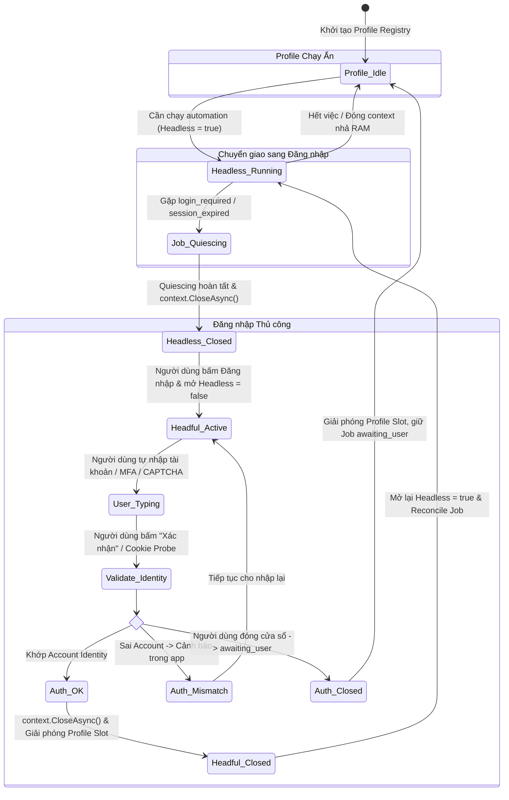

# TiToAI — Đặc tả Ranh giới & Hợp đồng Kỹ thuật (T02)

> Baseline v1.0.4 đã được review. Yêu cầu browser tách provider và phần job/pipeline mới được cụ thể hóa tại [contract bổ sung v1.1](execution-contract-v1.1.md); phải review T02a và tích hợp DTO/schema trước triển khai phụ thuộc. Các ví dụ `shared_ai`, MuseAI riêng Workspace, account chốt lúc enqueue, Script bắt buộc scene và media-only success bên dưới là baseline cũ, không áp dụng cho thiết kế đích v1.1. PASS lịch sử không chứng minh phần mở rộng đã đạt.

- **Mã tài liệu:** CONTRACT-G0-T02
- **Phiên bản:** `1.0.4` (Bản hợp đồng hoàn thiện sau đợt rà soát T02-FIX-R3: chuyển Asset composite FK sang ON DELETE NO ACTION / DeleteBehavior.NoAction, giữ nguyên WorkspaceId NOT NULL và composite ownership, đặc tả transaction cho project.delete và workspace.delete, đồng bộ toàn bộ envelopes/examples lên 1.0.4)
- **Ngày cập nhật:** 2026-10-26 (UTC+07)
- **Tác giả:** Coordinator / Architect (phiên điều phối trung tâm)
- **Căn cứ kỹ thuật:** `docs/decisions/versions.md` (T01 đã nghiệm thu), `docs/plans/SOURCE_PLAN.md`, `docs/plans/SETTINGS_PLAN.md`, `docs/plans/UI_THEME_PLAN.md`, `docs/plans/UI_BROWSER_PLAN.md`, `docs/agents/ENGINEERING_RULES.md`, `docs/agents/ORCHESTRATION.md`.
- **Đối chiếu re-review:** `docs/reviews/G0-T02-fix-response.md`, `docs/reviews/G0-T02-fix-r2-response.md`, `docs/reviews/G0-T02-r3-final.md`, `docs/reviews/G0-T02-fix-r3-response.md`. Hai response đầu giữ tổng hợp findings các vòng cũ; report R3 giữ kết luận trên v1.0.4.
- **Phạm vi áp dụng:** Toàn bộ các module và worker trong TiToAI từ Gate G1 trở đi.

---

## 1. Giao tiếp Desktop Host ↔ Web UI (WebView2 Bridge Contract)

### 1.1. Kênh giao tiếp duy nhất & Bảo mật Ranh giới Desktop
TiToAI chọn **WebView2 Message Bridge** (`window.chrome.webview.postMessage` và `chrome.webview.addEventListener('message')`) làm kênh giao tiếp duy nhất giữa WPF Desktop Host và React Web UI. Không sử dụng HTTP Minimal API loopback để loại bỏ nguy cơ xung đột cổng hoặc quét cổng cục bộ trên Windows.

- **Origin hợp lệ:** Duy nhất HTTPS origin `https://appassets.local` (scheme `https`, host `appassets.local`, port `443`).
- **Cấu hình Virtual Host Mapping:** WPF nạp static assets từ thư mục build React thông qua:
  ```csharp
  CoreWebView2.SetVirtualHostNameToFolderMapping(
      "appassets.local", 
      assetsFolderPath, 
      CoreWebView2HostResourceAccessKind.Allow
  );
  ```
- **Xác thực Origin của Message:**
  Desktop Host phân tích chuỗi `e.Source` của mọi thông điệp bằng `Uri.TryCreate`. Chỉ chấp nhận thông điệp khi thỏa mãn đồng thời 3 thành phần (scheme, host, port):
  ```csharp
  if (!Uri.TryCreate(e.Source, UriKind.Absolute, out var uri) ||
      uri.Scheme != Uri.UriSchemeHttps ||
      !string.Equals(uri.Host, "appassets.local", StringComparison.OrdinalIgnoreCase) ||
      uri.Port != 443)
  {
      // Từ chối thông điệp và ghi log cảnh báo bảo mật
      return;
  }
  ```
- **Rào chắn Điều hướng (Navigation Guard):**
  WPF Host lắng nghe sự kiện `CoreWebView2.NavigationStarting`. Để tránh lỗi chuỗi tiền tố với URL gốc không có dấu gạch chéo cuối (`https://appassets.local`), Host phân tích URI điều hướng qua `Uri.TryCreate` và duy trì nghiêm ngặt invariant Scheme, Host và Port 443:
  ```csharp
  if (!Uri.TryCreate(e.Uri, UriKind.Absolute, out var navUri) ||
      navUri.Scheme != Uri.UriSchemeHttps ||
      !string.Equals(navUri.Host, "appassets.local", StringComparison.OrdinalIgnoreCase) ||
      navUri.Port != 443)
  {
      // Hủy bỏ điều hướng trong WebView2 để bảo vệ App Shell
      e.Cancel = true;

      // Nếu là liên kết ngoài HTTP/HTTPS an toàn, mở bằng Default Browser của Windows
      if (navUri != null && (navUri.Scheme == Uri.UriSchemeHttp || navUri.Scheme == Uri.UriSchemeHttps))
      {
          Process.Start(new ProcessStartInfo(e.Uri) { UseShellExecute = true });
      }
      else
      {
          // Chặn đứng các scheme lạ/nguy hiểm: file:, javascript:, cmd:, powershell:, ms-settings:, ms-appinstaller:
          Logger.LogWarning("Chặn điều hướng tới scheme nguy hiểm: {Uri}", e.Uri);
      }
  }
  ```
- **Rào chắn Cửa sổ Mới (NewWindowRequested Guard):**
  WPF Host lắng nghe sự kiện `CoreWebView2.NewWindowRequested`:
  - Luôn thiết lập `e.Handled = true;` để ngăn chặn WebView2 tự động mở popup không kiểm soát.
  - Nếu target URI là HTTP/HTTPS hợp lệ: mở bằng trình duyệt mặc định của hệ điều hành; ngược lại bỏ qua.
- **Giới hạn Payload & Kiểm soát Dữ liệu:**
  - Kích thước Envelope JSON tối đa qua Bridge là **4 MiB**. Dữ liệu tệp media (ảnh, audio, video) tuyệt đối không truyền dạng base64 qua bridge mà phải thông qua các API tệp của Host (`asset.import_audio`, `asset.open_folder`).
  - Desktop Host không trả về quyền shell, cookie thô, đường dẫn profile Chromium, hoặc đường dẫn tệp tùy ý ngoài các root được cấp phép.
  - Khi deserialization thất bại hoặc payload thiếu trường bắt buộc, Host lập tức trả mã lỗi `INVALID_ARGUMENT` kèm chi tiết vi phạm, không chuyển tiếp vào business handler.

---

### 1.2. Envelope Chuẩn hóa & Phiên bản Hợp đồng
Mọi bản tin giữa Host (.NET) và Web UI (React) đều được đóng gói trong Envelope chuẩn hóa có `contractVersion = "1.0.4"` và `id` (GUID v4 lowercase) để đối soát (correlation).

#### A. Yêu cầu từ Web UI -> Desktop Host (Request Envelope)
```json
{
  "id": "e4f8b2d1-9c3a-4f5e-8b1a-2d3c4e5f6a7b",
  "type": "request",
  "command": "workspace.create",
  "payload": {
    "name": "Kênh Tin Tức 24h",
    "channelHandle": "@news24h_tiktok",
    "topic": "Tin tức công nghệ"
  },
  "clientTimestampUtc": "2026-10-26T02:20:00.000Z",
  "contractVersion": "1.0.4"
}
```

#### B. Phản hồi từ Desktop Host -> Web UI (Response Envelope)
```json
{
  "id": "e4f8b2d1-9c3a-4f5e-8b1a-2d3c4e5f6a7b",
  "type": "response",
  "success": true,
  "data": {
    "workspaceId": "w-7a1b2c3d-4e5f-6a7b-8c9d-0e1f2a3b4c5d"
  },
  "error": null,
  "serverTimestampUtc": "2026-10-26T02:20:00.120Z",
  "contractVersion": "1.0.4"
}
```

#### C. Sự kiện đơn phương từ Host -> Web UI (Event Envelope)
```json
{
  "id": "a1b2c3d4-e5f6-7a8b-9c0d-1e2f3a4b5c6d",
  "type": "event",
  "eventName": "job.progress_updated",
  "workspaceId": "w-7a1b2c3d-4e5f-6a7b-8c9d-0e1f2a3b4c5d",
  "seq": 142,
  "payload": {
    "jobId": "j-12345678-90ab-cdef-1234-567890abcdef",
    "sceneId": "s-87654321-fedc-ba09-8765-43210fedcba0",
    "state": "Running",
    "progressPercent": 45,
    "currentStep": "Đang sinh kịch bản chi tiết qua ChatGPT Web"
  },
  "serverTimestampUtc": "2026-10-26T02:20:05.500Z",
  "contractVersion": "1.0.4"
}
```

**Quy tắc Event Envelope:**
1. Trường `seq` (số nguyên 64-bit tăng đơn điệu) do Host cấp cho từng Event trong phiên làm việc. Web UI sử dụng `seq` để nhận biết và loại bỏ ngay lập tức các sự kiện lỗi thời (`stale events` có `seq <= lastSeenSeq`).
2. Trường `workspaceId` xác định phạm vi kênh của sự kiện. Web UI bỏ qua các event có `workspaceId` khác với Workspace đang mở (ngoại trừ các sự kiện toàn hệ thống có `workspaceId: null` như thay đổi theme hoặc trạng thái Shared AI profile).

---

### 1.3. Cấu trúc ErrorDto & Danh mục Mã lỗi Chuẩn hóa

```json
{
  "code": "VALIDATION_FAILED",
  "message": "Một hoặc nhiều đường dẫn lưu trữ không hợp lệ.",
  "retryable": false,
  "correlationId": "e4f8b2d1-9c3a-4f5e-8b1a-2d3c4e5f6a7b",
  "details": {
    "fieldErrors": {
      "documentsPath": ["Thư mục không tồn tại và không thể tạo tự động."],
      "imagesPath": ["Ổ đĩa E: không có quyền ghi (Access Denied)."]
    }
  }
}
```

| Mã lỗi | Ý nghĩa | Hành vi Frontend |
|---|---|---|
| `UNKNOWN_COMMAND` | Lệnh không nằm trong Allow-list | Báo lỗi hệ thống, ghi log |
| `INVALID_ARGUMENT` | Payload thiếu trường bắt buộc hoặc sai định dạng | Highlight form đỏ, thông báo chi tiết lỗi |
| `UNAUTHORIZED_WORKSPACE` | Thao tác trên entity không thuộc `workspaceId` hiện hành | Chặn thao tác, giữ an toàn dữ liệu kênh |
| `ENTITY_NOT_FOUND` | Không tìm thấy bản ghi (Workspace, Project, Scene, Job, Account) | Thông báo không tìm thấy, refresh view |
| `VALIDATION_FAILED` | Dữ liệu vi phạm nghiệp vụ hoặc path không ghi được | Giữ bản nháp, highlight ô lỗi theo `fieldErrors` |
| `STORAGE_ROOT_UNAVAILABLE`| Thư mục đích mất kết nối / không ghi được | Không resend AI; giữ job và cho chọn thử lại |
| `PROVIDER_SESSION_REQUIRED`| Hết hạn session; cần đăng nhập | Chuyển job sang `awaiting_user`, hiện CTA "Đăng nhập" |
| `AUTOMATION_BLOCKED` | CAPTCHA / bot detection chặn chạy ẩn | Hiện hướng dẫn nhập liệu manual trong app |
| `JOB_ALREADY_SUBMITTED` | Tác vụ đã gửi lên web; không được submit lại | Yêu cầu Reconcile hoặc chờ kết quả từ provider |
| `CONCURRENCY_CONFLICT` | Profile browser hoặc DB record đang bị khóa (hoặc xóa entity có job active) | Thử lại tự động sau backoff / chặn xóa entity |
| `INTERNAL_ERROR` | Lỗi ngoại lệ chưa xử lý ở host | Báo lỗi hệ thống kèm `correlationId` |

---

### 1.4. Cơ chế Hủy tác vụ & Xử lý Kết quả đến muộn (Late Cancellation)
TiToAI phân định rạch ròi giữa việc hủy một yêu cầu RPC ngắn hạn trên Bridge và hủy một Job chạy nền dài hạn trong hàng đợi:

1. **Hủy RPC trên Bridge (`type = "cancel"`):**
   - Chỉ dùng để hủy một lệnh RPC đang chờ phản hồi trên Bridge thông qua `targetRequestId`.
   - Host kích hoạt `CancellationTokenSource` tương ứng với RPC đó.
   - Thao tác này **không làm thay đổi trạng thái của Job bền vững** trong SQLite.

2. **Hủy Job bền vững trong Hàng đợi (`command = "job.cancel"`):**
   - Mọi thao tác hủy tác vụ sinh AI bắt buộc gửi Request Envelope chuẩn:
     `command: "job.cancel"`, payload: `{ "workspaceId": string, "jobId": string }`.
   - Host xác thực quyền sở hữu Workspace trước khi xử lý.

3. **Quy tắc An toàn Tác vụ Phụ & Kết Quả Đến Muộn (Side-effect Guard):**
   - **Giai đoạn trước Side Effect (`side_effect_submitted == 0`):** Nếu tác vụ đang ở bước chuẩn bị (chưa submit request lên website AI), Host hủy ngay lập tức, nhả browser context, cập nhật `Job.state = "Canceled"` và trả về `{ "jobId": string, "state": "Canceled", "cancelRequested": true }`.
   - **Giai đoạn đã Submit Side Effect (`side_effect_submitted == 1`):** 
     - Host ghi nhận `cancel_requested = 1`.
     - **Không chuyển ngay sang `AwaitingUser`** vì việc này sẽ kích hoạt nhả lock browser context, gây đóng trình duyệt hoặc tranh chấp tài nguyên trong khi Playwright vẫn đang chờ tải tệp.
     - Job tiếp tục giữ nguyên `state = 'Running'` với cờ `cancel_requested = 1`. Phản hồi DTO trả về `{ "jobId": string, "state": "Running", "cancelRequested": true }`.
     - **Khi kết quả đến muộn từ website AI:** Playwright worker vẫn tải tệp và lưu Asset an toàn vào thư mục lưu trữ, tạo bản ghi `Asset` với trạng thái `status = "Unlinked"`, rồi mới cập nhật `Job.state = "Canceled"`. Quy trình này bảo vệ quota/tiền bạc đã tiêu tốn trên tài khoản AI của người dùng.
     - **Nếu worker gặp sự cố / timeout trong khi chờ:** Scheduler Dead Worker Recovery sẽ quét và chuyển Job sang `state = 'AwaitingUser'` với `reason_code = 'reconcile_required'`.

---

### 1.5. Danh mục Lệnh được phép (Command Allow-list) theo Từng Gate

Để đảm bảo các worker không suy đoán và tập trung đúng phạm vi từng đợt triển khai, Command Allow-list được phân định rõ ràng theo Gate:

#### A. Nhóm Lệnh Nền tảng Gate G1 (Foundation: Shell, Settings, Theme, Workspace Selector)
- `workspace.list`: Lấy danh sách Workspace tóm tắt phục vụ Topbar Workspace Selector (`WorkspaceSummaryDto[]`).
- `settings.get`: Lấy toàn bộ cấu hình hệ thống (`SettingsDto`).
- `settings.save`: Xác thực đồng thời và lưu bền vững cấu hình Cài đặt (`SettingsDto`).
- `settings.browse_folder`: Mở hộp thoại chọn thư mục Windows của Host (`selectedPath`).
- `settings.validate_roots`: Kiểm tra hợp lệ và quyền ghi tức thời (dry-run) cho 3 thư mục lưu trữ trước khi bấm Lưu.
- `theme.get_preference`: Lấy cấu hình giao diện hiện tại (`preference`, `effectiveTheme`).
- `theme.set_preference`: Thay đổi cấu hình giao diện (`system | light | dark`).

#### B. Nhóm Lệnh Nghiệp vụ Kênh & Dữ liệu Gate G2 (Core Business: Workspace, Project, Scene, Asset, Browser, Account, Document, Prompt)
- `workspace.*`: `get`, `create`, `update`, `delete`, `set_status`.
- `project.*`: `list_by_workspace`, `get`, `create`, `update`, `delete`.
- `scene.*`: `list_by_project`, `get`, `create`, `update`, `delete`, `reorder`.
- `account.*`: `list_by_workspace`, `link`, `unlink`.
- `prompt.*`: `list_templates`, `get_template`, `save_template`, `preview`, `delete_override`. Prompt chỉ có nội dung hiện hành; không lưu lịch sử hoặc rollback version.
- `asset.*`: `import_audio`, `select_reference_image`, `get_metadata`, `open_folder`.
- `browser.*`: `list_profiles`, `request_login`, `cancel_login`, `check_session`.
- `document.*`: `export`.

#### C. Nhóm Lệnh Tác vụ & AI Pipeline Gate G3 (MVP Functionality: Queue, Execution, Capabilities)
- `job.*`: `enqueue`, `cancel`, `get_status`, `list_active`, `reconcile`.
- `provider.*`: `list`.

*Mọi lệnh không nằm trong danh mục trên đều bị Host từ chối với mã lỗi `UNKNOWN_COMMAND`.*

---

### 1.6. Đặc tả DTO & Schema Chi tiết cho Toàn bộ Lệnh Cốt lõi

#### A. Quản lý Tài khoản (`account.*`)
- **`account.list_by_workspace`:**
  - Request payload: `{ "workspaceId": string }`
  - Response data: `{ "accounts": AccountDto[] }`
- **`account.link`:**
  - Request payload: `{ "workspaceId": string, "provider": "MuseAI" | "TikTok", "profileId": string }`
  - Response data: `{ "account": AccountDto }`
- **`account.unlink`:**
  - Request payload: `{ "workspaceId": string, "accountId": string }`
  - Response data: `{ "accountId": string, "status": "Unlinked" }`
  - *Quy tắc nghiệp vụ:* Thao tác `unlink` cập nhật trạng thái bản ghi thành `status = "Unlinked"` nhằm lưu giữ lịch sử liên kết và phục vụ đối soát; không xóa cứng bản ghi khỏi SQLite.
- **`AccountDto`:**
  ```json
  {
    "accountId": "acc-1a2b3c4d-...",
    "workspaceId": "w-7a1b2c3d-...",
    "provider": "MuseAI",
    "accountIdentity": "channel_01_muse",
    "profileId": "museai_acc1a2b",
    "status": "Connected",
    "createdAtUtc": "2026-10-26T02:20:00.000Z"
  }
  ```
  *(Tuyệt đối không chứa cookie, token, mật khẩu hoặc đường dẫn vật lý `userDataDir`).*

#### B. Trình duyệt & Handoff Đăng nhập (`browser.*`)
- **`BrowserProfileDto`:**
  ```json
  {
    "profileId": "shared_ai",
    "kind": "SharedAI",
    "accountIdentity": null,
    "workspaceId": null,
    "visibilityState": "Hidden",
    "sessionStatus": "Connected",
    "activeJobCount": 1,
    "activeTabs": ["Script"]
  }
  ```
  - **Tập hợp Union Type / Enum chuẩn hóa:**
    - `kind`: `"SharedAI" | "MuseAI" | "TikTok"`
    - `visibilityState`: `"Hidden" | "VisibleWaiting" | "VisibleActive"`
    - `sessionStatus`: `"Connected" | "SessionExpired" | "Unverified"`
    - `activeTabs`: `("Script" | "Image" | "VideoPrompt")[]`
- **`browser.list_profiles`:**
  - Request payload: `{ "workspaceId"?: string | null }`
  - Response data: `{ "profiles": BrowserProfileDto[] }`
  - *Quy tắc phạm vi:*
    - Nếu `workspaceId` có giá trị GUID: Trả về profile Shared AI toàn app kèm các profile kênh (MuseAI / TikTok) liên kết với Workspace đó.
    - Nếu `workspaceId` là `null` hoặc không truyền: Trả về profile Shared AI toàn app và toàn bộ các profile kênh đã cấu hình trong hệ thống (phục vụ màn hình "Trình duyệt AI" cấp App Shell).
- **`browser.request_login`:**
  - Request payload: `{ "profileId": string, "targetUrl"?: string | null, "providerKey"?: string | null }`
  - Response data: `{ "queued": boolean, "visibilityState": "VisibleActive", "currentHolder": string | null }`
  - *Quy tắc:* Cho phép người dùng chủ động mở đồng thời nhiều cửa sổ đăng nhập cho các profile độc lập (`queued` luôn là `false`). Bấm nhiều lần vào cùng một profile không mở trùng. Nếu vượt ngân sách `max_open_browsers` toàn hệ thống thì từ chối với lỗi tài nguyên rõ ràng.
- **`browser.cancel_login`:**
  - Request payload: `{ "profileId": string }`
  - Response data: `{ "canceled": boolean }`
- **`browser.check_session`:**
  - Request payload: `{ "profileId": string }`
  - Response data: `{ "sessionStatus": "Connected" | "SessionExpired" | "Unverified", "identityMatches": boolean | null }`
- **Event `browser.profile_state_changed`:**
  ```json
  {
    "id": "e1f2a3b4-...",
    "type": "event",
    "eventName": "browser.profile_state_changed",
    "workspaceId": null,
    "seq": 105,
    "payload": {
      "profileId": "shared_ai",
      "visibilityState": "Hidden",
      "sessionStatus": "SessionExpired",
      "reasonCode": "wrong_account"
    },
    "serverTimestampUtc": "2026-10-26T02:20:00.000Z",
    "contractVersion": "1.0.4"
  }
  ```

#### C. Popup Cài đặt & Provider Registry (`settings.*`, `provider.*`)
- **`SettingsDto` (Response của `settings.get` và `settings.save`):**
  ```json
  {
    "documentsPath": "D:\\Workspaces\\Docs",
    "imagesPath": "D:\\Workspaces\\Images",
    "videosPath": "E:\\Videos",
    "documentsRootId": "root-default-docs",
    "imagesRootId": "root-default-images",
    "videosRootId": "root-default-videos",
    "imageProvider": "gemini-web",
    "scriptProvider": "chatgpt-web",
    "videoPromptProvider": "chatgpt-web",
    "themePreference": "system",
    "effectiveTheme": "dark"
  }
  ```
- **`settings.save`:**
  - Request payload:
    ```json
    {
      "documentsPath": "D:\\Workspaces\\Docs",
      "imagesPath": "D:\\Workspaces\\Images",
      "videosPath": "E:\\Videos",
      "imageProvider": "gemini-web",
      "scriptProvider": "chatgpt-web",
      "videoPromptProvider": "chatgpt-web"
    }
    ```
  - Response data: `SettingsDto`
- **`settings.browse_folder`:**
  - Request payload: `{ "target": "documents" | "images" | "videos", "initialPath": string | null }`
  - Response data: `{ "selectedPath": string | null }` *(trả về `null` nếu người dùng hủy hộp thoại).*
- **`settings.validate_roots` (Kiểm tra hợp lệ trước khi lưu - Dry Run):**
  - Request payload:
    ```json
    {
      "documentsPath": "D:\\Workspaces\\Docs",
      "imagesPath": "D:\\Workspaces\\Images",
      "videosPath": "E:\\Videos"
    }
    ```
  - Response data:
    ```json
    {
      "isValid": true,
      "fieldErrors": {}
    }
    ```
    *(Nếu không hợp lệ, trả về `isValid: false` kèm `fieldErrors: { [field: string]: string[] }`).*
- **`provider.list`:**
  - Request payload: `{}`
  - Response data: `{ "providers": ProviderCapabilityDto[] }`
- **`ProviderCapabilityDto`:**
  ```json
  {
    "providerKey": "gemini-web",
    "displayName": "Gemini Web",
    "supportedTasks": ["Script", "Image", "VideoPrompt"],
    "verificationStatus": "VERIFIED",
    "sessionStatus": "Connected",
    "manualHandoffMode": "InAppManual"
  }
  ```
  *(Lưu ý: Tác vụ Video Render trong MVP cố định qua `museai` theo tài khoản liên kết của Workspace, không thuộc 3 dropdown lựa chọn provider toàn app).*

#### D. Vòng đời Tác vụ Hàng đợi (`job.*`)
- **`job.enqueue`:**
  - Request payload:
    ```json
    {
      "workspaceId": "w-7a1b2c3d-...",
      "sceneId": "s-87654321-...",
      "taskType": "Script",
      "customPrompt": null
    }
    ```
  - Response data: `{ "jobId": "j-12345678-..." }`
- **`job.cancel`:**
  - Request payload: `{ "workspaceId": "w-7a1b2c3d-...", "jobId": "j-12345678-..." }`
  - Response data:
    ```json
    {
      "jobId": "j-12345678-...",
      "state": "Running",
      "cancelRequested": true
    }
    ```
    *(Đối với job chưa submit, trả về `"state": "Canceled"`. Đối với job đã submit, trả về `"state": "Running"` kèm `"cancelRequested": true` để worker tiếp tục tải kết quả đến muộn).*
- **`job.reconcile`:**
  - Request payload: `{ "workspaceId": "w-7a1b2c3d-...", "jobId": "j-12345678-..." }`
  - Response data: `{ "jobId": "j-12345678-...", "state": "Succeeded" | "Queued" | "Failed" | "AwaitingUser", "reasonCode": string | null }`

#### E. Xuất Kịch bản / Tài liệu (`document.export`)
- **`document.export`:**
  - Request payload:
    ```json
    {
      "workspaceId": "w-7a1b2c3d-...",
      "sceneId": "s-87654321-...",
      "format": "txt",
      "customFileName": null
    }
    ```
  - Response data:
    ```json
    {
      "assetId": "ast-98765432-...",
      "displayName": "KichBan_Scene01.txt",
      "storageRootId": "root-default-docs",
      "relativePath": "w-7a1b2c3d-.../projects/prj-1122.../documents/ast-98765432-...txt",
      "byteSize": 1420
    }
    ```

#### F. Giao diện Sáng/Tối (`theme.*`)
- **`theme.get_preference`:**
  - Request payload: `{}`
  - Response data: `{ "preference": "system" | "light" | "dark", "effectiveTheme": "light" | "dark" }`
- **`theme.set_preference`:**
  - Request payload: `{ "preference": "system" | "light" | "dark" }`
  - Response data: `{ "preference": "system" | "light" | "dark", "effectiveTheme": "light" | "dark" }`
- **Event `theme.changed`:**
  ```json
  {
    "id": "t1-...",
    "type": "event",
    "eventName": "theme.changed",
    "workspaceId": null,
    "seq": 22,
    "payload": {
      "preference": "system",
      "effectiveTheme": "dark"
    },
    "serverTimestampUtc": "2026-10-26T02:20:00.000Z",
    "contractVersion": "1.0.4"
  }
  ```

#### G. Quản lý Workspace (`workspace.*`)
- **`workspace.list` (Gate G1 Topbar):**
  - Request payload: `{}`
  - Response data:
    ```json
    {
      "workspaces": [
        {
          "workspaceId": "w-7a1b2c3d-4e5f-6a7b-8c9d-0e1f2a3b4c5d",
          "name": "Kênh Tin Tức 24h",
          "channelHandle": "@news24h_tiktok",
          "topic": "Tin tức công nghệ",
          "status": "Active"
        }
      ]
    }
    ```
- **`workspace.set_status`:**
  - Request payload: `{ "workspaceId": "w-7a1b2c3d-...", "status": "Active" | "Paused" }`
  - Response data: `{ "workspaceId": "w-7a1b2c3d-...", "status": "Active" | "Paused", "updatedAtUtc": string }`
- **Event `workspace.status_changed`:**
  ```json
  {
    "id": "ws-event-...",
    "type": "event",
    "eventName": "workspace.status_changed",
    "workspaceId": "w-7a1b2c3d-...",
    "seq": 88,
    "payload": {
      "workspaceId": "w-7a1b2c3d-...",
      "status": "Paused",
      "updatedAtUtc": "2026-10-26T02:20:00.000Z"
    },
    "serverTimestampUtc": "2026-10-26T02:20:00.000Z",
    "contractVersion": "1.0.4"
  }
  ```

#### H. Quản lý Tài nguyên Âm thanh & Tệp Media (`asset.*`)
- **`asset.import_audio` (Gate G2):**
  - Request payload:
    ```json
    {
      "workspaceId": "w-7a1b2c3d-...",
      "projectId": "prj-11223344-...",
      "sceneId": "s-87654321-..."
    }
    ```
  - *Hành vi Host:* WPF Host hiển thị `OpenFileDialog` cho phép chọn tệp âm thanh (`*.mp3;*.wav`). Host tính mã băm SHA-256, sao chép tệp vào `%LOCALAPPDATA%\TiToAI\audio\{workspace_id}\projects\{project_id}\audio\{asset_id}.{ext}`, tạo bản ghi `Asset` với `storage_root_id = "root-internal-audio"` và `status = "Linked"`, cập nhật khóa ngoại `Scene.audio_asset_id`, và trả về `AssetDto`. (Nếu người dùng hủy hộp thoại, trả về `{ "asset": null }`).
  - Response data:
    ```json
    {
      "asset": {
        "assetId": "ast-44556677-8899-aabb-ccdd-eeff00112233",
        "workspaceId": "w-7a1b2c3d-4e5f-6a7b-8c9d-0e1f2a3b4c5d",
        "projectId": "prj-11223344-5566-7788-99aa-bbccddeeff00",
        "assetType": "Audio",
        "storageRootId": "root-internal-audio",
        "relativePath": "w-7a1b2c3d-.../projects/prj-1122.../audio/ast-44556677-...mp3",
        "byteSize": 3482100,
        "sha256Hash": "e3b0c44298fc1c149afbf4c8996fb92427ae41e4649b934ca495991b7852b855",
        "status": "Linked",
        "createdAtUtc": "2026-10-26T02:20:00.000Z"
      }
    }
    ```

#### I. Quản lý Mẫu Prompt (`prompt.*`)
- **Tập hợp Mục đích Hợp lệ (Purpose):** `"Script" | "Image" | "VideoPrompt"`.
- **`PromptTemplateDto`:**
  ```json
  {
    "id": "p-1a2b3c4d-...",
    "purpose": "Script",
    "name": "Kịch bản Mặc định",
    "workspaceId": null,
    "templateText": "Viết kịch bản ngắn về chủ đề {topic} cho kênh {channel_name}...",
    "variableDefinitions": [
      {
        "name": "topic",
        "isRequired": true,
        "defaultValue": null,
        "description": "Chủ đề kịch bản"
      }
    ],
    "isOverride": false,
    "createdAtUtc": "2026-10-26T02:20:00.000Z",
    "updatedAtUtc": "2026-10-26T02:20:00.000Z"
  }
  ```
- **`prompt.list_templates`:**
  - Request payload: `{ "workspaceId"?: string | null }`
  - Response data: `{ "templates": PromptTemplateDto[] }`
  - *Quy tắc:* Nếu có `workspaceId`, trả về template Global và template Override của riêng Workspace đó; tuyệt đối cấm trả về override của kênh khác.
- **`prompt.get_template`:**
  - Request payload: `{ "purpose": "Script" | "Image" | "VideoPrompt", "workspaceId"?: string | null }`
  - Response data: `{ "template": PromptTemplateDto, "currentVersion": PromptContentDto | null }` (legacy JSON field name; value is the single current prompt, not a history entry).
  - *Resolution Precedence:* Ưu tiên trả về Workspace Override nếu tồn tại; nếu không, tự động fallback về Global Template.
- **`prompt.save_template`:**
  - Request payload:
    ```json
    {
      "purpose": "Script",
      "workspaceId": null,
      "templateText": "Nội dung template mới với {bien}...",
      "variableDefinitionsJson": "[{\"name\":\"bien\",\"isRequired\":true,\"description\":\"Mô tả biến\"}]"
    }
    ```
  - Response data: `{ "template": PromptTemplateDto, "prompt": PromptContentDto }`
  - *Quy tắc:* Tạo hoặc cập nhật duy nhất một nội dung theo `(purpose, workspaceId)`. Không tạo lịch sử prompt.
- **`prompt.preview`:**
  - Request payload:
    ```json
    {
      "templateId": "p-1a2b3c4d-...",
      "draftTemplateText": null,
      "purpose": "Script",
      "workspaceId": "w-7a1b2c3d-...",
      "variables": { "topic": "AI Automation" }
    }
    ```
  - Response data:
    ```json
    {
      "renderedText": "Viết kịch bản ngắn về chủ đề AI Automation...",
      "effectiveTemplateId": "p-1a2b3c4d-...",
      "isOverride": false,
      "validation": {
        "isValid": true,
        "missingRequiredVariables": [],
        "undeclaredVariables": [],
        "malformedPlaceholders": []
      }
    }
    ```
  - *Quy tắc:* Render tất định (deterministic), không eval/script, escape `{{` $\rightarrow$ `{`, `}}` $\rightarrow$ `}`. Hỗ trợ tiếng Việt có dấu và emoji.
- **`prompt.delete_override`:**
  - Request payload: `{ "templateId": string, "workspaceId": string }`
  - Response data: `{ "deleted": boolean, "fallbackTemplate": PromptTemplateDto }`
  - *Quy tắc:* Xóa override của Workspace; tự động fallback về Global Template mặc định. Tuyệt đối cấm xóa template Global qua lệnh này.

---

## 2. Mô hình Thực thể & Cô lập Dữ liệu (Schema Ownership & Data Isolation)

### 2.1. Thiết lập SQLite Cơ sở
- Tập tin DB: `%LOCALAPPDATA%/TiToAI/titoai.db`
- Cấu hình bắt buộc trên mỗi connection (`TiToAIDbContext`):
  ```sql
  PRAGMA journal_mode = WAL;
  PRAGMA foreign_keys = ON;
  PRAGMA busy_timeout = 5000;
  PRAGMA synchronous = NORMAL;
  ```
- Định dạng Khóa chính: GUID/UUID lưu dưới dạng `TEXT` (chuỗi 36 ký tự có dấu gạch ngang, lowercase). Toàn bộ mốc thời gian lưu UTC ISO-8601 string (`YYYY-MM-DDTHH:mm:ss.fffZ`).

---

### 2.2. Bảng thực thể và Composite Foreign Keys

```mermaid
erDiagram
    Workspace ||--o{ Account : "sở hữu (1:N)"
    Workspace ||--o{ Project : "sở hữu (1:N)"
    Workspace ||--o{ Asset : "sở hữu (1:N)"
    Workspace ||--o{ Job : "sở hữu (1:N)"
    Project ||--o{ Scene : "chứa (1:N)"
    Project ||--o{ Asset : "chứa (1:N nullable, ON DELETE NO ACTION)"
    Scene ||--o{ Job : "tạo (1:N)"
    Scene }o--o| Asset : "audio_asset_id (ON DELETE SET NULL)"
    Scene }o--o| Asset : "image_asset_id (ON DELETE SET NULL)"
    Scene }o--o| Asset : "video_asset_id (ON DELETE SET NULL)"

    Workspace {
        string id PK
        string name
        string channel_handle
        string topic
        string status "Active | Paused"
        string created_at_utc
        string updated_at_utc
    }

    Account {
        string id PK
        string workspace_id FK
        string provider "MuseAI | TikTok"
        string account_identity
        string profile_id
        string status "Connected | SessionExpired | Unverified | Unlinked"
        string created_at_utc
    }

    Project {
        string id PK
        string workspace_id FK
        string name
        string description
        string status "Draft | InProgress | Completed"
        string created_at_utc
        string updated_at_utc
    }

    Scene {
        string id PK
        string project_id FK
        string workspace_id FK
        int sequence_order
        string name
        decimal target_duration_seconds
        string prompt_text
        string status "Empty | Draft | Queued | Running | Completed | Failed"
        string audio_asset_id FK
        string image_asset_id FK
        string video_asset_id FK
        string created_at_utc
        string updated_at_utc
    }

    Asset {
        string id PK
        string workspace_id FK
        string project_id FK_nullable
        string storage_root_id
        string relative_path
        string asset_type "Document | Image | Video | Audio"
        string mime_type
        int64 byte_size
        string sha256_hash
        string status "Linked | Unlinked"
        string created_at_utc
    }

    Job {
        string id PK
        string workspace_id FK
        string scene_id FK
        string task_type "Script | Image | VideoPrompt | VideoRender"
        string state "Queued | Reserved | Running | AwaitingUser | Succeeded | Failed | Canceled"
        string reason_code
        string provider_key "gemini-web | chatgpt-web | museai"
        string config_snapshot_json
        string prompt_snapshot_text
        string storage_root_id
        int attempts
        int max_attempts
        string lease_expires_at_utc
        string retry_after_utc "nullable ISO-8601 UTC timestamp"
        int side_effect_submitted "0 | 1 (default 0)"
        string side_effect_at_utc "nullable UTC timestamp"
        string result_reference "nullable provider result/session reference"
        int cancel_requested "0 | 1 (default 0)"
        string last_heartbeat_at_utc "nullable UTC timestamp"
        string created_at_utc
        string updated_at_utc
    }

    AppSettings {
        string key PK
        string value
        string updated_at_utc
    }
```

---

### 2.3. SQLite DDL Hợp Lệ & Cấu Hình EF Core Fluent API

> [!IMPORTANT]
> **Quy chuẩn SQLite DDL:** SQLite hoàn toàn **không hỗ trợ** cú pháp `ALTER TABLE ADD CONSTRAINT`. Toàn bộ khóa ngoại và ràng buộc toàn vẹn bắt buộc phải được khai báo trực tiếp (inline) bên trong câu lệnh `CREATE TABLE` hoặc thông qua Fluent API của EF Core trong `TiToAIDbContext.OnModelCreating`.

#### A. Cú pháp SQLite DDL Chuẩn (CREATE TABLE)
```sql
-- 1. Bảng Workspace
CREATE TABLE Workspace (
    id TEXT NOT NULL PRIMARY KEY,
    name TEXT NOT NULL,
    channel_handle TEXT NOT NULL,
    topic TEXT NOT NULL,
    status TEXT NOT NULL DEFAULT 'Active',
    created_at_utc TEXT NOT NULL,
    updated_at_utc TEXT NOT NULL
);

-- 2. Bảng Account (Khóa ngoại trực tiếp tới Workspace + Partial Unique Indexes)
CREATE TABLE Account (
    id TEXT NOT NULL PRIMARY KEY,
    workspace_id TEXT NOT NULL,
    provider TEXT NOT NULL,
    account_identity TEXT NOT NULL,
    profile_id TEXT NOT NULL,
    status TEXT NOT NULL DEFAULT 'Connected',
    created_at_utc TEXT NOT NULL,
    FOREIGN KEY (workspace_id) REFERENCES Workspace(id) ON DELETE CASCADE
);

-- Chỉ mục duy nhất có điều kiện (Partial Unique Indexes):
-- Cho phép lưu giữ lịch sử Unlinked mà không gây xung đột khi liên kết lại (Relink)
CREATE UNIQUE INDEX uq_account_workspace_provider 
    ON Account(workspace_id, provider) 
    WHERE status != 'Unlinked';

CREATE UNIQUE INDEX uq_account_provider_identity 
    ON Account(provider, account_identity) 
    WHERE status != 'Unlinked';

-- 3. Bảng Project
CREATE TABLE Project (
    id TEXT NOT NULL PRIMARY KEY,
    workspace_id TEXT NOT NULL,
    name TEXT NOT NULL,
    description TEXT,
    status TEXT NOT NULL DEFAULT 'Draft',
    created_at_utc TEXT NOT NULL,
    updated_at_utc TEXT NOT NULL,
    FOREIGN KEY (workspace_id) REFERENCES Workspace(id) ON DELETE CASCADE
);
CREATE UNIQUE INDEX uq_project_id_workspace ON Project(id, workspace_id);

-- 4. Bảng Scene (Composite Foreign Key tới Project và tham chiếu an toàn Asset)
CREATE TABLE Scene (
    id TEXT NOT NULL PRIMARY KEY,
    project_id TEXT NOT NULL,
    workspace_id TEXT NOT NULL,
    sequence_order INTEGER NOT NULL,
    name TEXT NOT NULL,
    target_duration_seconds REAL NOT NULL,
    prompt_text TEXT,
    status TEXT NOT NULL DEFAULT 'Empty',
    audio_asset_id TEXT,
    image_asset_id TEXT,
    video_asset_id TEXT,
    created_at_utc TEXT NOT NULL,
    updated_at_utc TEXT NOT NULL,
    FOREIGN KEY (project_id, workspace_id) REFERENCES Project(id, workspace_id) ON DELETE CASCADE,
    FOREIGN KEY (audio_asset_id) REFERENCES Asset(id) ON DELETE SET NULL,
    FOREIGN KEY (image_asset_id) REFERENCES Asset(id) ON DELETE SET NULL,
    FOREIGN KEY (video_asset_id) REFERENCES Asset(id) ON DELETE SET NULL
);
CREATE UNIQUE INDEX uq_scene_id_workspace ON Scene(id, workspace_id);

-- 5. Bảng Asset (Hỗ trợ project_id nullable cho tài nguyên dự án hoặc dùng chung kênh)
CREATE TABLE Asset (
    id TEXT NOT NULL PRIMARY KEY,
    workspace_id TEXT NOT NULL,
    project_id TEXT,
    storage_root_id TEXT NOT NULL,
    relative_path TEXT NOT NULL,
    asset_type TEXT NOT NULL,
    mime_type TEXT,
    byte_size INTEGER NOT NULL,
    sha256_hash TEXT NOT NULL,
    status TEXT NOT NULL DEFAULT 'Linked',
    created_at_utc TEXT NOT NULL,
    FOREIGN KEY (workspace_id) REFERENCES Workspace(id) ON DELETE CASCADE,
    FOREIGN KEY (project_id, workspace_id) REFERENCES Project(id, workspace_id) ON DELETE NO ACTION
);
CREATE UNIQUE INDEX uq_asset_id_workspace ON Asset(id, workspace_id);
CREATE INDEX ix_asset_project_workspace ON Asset(project_id, workspace_id);

-- 6. Bảng Job (Bao gồm retry_after_utc, lease và tracking side-effect)
CREATE TABLE Job (
    id TEXT NOT NULL PRIMARY KEY,
    workspace_id TEXT NOT NULL,
    scene_id TEXT NOT NULL,
    task_type TEXT NOT NULL,
    state TEXT NOT NULL DEFAULT 'Queued',
    reason_code TEXT,
    provider_key TEXT NOT NULL,
    config_snapshot_json TEXT,
    prompt_snapshot_text TEXT,
    storage_root_id TEXT NOT NULL,
    attempts INTEGER NOT NULL DEFAULT 0,
    max_attempts INTEGER NOT NULL DEFAULT 3,
    lease_expires_at_utc TEXT,
    retry_after_utc TEXT,
    side_effect_submitted INTEGER NOT NULL DEFAULT 0,
    side_effect_at_utc TEXT,
    result_reference TEXT,
    cancel_requested INTEGER NOT NULL DEFAULT 0,
    last_heartbeat_at_utc TEXT,
    created_at_utc TEXT NOT NULL,
    updated_at_utc TEXT NOT NULL,
    FOREIGN KEY (scene_id, workspace_id) REFERENCES Scene(id, workspace_id) ON DELETE CASCADE
);
CREATE INDEX ix_job_state_lease_retry ON Job(state, lease_expires_at_utc, retry_after_utc);
CREATE INDEX ix_job_workspace ON Job(workspace_id);

-- 7. Bảng AppSettings
CREATE TABLE AppSettings (
    key TEXT NOT NULL PRIMARY KEY,
    value TEXT NOT NULL,
    updated_at_utc TEXT NOT NULL
);
```

#### B. Cấu hình Fluent API EF Core (`TiToAIDbContext.OnModelCreating`)
Dành cho Persistence Worker (Task T04):
```csharp
// Composite Keys & Foreign Keys
modelBuilder.Entity<Project>(b =>
{
    b.HasKey(p => p.Id);
    b.HasOne<Workspace>()
     .WithMany()
     .HasForeignKey(p => p.WorkspaceId)
     .OnDelete(DeleteBehavior.Cascade);
    b.HasIndex(p => new { p.Id, p.WorkspaceId })
     .IsUnique()
     .HasDatabaseName("uq_project_id_workspace");
});

modelBuilder.Entity<Account>(b =>
{
    b.HasKey(a => a.Id);
    b.HasOne<Workspace>()
     .WithMany()
     .HasForeignKey(a => a.WorkspaceId)
     .OnDelete(DeleteBehavior.Cascade);
     
    // Partial Unique Indexes trong EF Core SQLite
    b.HasIndex(a => new { a.WorkspaceId, a.Provider })
     .IsUnique()
     .HasFilter("status != 'Unlinked'")
     .HasDatabaseName("uq_account_workspace_provider");

    b.HasIndex(a => new { a.Provider, a.AccountIdentity })
     .IsUnique()
     .HasFilter("status != 'Unlinked'")
     .HasDatabaseName("uq_account_provider_identity");
});

modelBuilder.Entity<Scene>(b =>
{
    b.HasKey(s => s.Id);
    b.HasOne<Project>()
     .WithMany()
     .HasForeignKey(s => new { s.ProjectId, s.WorkspaceId })
     .HasPrincipalKey(p => new { p.Id, p.WorkspaceId })
     .OnDelete(DeleteBehavior.Cascade);
     
    b.HasOne<Asset>()
     .WithMany()
     .HasForeignKey(s => s.AudioAssetId)
     .OnDelete(DeleteBehavior.SetNull);

    b.HasOne<Asset>()
     .WithMany()
     .HasForeignKey(s => s.ImageAssetId)
     .OnDelete(DeleteBehavior.SetNull);

    b.HasOne<Asset>()
     .WithMany()
     .HasForeignKey(s => s.VideoAssetId)
     .OnDelete(DeleteBehavior.SetNull);

    b.HasIndex(s => new { s.Id, s.WorkspaceId })
     .IsUnique()
     .HasDatabaseName("uq_scene_id_workspace");
});

modelBuilder.Entity<Asset>(b =>
{
    b.HasKey(a => a.Id);
    b.HasOne<Workspace>()
     .WithMany()
     .HasForeignKey(a => a.WorkspaceId)
     .OnDelete(DeleteBehavior.Cascade);
     
    b.HasOne<Project>()
     .WithMany()
     .HasForeignKey(a => new { a.ProjectId, a.WorkspaceId })
     .HasPrincipalKey(p => new { p.Id, p.WorkspaceId })
     .OnDelete(DeleteBehavior.NoAction);

    b.HasIndex(a => new { a.Id, a.WorkspaceId })
     .IsUnique()
     .HasDatabaseName("uq_asset_id_workspace");

    b.HasIndex(a => new { a.ProjectId, a.WorkspaceId })
     .HasDatabaseName("ix_asset_project_workspace");
});

modelBuilder.Entity<Job>(b =>
{
    b.HasKey(j => j.Id);
    b.HasOne<Scene>()
     .WithMany()
     .HasForeignKey(j => new { j.SceneId, j.WorkspaceId })
     .HasPrincipalKey(s => new { s.Id, s.WorkspaceId })
     .OnDelete(DeleteBehavior.Cascade);

    b.HasIndex(j => new { j.State, j.LeaseExpiresAtUtc, j.RetryAfterUtc })
     .HasDatabaseName("ix_job_state_lease_retry");
});
```

#### C. Rào chắn Chặn Xóa Thực Thể Khi Có Job Đang Chạy (Active Job Guard) & Đặc Tả Transaction Xóa Thực Thể

Mặc dù SQLite hỗ trợ `ON DELETE CASCADE`, việc xóa một Scene, Project hoặc Workspace trong khi Job của nó đang chạy ngầm hoặc đã submit request lên AI website (`side_effect_submitted == 1`) sẽ xóa sạch dấu vết đối soát, gây thất thoát tài nguyên và chi phí của người dùng. Đồng thời, do quan hệ composite foreign key `Asset(project_id, workspace_id) REFERENCES Project(id, workspace_id)` mang hành vi `ON DELETE NO ACTION` (không dùng `ON DELETE SET NULL` vì `workspace_id` là `NOT NULL` và SQL standard/SQLite sẽ cố gắng đặt cả `workspace_id` về `NULL`), tầng Application Layer bắt buộc phải điều phối thao tác xóa thông qua transaction tuần tự và chặt chẽ.

##### 1. Rào chắn Active / Unresolved Job Guard bắt buộc
1. Khi tiếp nhận yêu cầu `scene.delete`, `project.delete`, hoặc `workspace.delete`, Host bắt buộc truy vấn kiểm tra các job liên quan trong phạm vi xóa:
   ```csharp
   bool hasActiveJobs = await dbContext.Jobs.AnyAsync(j =>
       scopeMatches(j) && (j.State == "Reserved" || j.State == "Running" || j.State == "AwaitingUser")
   );
   ```
2. Nếu `hasActiveJobs == true`:
   - Host **từ chối thực hiện xóa** và trả về mã lỗi `CONCURRENCY_CONFLICT` hoặc `JOB_ALREADY_SUBMITTED`.
   - Thông báo chi tiết lỗi: *"Không thể xóa thực thể trong khi có tác vụ đang chạy hoặc đang chờ đối soát. Vui lòng hủy tác vụ hoặc đợi hoàn tất trước khi xóa."*
3. Chỉ khi toàn bộ các Job liên quan đã chuyển sang trạng thái kết thúc (`Succeeded`, `Failed`, `Canceled`), lệnh xóa mới được thực thi an toàn.

##### 2. Đặc tả Transaction Xóa Dự án (`project.delete`)
Do khóa ngoại composite giữa `Asset` và `Project` là `ON DELETE NO ACTION`, SQLite sẽ chặn việc xóa `Project` nếu vẫn còn bất kỳ bản ghi `Asset` nào có `project_id == projectId`. Toàn bộ quy trình `project.delete` bắt buộc thực thi trong **cùng một Database Transaction duy nhất** (kết hợp serialize/reserve để phòng chống race condition):

- **Bước 1 — Active/Unresolved Job Guard & Serialize/Reserve:**
  Mở transaction ở mức cô lập cao hoặc SQLite `IMMEDIATE` transaction để khóa quyền ghi (serialize/reserve), ngăn không cho Scheduler cấp phát lease mới hoặc worker khác kích hoạt job liên quan đến Project trong suốt thời gian xóa. Kiểm tra `hasActiveJobs` của toàn bộ các Scene thuộc Project; nếu có job active/unresolved thì rollback và trả mã lỗi `CONCURRENCY_CONFLICT`.
- **Bước 2 — Detach `Asset.project_id = NULL` nhưng bảo toàn `WorkspaceId`:**
  Trước khi xóa Project, cập nhật toàn bộ các bản ghi `Asset` đang liên kết với Project này:
  ```sql
  UPDATE Asset 
  SET project_id = NULL 
  WHERE project_id = @ProjectId AND workspace_id = @WorkspaceId;
  ```
  *(Tương đương EF Core: `await dbContext.Assets.Where(a => a.ProjectId == projectId && a.WorkspaceId == workspaceId).ExecuteUpdateAsync(s => s.SetProperty(a => a.ProjectId, (string?)null));`)*.
  > [!IMPORTANT]
  > Thao tác này giải phóng khóa ngoại `NO ACTION` trỏ tới `Project`, nhưng **tuyệt đối giữ nguyên giá trị `workspace_id` không đổi** (`workspace_id TEXT NOT NULL`). Các tệp media không bị xóa mất trên đĩa và bản ghi `Asset` tiếp tục thuộc quyền sở hữu của Workspace (trở thành tài nguyên cấp kênh / unassigned project asset).
- **Bước 3 — Xóa bản ghi `Project`:**
  ```sql
  DELETE FROM Project WHERE id = @ProjectId AND workspace_id = @WorkspaceId;
  ```
  Cơ chế `ON DELETE CASCADE` tự động xóa các Scene thuộc Project và các Job đã kết thúc của Scene. Do toàn bộ Asset đã có `project_id = NULL`, ràng buộc khóa ngoại `NO ACTION` không bị vi phạm.
- **Bước 4 — Commit Transaction & Phát Event:**
  Commit transaction bền vững và phát sự kiện đồng bộ tới Web UI qua Bridge.

##### 3. Đặc tả Transaction Xóa Kênh (`workspace.delete`)
Bảng `Asset` có 2 khóa ngoại:
1. `FOREIGN KEY (workspace_id) REFERENCES Workspace(id) ON DELETE CASCADE`
2. `FOREIGN KEY (project_id, workspace_id) REFERENCES Project(id, workspace_id) ON DELETE NO ACTION`

Khi xóa Workspace, nếu để SQLite tự động cascade xóa `Project` trước khi xóa `Asset`, hành vi `NO ACTION` tại `Asset` sẽ kích hoạt kiểm tra và quăng lỗi vi phạm khóa ngoại `SQLITE_CONSTRAINT_FOREIGNKEY` vì các `Asset` vẫn đang tham chiếu tới các `Project` thuộc Workspace đó.

Do đó, quy trình `workspace.delete` bắt buộc thực thi trong **cùng một Database Transaction duy nhất** theo một trong hai quy trình an toàn sau để không bao giờ vướng FK:

- **Quy trình Khuyến nghị (Detach Asset–Project liên quan trước khi Cascade Xóa Workspace):**
  1. *Guard:* Kiểm tra toàn bộ Workspace không có bất kỳ Job nào ở `Reserved`, `Running`, `AwaitingUser`. Nếu có -> từ chối xóa với `CONCURRENCY_CONFLICT`.
  2. *Detach Asset:* Thực thi cập nhật detach toàn bộ Asset trong Workspace trước cascade:
     ```sql
     UPDATE Asset SET project_id = NULL WHERE workspace_id = @WorkspaceId;
     ```
     Sau bước này, 100% Asset trong Workspace đều có `project_id = NULL`, triệt tiêu hoàn toàn mọi ràng buộc tới bảng `Project`.
  3. *Xóa Workspace:*
     ```sql
     DELETE FROM Workspace WHERE id = @WorkspaceId;
     ```
     Cơ chế `ON DELETE CASCADE` của SQLite sẽ tự động dọn dẹp an toàn toàn bộ `Account`, `Project`, `Scene`, `Job`, và `Asset` mà không gặp bất kỳ xung đột FK nào.
  4. *Dọn dẹp thư mục vật lý:* Sau khi transaction DB commit thành công, Host dọn dẹp thư mục cục bộ của Workspace.

- **Quy trình Thay thế (Thứ tự Xóa Explicit Từ Con Đến Cha):**
  Nếu Host xóa tuần tự từng thực thể trong transaction mà không dựa vào engine cascade:
  1. Kiểm tra Active Job Guard toàn bộ Workspace.
  2. Detach Scene asset foreign keys:
     ```sql
     UPDATE Scene SET audio_asset_id = NULL, image_asset_id = NULL, video_asset_id = NULL WHERE workspace_id = @WorkspaceId;
     ```
  3. Xóa Job: `DELETE FROM Job WHERE workspace_id = @WorkspaceId;`
  4. Xóa Scene: `DELETE FROM Scene WHERE workspace_id = @WorkspaceId;`
  5. Detach Asset khỏi Project: `UPDATE Asset SET project_id = NULL WHERE workspace_id = @WorkspaceId;`
  6. Xóa Project: `DELETE FROM Project WHERE workspace_id = @WorkspaceId;`
  7. Xóa Asset: `DELETE FROM Asset WHERE workspace_id = @WorkspaceId;`
  8. Xóa Account: `DELETE FROM Account WHERE workspace_id = @WorkspaceId;`
  9. Xóa Workspace: `DELETE FROM Workspace WHERE id = @WorkspaceId;`

##### 4. Bất biến Kiến trúc Bắt buộc (Architectural Invariants)
- **Không bỏ `WorkspaceId` khỏi Foreign Key:** Ràng buộc `FOREIGN KEY (project_id, workspace_id) REFERENCES Project(id, workspace_id)` bắt buộc phải giữ nguyên để bảo đảm tính toàn vẹn đa cấp và cô lập dữ liệu (không thể gán Asset của Workspace này vào Project của Workspace khác).
- **Không cho phép `WorkspaceId` nullable:** Cột `workspace_id` trong `Asset` bắt buộc là `TEXT NOT NULL` để bảo đảm mọi tài nguyên media đều thuộc về một kênh TikTok xác định.

#### D. Kiểm tra quyền sở hữu đa cấp tại Application Layer
Mọi truy vấn lấy Scene, Asset, Job bắt buộc lọc theo `workspace_id` của phiên làm việc hiện tại. Nghiêm cấm nhận `sceneId` từ client mà không kiểm tra `scene.WorkspaceId == currentWorkspaceId`. Vi phạm lập tức trả về mã lỗi `UNAUTHORIZED_WORKSPACE`.

#### E. An toàn Đường dẫn Tệp (Directory Traversal Guard)
Mọi thao tác ghi/đọc tệp từ `relative_path` bắt buộc phải kiểm tra chuẩn hóa và bảo vệ thoát thư mục:
```csharp
string fullPath = Path.GetFullPath(Path.Combine(rootPath, relativePath));
string relative = Path.GetRelativePath(rootPath, fullPath);
if (Path.IsPathRooted(relative) || relative == ".." ||
    relative.StartsWith(".." + Path.DirectorySeparatorChar, StringComparison.Ordinal))
{
    throw new SecurityException("Phát hiện đường dẫn vượt ngoài thư mục gốc cho phép.");
}
```
Host cũng kiểm tra junction/symlink theo `SETTINGS_PLAN.md` §2 để đích đến sau khi phân giải vẫn nằm trọn vẹn trong root được cấp phép.

---

## 3. Vòng đời Hàng đợi Bền vững & Scheduler (Job State Machine Contract)

### 3.1. Bảng chuyển dịch trạng thái (State Transition Matrix)

| Trạng thái hiện tại | Sự kiện kích hoạt | Trạng thái kế tiếp | Hành động hệ thống |
|---|---|---|---|
| `Queued` | Scheduler reserve | `Reserved` | Cập nhật `lease_expires_at_utc = now + 45s`, tăng `attempts` |
| `Reserved` | Worker nhận thực thi | `Running` | Khởi tạo Playwright context chạy ẩn 100% |
| `Running` | Phát hiện hết session / CAPTCHA | `AwaitingUser` | Nhả lock browser context, ghi `reason_code` (`login_required` / `automation_blocked`), bắn Event cho UI |
| `Running` | Hoàn thành sinh asset | `Succeeded` | Lưu file atomic vào root snapshot, kiểm tra sha256, tạo bản ghi `Asset`, cập nhật Scene, commit transaction, bắn Event |
| `Running` | Lỗi trước side effect, còn lượt | `Queued` | Chỉ retry khi `side_effect_submitted == 0`; cập nhật `retry_after_utc = UtcNow + 2^{attempts} * 5s` |
| `Running` | Hết lượt trước side effect | `Failed` | Chỉ khi `side_effect_submitted == 0 && attempts >= max_attempts`, ghi `reason_code = 'max_attempts_exceeded'` |
| `Running` | Crash/timeout sau khi có thể đã submit | `AwaitingUser` | Ghi `reason_code = 'reconcile_required'`; giữ cờ side effect, tuyệt đối cấm gửi lại tự động |
| `Running` | Người dùng bấm Hủy trước side effect | `Canceled` | Kích hoạt `CancellationToken`, chuyển `Canceled`, nhả browser lock |
| `Running` | Người dùng bấm Hủy sau side effect | `Running` (Chờ kết quả) | Ghi `cancel_requested = 1`. Khi kết quả về muộn, lưu asset dạng `Unlinked` rồi kết thúc `Canceled` |
| `AwaitingUser` | Reconcile: Đã sinh thành công trên web | `Succeeded` | Tải asset về, lưu atomic, tạo `Asset`, liên kết Scene, cập nhật `Succeeded` |
| `AwaitingUser` | Reconcile: Bị website từ chối / vi phạm | `Failed` | Ghi `reason_code = 'provider_rejected'`, cập nhật `Failed` |
| `AwaitingUser` | Reconcile: Chưa từng được tiếp nhận | `Queued` | Đặt lại `side_effect_submitted = 0`, `retry_after_utc = null`, chuyển `Queued` để thực thi an toàn |
| `AwaitingUser` | Reconcile: Vẫn đang xử lý trên web | `AwaitingUser` | Giữ nguyên trạng thái, thông báo người dùng kiểm tra lại sau |
| `AwaitingUser` | Người dùng bấm Hủy | `Canceled` | Chấm dứt tác vụ đang chờ |

**Ranh giới chuyển dịch sang `Succeeded` (Atomic Write Boundary):**
Việc chuyển Job sang `Succeeded` chỉ được thực hiện sau khi:
1. File asset đã được lưu bền vững (ghi file tạm -> kiểm tra hash SHA-256 -> đổi tên chính thức).
2. Bản ghi `Asset` đã được lưu vào DB với đúng `storage_root_id` và `relative_path`.
3. Bản ghi `Scene` đã được cập nhật khóa ngoại trỏ tới `Asset`.
4. Cập nhật `Job.state = 'Succeeded'` trong cùng một Database Transaction.
Nếu lưu tệp thất bại (do mất ổ cứng hoặc hết dung lượng), Job **KHÔNG được chuyển `Failed` hay submit lại AI**, mà chuyển sang `AwaitingUser` với mã `STORAGE_ROOT_UNAVAILABLE` để người dùng khắc phục ổ đĩa và lưu lại kết quả.

---

### 3.2. Cơ chế Thuê (Lease), Nhịp tim (Heartbeat), Phục hồi Crash & Cửa Sổ Sự Cố (Crash Windows)
- **Chu kỳ Heartbeat:** Worker đang chạy cập nhật `last_heartbeat_at_utc` và gia hạn `lease_expires_at_utc = DateTime.UtcNow.AddSeconds(45)` mỗi **15 giây**.
- **Quy tắc Phục hồi Dead Worker (Cấm Tuyệt đối Resend Mù):**
  Khi khởi động ứng dụng hoặc định kỳ mỗi **60 giây**, Scheduler quét các job có:
  `state IN ('Reserved', 'Running') AND lease_expires_at_utc < UtcNow`.
  Scheduler xử lý theo thứ tự ưu tiên nghiêm ngặt sau:
  1. **Ưu tiên 1 (Side-effect Guard — Chống gửi lại tự động):**
     Nếu `side_effect_submitted == 1`:
     Bắt buộc chuyển ngay sang `state = 'AwaitingUser'` với `reason_code = 'reconcile_required'`.
     Ghi log cảnh báo: *"Phát hiện job đã submit lên website AI trước khi crash. Chuyển AwaitingUser để đối soát, tuyệt đối không gửi lại tự động."*
  2. **Ưu tiên 2 (Retry an toàn cho tác vụ chưa submit):**
     Nếu `side_effect_submitted == 0` VÀ `attempts < max_attempts`:
     Chuyển về `state = 'Queued'`, thiết lập độ trễ retry:
     `retry_after_utc = DateTime.UtcNow.AddSeconds(Math.Pow(2, attempts) * 5).ToString("o")`.
     (Không tăng `attempts` lần nữa vì đã tăng khi reserve).
  3. **Ưu tiên 3 (Quá số lần thử cho phép):**
     Nếu `side_effect_submitted == 0` VÀ `attempts >= max_attempts`:
     Chuyển sang `state = 'Failed'` với `reason_code = 'lease_expired_max_attempts'`.

- **Cam Kết Ý Định Tác Vụ Phụ (Commit Side-effect Intent BEFORE Browser Click):**
  Worker Playwright **BẮT BUỘC PHẢI HOÀN TẤT COMMIT BỀN VỮNG** (`await dbContext.SaveChangesAsync()`) cờ `side_effect_submitted = 1` và `side_effect_at_utc = UtcNow` vào SQLite **TRƯỚC KHI (BEFORE)** thực hiện hành động click nút Gửi/Sinh trên trình duyệt. Tuyệt đối cấm commit đồng thời hoặc commit sau khi đã phát tín hiệu click.

- **Đối soát 3 Cửa Sổ Sự Cố (Crash Windows Analysis):**
  1. *Cửa sổ 1 (Crash trước khi commit flag):* `side_effect_submitted == 0`. SQLite chưa có cờ, nút submit chưa click. Khi khởi động lại, Scheduler xử lý theo Ưu tiên 2, chuyển về `Queued` và áp dụng backoff an toàn.
  2. *Cửa sổ 2 (Crash sau khi commit flag nhưng trước khi click):* `side_effect_submitted == 1`. Khi khởi động lại, Scheduler kích hoạt Ưu tiên 1, chuyển sang `AwaitingUser` (`reconcile_required`). Khi người dùng bấm "Đối soát", hệ thống kiểm tra lịch sử trên website AI: nếu website chưa từng tiếp nhận yêu cầu, hệ thống đặt lại `side_effect_submitted = 0`, xóa `retry_after_utc` và đưa về `Queued` an toàn. Không có rủi ro sinh trùng lặp!
  3. *Cửa sổ 3 (Crash sau khi click hoặc trong khi AI đang xử lý):* `side_effect_submitted == 1`. Cờ đã nằm bền vững trong SQLite. Khi khởi động lại, hệ thống chuyển `AwaitingUser` (`reconcile_required`). Khi đối soát, hệ thống thấy bài sinh đã hoàn tất trên web, tải asset về, kiểm tra hash và chuyển `Succeeded`.

- **Câu truy vấn Phân phối của Scheduler:**
  ```sql
  SELECT * FROM Job 
  WHERE state = 'Queued' 
    AND (retry_after_utc IS NULL OR retry_after_utc <= @UtcNow)
    AND workspace_id NOT IN (SELECT id FROM Workspace WHERE status = 'Paused')
  ORDER BY created_at_utc ASC;
  ```

---

### 3.3. Tạm dừng Kênh (Workspace Pause Semantics)
- Khi người dùng chuyển trạng thái Workspace sang `Paused`:
  - Scheduler **ngừng phân phối (dispatch)** mọi job mới thuộc Workspace đó.
  - Các job đang chạy (`Running`) **tiếp tục hoàn tất** an toàn, không ngắt ngang để bảo toàn dữ liệu và quota.
- Job mới được tạo trong lúc Workspace đang `Paused`:
  - Vẫn được ghi vào SQLite với trạng thái `Queued`.
  - Giao diện hiển thị thông báo: *"Workspace đang tạm dừng, tác vụ sẽ chạy khi kênh được kích hoạt lại"*. Scheduler bỏ qua không cấp phát `Reserved`.
- Đánh thức Scheduler khi kích hoạt lại (`Active`):
  - Khi gọi `workspace.set_status` chuyển từ `Paused` sang `Active`, Host lập tức phát tín hiệu đánh thức (Wakeup Signal) vào `Channel<bool>` của Scheduler để quét hàng đợi và phân phối job ngay lập tức, không bắt người dùng chờ chu kỳ poll 60s.
- Host phát Event `workspace.status_changed` tới Web UI với đầy đủ Envelope và `seq` tăng đơn điệu.

---

## 4. Quản lý Trình duyệt Ẩn, Khóa Profile & Handoff Đăng nhập (Browser Visibility Contract)

### 4.1. Quy tắc Chạy Ẩn 100%
- Mọi hoạt động automation (lấy kịch bản, sinh ảnh, prompt video, render) **bắt buộc chạy với `Headless = true`**.
- Tuyệt đối không bật cửa sổ, không thu nhỏ cửa sổ trên taskbar, không chiếm focus hệ điều hành Windows.

---

### 4.2. Khóa Đơn Instance Profile (Single-Instance Profile Lock)
- Để tránh xung đột Named Mutex của Chromium trên Windows, mỗi thư mục profile (`userDataDir`) được kiểm soát bởi một `AsyncKeyedLock`.
- Tại một thời điểm, chỉ một tiến trình Chromium (ẩn hoặc hiện) được phép mở một `userDataDir`.
- **Cấu trúc Đường dẫn Profile Chuẩn:**
  Toàn bộ profile nằm dưới `%LOCALAPPDATA%/TiToAI/profiles/`:
  - Shared AI: `%LOCALAPPDATA%/TiToAI/profiles/shared_ai`
  - MuseAI: `%LOCALAPPDATA%/TiToAI/profiles/museai_{profile_id}`
  - TikTok: `%LOCALAPPDATA%/TiToAI/profiles/tiktok_{profile_id}`
  *(Tuyệt đối không dùng email, username hoặc account handle trong tên đường dẫn; đường dẫn vật lý không bao giờ trả về Web UI).*

---

### 4.3. Quy tắc Mở Đăng nhập Đồng thời cho Nhiều Profile Độc lập (Concurrent Multi-Profile Login)
- **Chỉ dẫn mới (thay thế quy tắc Global One-Visible-Login cũ):** Người dùng được phép chủ động mở đồng thời nhiều cửa sổ đăng nhập cho các profile độc lập khi bấm "Đăng nhập".
- **Khóa theo từng profile (Single-Instance per Profile):** Mỗi `userDataDir` chỉ có đúng một tiến trình/owner nắm giữ file lock `.titoai_lock`. Bấm nhiều lần trên cùng một profile không mở trùng cửa sổ.
- **Không tự bật hàng loạt:** Hệ thống tuyệt đối không tự động bật cửa sổ đăng nhập khi nhiều tài khoản hết phiên; cửa sổ hiển thị chỉ xuất hiện khi người dùng chủ động thao tác.
- **Ngân sách tài nguyên `max_open_browsers`:** Giữ nguyên ngân sách tài nguyên tổng số trình duyệt mở đồng thời trên toàn app; nếu chạm ngưỡng ngân sách, báo lỗi tài nguyên rõ ràng, không dùng lại thông báo "chỉ một cửa sổ đăng nhập".
- **Độc lập vòng đời:** Đóng hoặc hủy một profile không làm đóng hoặc ảnh hưởng tới trạng thái của các profile đang mở khác.

---

### 4.4. State Machine của Browser Profile & Quy trình Quiescing Shared AI



**Quy trình 4 bước Quiescing của Shared AI Profile:**
Shared AI quản lý tối đa 3 tab (Script, Image, VideoPrompt). Khi 1 tab gặp `login_required` hoặc `session_expired`, Host tạm dừng toàn bộ profile theo thứ tự:
1. **Bước 1 (Pause Dispatch):** Scheduler kích hoạt cờ `ProfilePauseDispatch(shared_ai)`, lập tức ngừng phân phối job mới vào tất cả các tab của profile.
2. **Bước 2 (Drain Idempotent):** Các tab đang ở bước đọc/chuẩn bị (`side_effect_submitted == 0`) được dừng an toàn. **Worker chủ động cập nhật trạng thái Job trong SQLite về `Queued` ngay lập tức, xóa hạn lease (`lease_expires_at_utc = null`), và không tăng attempts**; không để job ở trạng thái `Running` chờ Dead Worker Recovery quét sau 60s gây ô nhiễm log với cảnh báo crash giả.
3. **Bước 3 (Wait In-Flight Side Effect):** Các tab đã submit request lên website AI bắt buộc phải đợi nhận kết quả hoặc timeout hữu hạn; tuyệt đối không gọi `context.CloseAsync()` ngắt ngang làm mất kết quả. Nếu timeout hoặc không chắc chắn, ghi nhận cờ side effect và chuyển Job liên quan sang `AwaitingUser` với mã `reconcile_required`.
4. **Bước 4 (Handoff to Login):** Khi tất cả các tab đã ở trạng thái tĩnh, đóng context ẩn và chuyển giao quyền sở hữu cho luồng đăng nhập hiển thị. Sau khi người dùng đăng nhập thành công và được xác minh, đóng context hiển thị, mở lại profile ẩn, khôi phục tab pool và reconcile từng Job dở dang trước khi tiếp tục.

---

### 4.5. Danh mục Mã lý do Profile & Handoff (Reason Codes)
- `login_required`: Chưa từng đăng nhập hoặc session rỗng.
- `session_expired`: Cookie hết hạn hoặc bị đăng xuất từ xa.
- `wrong_account`: Tài khoản vừa đăng nhập không khớp `account_identity` của kênh.
- `automation_blocked`: Website chặn tự động hóa / xuất hiện CAPTCHA ngoài màn hình login. Chuyển manual in-app mode, không mở browser.
- `network_error`: Mất kết nối Internet khi tải trang.
- `auth_closed`: Người dùng đóng cửa sổ đăng nhập trước khi xác minh thành công; giải phóng Semaphore, giữ Job ở `AwaitingUser`, phát Event `browser.profile_state_changed` và không tự mở lại cửa sổ.

---

## 5. Hợp đồng Popup Cài đặt (Settings Contract - P0)

### 5.1. Cấu trúc Khóa trong `AppSettings`
Mọi cấu hình hệ thống được lưu trong bảng `AppSettings`:

| Khóa | Ý nghĩa | Kiểu dữ liệu | Mặc định |
|---|---|---|---|
| `storage.documentsRootId` | ID root lưu tài liệu | `string` | `root-default-docs` |
| `storage.imagesRootId` | ID root lưu ảnh AI | `string` | `root-default-images` |
| `storage.videosRootId` | ID root lưu video AI | `string` | `root-default-videos` |
| `storage.roots` | Bảng ánh xạ Root ID -> Đường dẫn thật | `json` | *(Bản đồ 4 thư mục mặc định dưới LocalAppData)* |
| `ai.providers.image` | Provider sinh ảnh | `string \| null` | `null` (Chưa chọn) |
| `ai.providers.script` | Provider sinh kịch bản | `string \| null` | `null` (Chưa chọn) |
| `ai.providers.videoPrompt` | Provider sinh prompt video | `string \| null` | `null` (Chưa chọn) |
| `ui.theme` | Lựa chọn giao diện | `string` | `system` (`system` \| `light` \| `dark`) |

---

### 5.2. Ánh xạ 3 Storage Roots & Nguyên tắc Bất biến Lịch sử
- **Bản đồ Root mặc định khi khởi tạo ứng dụng:**
  ```json
  {
    "root-default-docs": "%LOCALAPPDATA%\\TiToAI\\documents",
    "root-default-images": "%LOCALAPPDATA%\\TiToAI\\images",
    "root-default-videos": "%LOCALAPPDATA%\\TiToAI\\videos",
    "root-internal-audio": "%LOCALAPPDATA%\\TiToAI\\audio"
  }
  ```

- **Quy tắc Tái sử dụng Root ID cũ (Tránh Phân mảnh):**
  Trước khi tạo Root ID mới, Host tiến hành chuẩn hóa đường dẫn đầu vào bằng `Path.GetFullPath`. Nếu đường dẫn chuẩn hóa này đã tồn tại trong từ điển ánh xạ `storage.roots` (so sánh không phân biệt hoa thường trên Windows), hệ thống **tái sử dụng Root ID đã có** thay vì tạo ID mới.

- **Nguyên tắc Bảo toàn Dữ liệu cũ khi Đổi Thư mục:**
  Khi người dùng đổi đường dẫn thư mục ảnh sang một đường dẫn mới chưa từng cấu hình:
  1. Hệ thống sinh một Root ID mới: `root-images-20261026-xxxx`.
  2. Bổ sung vào JSON `storage.roots`: `{ "root-images-20261026-xxxx": "E:\\NewImages", ... }`.
  3. Root cũ `root-images-old` **vẫn được giữ nguyên trong từ điển ánh xạ**.
  4. Cập nhật `storage.imagesRootId = "root-images-20261026-xxxx"`.
  5. Toàn bộ asset cũ và job cũ vẫn giữ nguyên tham chiếu tới root cũ, tiếp tục đọc và lưu đúng vị trí.
  6. Ứng dụng **tuyệt đối không tự ý di chuyển hoặc xóa các file đã có trên đĩa**.

---

### 5.3. Định dạng Lưu trữ Asset Media, Tệp Audio Gốc & Xuất Tài liệu
- **Quy ước đường dẫn con (`relative_path`):**
  `{workspace_id}/projects/{project_id}/{asset_type}/{asset_id}.{ext}`
- **Tệp Audio gốc (MP3/WAV):**
  File Audio MP3/WAV do người dùng import vào Scene được lưu trữ nội bộ dưới `root-internal-audio` (`%LOCALAPPDATA%/TiToAI/audio`). Bản ghi `Asset` có `asset_type = "Audio"` luôn gắn cố định với `storage_root_id = "root-internal-audio"`. File audio gốc không bị di dời khi người dùng thay đổi 3 roots tài liệu/ảnh/video.
- **Xuất Tài liệu / Kịch bản (`document.export`):**
  Lệnh `document.export` ghi tệp kịch bản vào `storage.documentsRootId` với quy ước:
  `{workspace_id}/projects/{project_id}/documents/{asset_id}.{ext}`.

---

### 5.4. Routing AI Độc lập & Snapshot Bất biến
- Lần đầu mở app: 3 trường AI hiển thị **"Chưa chọn"** (`null`). Khi người dùng cố gắng tạo job thuộc tác vụ chưa cấu hình, hệ thống yêu cầu mở Cài đặt để chọn provider.
- Khi một Job được tạo, hệ thống ghi cứng **Job Snapshot bất biến**:
  - `provider_key`: giá trị tại thời điểm tạo (`gemini-web` hoặc `chatgpt-web`).
  - `prompt_snapshot_text`: toàn bộ nội dung prompt đã render đầy đủ biến số.
  - `storage_root_id`: ID của thư mục lưu trữ đích hiệu lực tại thời điểm tạo job.
  - `config_snapshot_json`: cấu hình adapter/timeout tương ứng.
- **Tính bất biến:** Người dùng đổi cài đặt trong Settings hoặc sửa prompt trong Scene sau đó **hoàn toàn không làm ảnh hưởng** đến các job đang ở trạng thái `Queued`, `Running`, hoặc `AwaitingUser`. Khi retry hoặc resume, job luôn dùng dữ liệu snapshot ban đầu.
- **Video Render Routing:** Tác vụ Video Render trong MVP cố định qua `museai` theo tài khoản liên kết của Workspace, không thuộc 3 dropdown lựa chọn provider toàn app.

---

### 5.5. DTO Bản nháp (Draft) & Lưu Đồng thời (Atomic Save)
- Giao diện Popup Cài đặt thao tác trên bản nháp (Client-side Draft).
- Bấm "Hủy" hoặc đóng popup: hủy bỏ toàn bộ thay đổi chưa lưu, không làm gián đoạn job đang chạy.
- Bấm "Lưu": Gửi lệnh `settings.save` chứa toàn bộ cấu hình draft.
- **Xác thực Atomic tại Host:**
  Host chuẩn hóa và kiểm tra quyền ghi đồng thời trên cả 3 đường dẫn (tạo file tạm test rồi xóa), đồng thời kiểm tra junction/symlink để đích đến còn nằm trong root đã chọn. Nếu một đường dẫn không hợp lệ:
  1. Hủy bỏ toàn bộ giao dịch, không lưu bất kỳ thay đổi nào vào DB.
  2. Trả về mã lỗi `VALIDATION_FAILED` với chi tiết `fieldErrors` theo trường (ví dụ `{"fieldErrors": {"imagesPath": ["Ổ đĩa không có quyền ghi"]}}`).
  3. Giao diện Web UI giữ nguyên popup và bản nháp, highlight đỏ chính xác ô nhập liệu bị lỗi.

---

## 6. Hợp đồng Giao diện Sáng/Tối (Theme Contract)

### 6.1. Giá trị Cấu hình, Đồng bộ Hệ thống & Fallback An toàn
- Lựa chọn người dùng: `ui.theme = "system" | "light" | "dark"`. Mặc định khởi tạo là `"system"`.
- Theme hiệu lực (`effectiveTheme`): Luôn là `"light"` hoặc `"dark"`.
  - Nếu `ui.theme == "system"`: Host đọc registry Windows (`AppsUseLightTheme`) để tính `effectiveTheme`. Khi Windows đổi theme, Host phát Event `theme.changed` với `effectiveTheme` mới.
  - Nếu `ui.theme == "light"` hoặc `"dark"`: `effectiveTheme` cố định theo lựa chọn, bỏ qua sự kiện của Windows.
- **Quy tắc Fallback An toàn:**
  - Nếu Host không thể đọc được registry Windows (do quyền hạn hoặc Windows build tùy biến), hệ thống an toàn **fallback về `dark`** cho `effectiveTheme`, ghi log cảnh báo, không ném ngoại lệ làm sập app và không ghi đè giá trị `ui.theme` trong DB.
  - Nếu đọc `AppSettings` tại startup thất bại, UI tạm thời hiển thị chế độ `system`, báo lỗi đọc và không tự ý ghi đè mặc định lên database.

---

### 6.2. Bộ Semantic Design Tokens Chuẩn hóa
Tất cả các thành phần UI (React & WPF) bắt buộc sử dụng các biến CSS token ngữ nghĩa, tuyệt đối không hardcode mã màu:

| Token | Dark (Mặc định tham khảo) | Light tương ứng | Mục đích |
|---|---|---|---|
| `--bg-app` | `#0B1220` | `#F4F6FB` | Nền toàn bộ cửa sổ ứng dụng |
| `--bg-surface` | `#111D2E` | `#FFFFFF` | Nền Card, Panel, Bảng |
| `--bg-surface-elevated` | `#18263B` | `#EAF0F8` | Nền Modal, Popup, Hover |
| `--border-subtle` | `#33465F` | `#D5DEEB` | Viền Card, Phân cách vùng |
| `--text-primary` | `#F4F7FC` | `#172238` | Tiêu đề, chữ nội dung chính |
| `--text-secondary` | `#A9B8CD` | `#52627A` | Nhãn phụ, mô tả |
| `--text-muted` | `#6C7D93` | `#8C9BAE` | Chữ mờ, placeholder |
| `--accent-primary` | `#6D3AF2` | `#6230DC` | Màu nút CTA chính, active tab |
| `--accent-focus` | `#B7A0FF` | `#6230DC` | Viền focus bàn phím (a11y) |
| `--status-success` | `#10B981` | `#059669` | Trạng thái thành công |
| `--status-warning` | `#F59E0B` | `#D97706` | Trạng thái cần chú ý |
| `--status-error` | `#EF4444` | `#DC2626` | Trạng thái lỗi |

---

### 6.3. Khử hiện tượng Chớp sáng (Anti-Flicker WPF & HTML Startup)
Để triệt tiêu hoàn toàn hiện tượng chớp trắng màn hình khi khởi động ứng dụng ở giao diện Dark:
1. **Khử chớp ở cấp WPF Host:**
   WPF `MainWindow` đọc `effectiveTheme` trước khi khởi tạo WebView2 và thiết lập:
   ```csharp
   this.Background = new SolidColorBrush((Color)ColorConverter.ConvertFromString(isDark ? "#0B1220" : "#F4F6FB"));
   ```
   Đồng thời thiết lập `CoreWebView2EnvironmentOptions.DefaultBackgroundColor`.
2. **Khử chớp ở cấp HTML Shell:**
   Tệp `index.html` của React Web UI đặt sẵn thuộc tính màu nền tối inline ngay trên thẻ `<body>`:
   ```html
   <body style="background-color: #0B1220; color: #F4F7FC;">
   ```
   nhằm ngăn chặn chớp trắng DOM trước khi JavaScript nạp và phân tích xong `tokens.css`.

---

## 7. Phân vùng Trách nhiệm & Quyền Sở hữu Module (T03 - T06a)

Bảng phân công chi tiết cho các task Gate G1 nhằm đảm bảo không có xung đột quyền ghi file khi triển khai:

| Task ID | Tên Task & Module | File sở hữu (Chỉ định rõ ràng) | File Chỉ Đọc / Contract |
|---|---|---|---|
| **T03** | Solution tối thiểu & Build Infra *(Integrator)* | `TiToAI.sln`, `global.json`, `Directory.Build.props`, `Directory.Packages.props`, `.gitignore`; toàn bộ file `.csproj` (`src/TiToAI.Contracts/TiToAI.Contracts.csproj`, `src/TiToAI.Domain/TiToAI.Domain.csproj`, `src/TiToAI.Infrastructure/TiToAI.Infrastructure.csproj`, `src/TiToAI.Desktop/TiToAI.Desktop.csproj`); khung build frontend (`src/TiToAI.Web/package.json`, `src/TiToAI.Web/vite.config.ts`, `src/TiToAI.Web/tsconfig.json`, `src/TiToAI.Web/index.html`); `src/TiToAI.Contracts/*`; và Composition Root (`src/TiToAI.Desktop/App.xaml*`, `src/TiToAI.Desktop/MainWindow.xaml.cs`) khi tích hợp G1 | `docs/decisions/contracts.md` |
| **T04** | SQLite Bootstrap & Persistence *(Persistence Worker)* | `src/TiToAI.Infrastructure/Persistence/*`, `src/TiToAI.Domain/Entities/*`, `tests/TiToAI.Infrastructure.Tests/*` | `src/TiToAI.Contracts/*`, `global.json`, `.csproj` đã tạo |
| **T05** | WPF / WebView2 Host *(Desktop Worker)* | `src/TiToAI.Desktop/MainWindow.xaml`, `src/TiToAI.Desktop/Bridge/*` *(dùng mock/stub handler khi T04 đang chạy)* | `src/TiToAI.Contracts/*`, `Directory.Build.props`, `.csproj` đã tạo |
| **T06** | React Shell & Settings Popup UI *(UI Worker)* | `src/TiToAI.Web/src/shell/*`, `src/TiToAI.Web/src/styles/tokens.css`, `src/TiToAI.Web/src/services/bridgeClient.ts` *(Client Bridge Wrapper trung tâm)*, `src/TiToAI.Web/src/features/settings/SettingsModal.tsx`, `src/TiToAI.Web/src/features/settings/ThemeSettingsTab.tsx`, `src/TiToAI.Web/src/features/settings/settingsTypes.ts` | `src/TiToAI.Contracts/*`, `package.json` đã tạo |
| **T06a**| Theme Integration *(UI + Integrator)* | `src/TiToAI.Desktop/ThemeSyncService.cs`, `src/TiToAI.Web/src/services/theme.ts` | File Host và UI đã tạo |

**Quy định về Composition Root, Client Bridge Wrapper và Phân rã Thư mục Cài đặt:**
1. **Client Bridge Wrapper (`bridgeClient.ts`):**
   Tệp `src/TiToAI.Web/src/services/bridgeClient.ts` thuộc quyền sở hữu duy nhất của **T06 (UI Shell Worker)**. Tệp này chịu trách nhiệm đóng gói các hàm gọi `window.chrome.webview.postMessage`, lắng nghe `chrome.webview.addEventListener('message')`, khớp correlation ID và quản lý monotonic `seq` cho toàn bộ ứng dụng React.
2. **Phân rã thư mục Cài đặt (`features/settings/`):**
   - **T06 (G1):** Chỉ sở hữu khung popup (`SettingsModal.tsx`), tab Giao diện (`ThemeSettingsTab.tsx`) và định nghĩa kiểu dữ liệu (`settingsTypes.ts`).
   - **T09 (G2):** Sở hữu tab Lưu trữ (`StorageSettingsTab.tsx`).
   - **T18 (G3):** Sở hữu tab AI & Prompt (`AiProviderSettingsTab.tsx`).
3. **Composition Root (DI):**
   Trong quá trình T04 và T05 chạy song song, T05 sử dụng handler giả lập (stub). Việc đăng ký `TiToAIDbContext` thật vào `App.xaml.cs` và `MainWindow.xaml.cs` do Integrator (T03) thực hiện trong bước tích hợp G1 (sau khi T04 hoàn thành), không để T05 ghi đè trong lúc chạy song song.

---

## 8. Hợp đồng Quy trình Sản xuất Video từ Ảnh Mẫu và Sản phẩm (Workflow RPC Contract)

Căn cứ kỹ thuật: `docs/plans/PRODUCT_IMAGE_VIDEO_WORKFLOW_PLAN.md`.

### 8.1. Các Lệnh RPC Bridge (`workflow.*`)
Tất cả các lệnh thuộc allow-list của WebView2 Bridge, nhận và trả về Envelope chuẩn:
- `workflow.get_config`: Lấy cấu hình quy trình cấp Project (`projectId`).
- `workflow.save_config`: Lưu cấu hình cấp Project (chế độ, prompt mục tiêu, asset references, audio option).
- `workflow.start`: Bắt đầu chu trình tạo video (tự động lập cảnh nếu chưa có cảnh, kiểm tra hợp lệ, khởi tạo trạng thái run).
- `workflow.list_scenes`: Lấy danh sách chi tiết tiến độ quy trình theo cảnh của dự án.
- `workflow.update_scene_input`: Cập nhật input/override cho từng cảnh, thực thi ma trận phụ thuộc §3.4 để đánh dấu stale/re-run.
- `workflow.pause`: Tạm dừng tiến trình run của dự án.
- `workflow.resume`: Tiếp tục tiến trình run của dự án.

### 8.2. Ba Chế độ Bắt đầu (Workflow Modes)
1. `ModelAndProduct`: Yêu cầu cả ảnh mẫu (`modelReference`) và ảnh sản phẩm (`productReference`). Tự động tạo ảnh nền tảng (`foundationImage`) và các biến thể cảnh trước khi sang prompt.
2. `ReadyImage`: Yêu cầu ảnh đã hoàn thiện (`readyImage`). Đi thẳng tới bước viết prompt chuyển động, không phát sinh job tạo ảnh.
3. `ProductOnly`: Yêu cầu ảnh sản phẩm (`productReference`), không bắt ảnh mẫu.

### 8.3. Audio Tùy chọn (Optional Audio)
- Mặc định: `None` (Không gửi audio). Scene đạt điều kiện sẵn sàng tạo video mà không bị chặn bởi audio.
- Chọn file: `CustomAudio` với `AudioAssetId`. Hệ thống kiểm tra quyền sở hữu asset thuộc đúng Workspace.

### 8.4. Ma trận Phụ thuộc & Đánh dấu Chạy lại (§3.4 Dependency Matrix)
- Sửa prompt chuyển động: Chỉ làm lại video của cảnh đó; giữ nguyên ảnh.
- Thay ảnh của cảnh: Làm lại prompt chuyển động và video của cảnh đó; không làm lại ảnh của các cảnh khác.
- Thay mẫu/sản phẩm hoặc ảnh nền tảng: Làm lại ảnh dẫn xuất, prompt và video của các cảnh phụ thuộc; giữ cảnh có override độc lập.
- Thay đổi thứ tự cảnh: Chỉ cập nhật sequence metadata, không kích hoạt AI chạy lại.

### 8.5. Hợp đồng Lập Cảnh, Ảnh Nền tảng/Biến thể & Prompt từ Ảnh (Mốc 2 Contract)
1. **Lập cảnh có mục đích (`AiScenePlanningResultDto`, `ScenePlanItemDto`):**
   - AI nhận Goal Prompt mục tiêu, phong cách và tỷ lệ khung hình từ dự án.
   - Trả về danh sách $K$ cảnh: sequenceOrder, name, purpose, targetDurationSeconds, imageStrategy (`ReuseFoundation` | `GenerateVariant` | `DirectInput`), motionPromptDraft.
   - Tuyệt đối không dùng danh sách cảnh mẫu cứng cố định trong production. Nếu chưa có AI lập cảnh, dự án giữ nguyên số cảnh hiện có do người dùng tạo.
2. **Ảnh nền tảng và biến thể (`ImageGenerationResultDto`):**
   - Chế độ `ModelAndProduct`: Tạo 1 ảnh nền tảng (`FoundationImage`) từ ảnh mẫu và ảnh sản phẩm. Các cảnh tái sử dụng ảnh nền tảng hoặc yêu cầu tạo biến thể góc nhìn/bối cảnh (`SceneVariantImage`).
   - Chế độ `ReadyImage` / `ProductOnly`: Gán trực tiếp ảnh đầu vào làm ảnh dùng cho video mà không phát sinh job tạo ảnh.
3. **Prompt chuyển động từ ảnh (`MotionPromptGenerationResultDto`):**
   - AI đọc ảnh được chọn (`selectedImageAssetId`), nhận diện trang phục/chất liệu/bối cảnh và viết prompt chuyển động tiếng Anh chuẩn cho video provider.
   - Tách biệt hoàn toàn với kịch bản lời dẫn (Script).
4. **Hành vi Audio tùy chọn:**
   - Mặc định "Không gửi audio" (`None`).
   - Lưu ý: "Không gửi audio" không đồng nghĩa video chắc chắn im lặng nếu provider tự sinh âm thanh nền (như tiếng nhạc hoặc âm thanh môi trường); ghi đúng hành vi capability của provider.

### 8.6. Cơ chế Lưu trữ, Revision, Concurrency & Recovery trong SQLite AppSettings
- **Cấu trúc lưu trữ:**
  * Cấu hình dự án: `project.workflow.config.{projectId}` lưu JSON của `ProjectWorkflowConfigDto`.
  * Chi tiết từng cảnh: `scene.workflow.{sceneId}` lưu JSON của `SceneWorkflowDetailDto`.
  * Các trường cốt lõi của cảnh (`ImageAssetId`, `VideoAssetId`, `PromptText`, `TargetDurationSeconds`, v.v.) đồng bộ trực tiếp vào bảng `Scenes`.
- **Đánh giá tính phù hợp:**
  * *Atomicity & Durability:* Mọi thao tác lưu cấu hình chạy trong giao dịch SQLite WAL với foreign keys ON và busy timeout 5000ms.
  * *Concurrency Control:* Sử dụng Optimistic Concurrency Control qua `ExpectedRevision` so khớp với `scene.UpdatedAtUtc`. Lệch revision ném `SceneConcurrencyConflictException`, bảo toàn 100% bản nháp của người dùng.
  * *Recovery:* Sau crash hoặc restart, `GetWorkflowConfigAsync` và `ListSceneWorkflowDetailsAsync` đọc dữ liệu bền vững từ DB SQLite.
  * *Kết luận:* Storage hiện tại trong `AppSettings` đáp ứng trọn vẹn yêu cầu kỹ thuật, không cần thay đổi schema hay viết lại.
