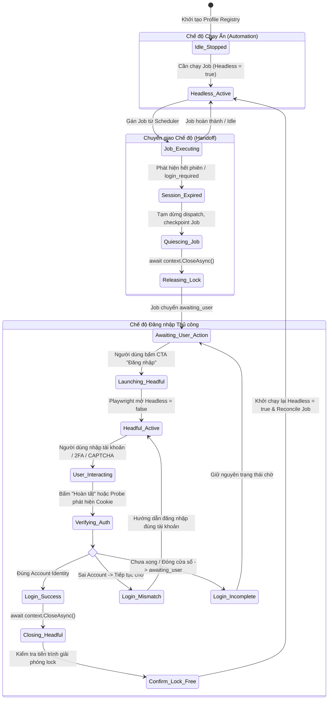

# TiToAI — Báo cáo xác minh Stack & Công nghệ (T01)

- **Task ID:** T01 (Xác minh stack)
- **Vai trò thực hiện:** Researcher duy nhất của T01
- **Workspace:** `D:\workspace\TitoAI` (Đã kiểm tra đường dẫn thực tế)
- **Ngày xác minh:** 2026-10-26 (UTC+07)
- **Model evidence:** Gemini 3.8 Flash (High) — quan sát từ UI Antigravity ngày 2026-10-26 01:18 UTC+07 (project: TitoAI; Model Selection: Gemini 3.8 Flash High). Không sử dụng Auto, không đổi sang model khác, không gọi subagent chưa kiểm chứng.
- **Chế độ dự án:** `IMPLEMENTATION` (Đã được người dùng cấp quyền triển khai code theo `docs/agents/STATUS.md`; T01 thực hiện nghiên cứu/xác minh trong phạm vi G0, chưa scaffold/build).
- **Trạng thái Task:** Hoàn tất nghiên cứu tài liệu, xác minh metadata registry và đề xuất pins; sẵn sàng bàn giao cho T02.

---

## 1. Hiện trạng Toolchain trên máy cục bộ

Trước khi xem xét phiên bản package, đã thực hiện quét kiểm tra môi trường và tiếp nhận bằng chứng thực tế từ PowerShell host của bên điều phối:

| Công cụ | Vị trí kiểm tra / Bằng chứng | Phiên bản thực tế | Ghi chú & Đánh giá |
|---|---|---|---|
| **Git** | `C:\Program Files\Git\cmd\git.exe` | `git version 2.55.0.windows.3` | Sẵn sàng trong sandbox cho T03 (khởi tạo Git). |
| **pnpm** | `C:\Users\PC\AppData\Local\pnpm\bin\pnpm.cmd` | `12.15.0` | Sẵn sàng trong sandbox cho quản lý dependency frontend. |
| **Node.js** | `C:\Program Files\nodejs\node.exe` (Xác minh từ PowerShell host điều phối) | **`v24.19.0`** (Host PowerShell chạy `node.exe --version`) | **Máy trạm ĐÃ CÓ Node.js v24.19.0**. Lệnh trực tiếp trong sandbox gặp `CommandNotFoundException` / `Access Denied` do giới hạn phân quyền truy cập `Program Files` và PATH trong sandbox Antigravity. Không kết luận máy thiếu Node. |
| **npm** | `C:\Program Files\nodejs\npm.cmd` (Xác minh từ PowerShell host điều phối) | **`11.17.0`** (Host PowerShell chạy `npm.cmd --version`) | **Máy trạm ĐÃ CÓ npm 11.17.0**. Khi triển khai T03, cần đảm bảo quyền/PATH sandbox hoặc gọi qua pnpm/host environment. |
| **.NET SDK** | Quét PATH, `C:\Program Files\dotnet\dotnet.exe`, `C:\Users\PC\.dotnet\dotnet.exe` | **Chưa thấy trên PATH / hai vị trí chuẩn** | Chưa thấy trên PATH và không tồn tại tại hai vị trí cài đặt tiêu chuẩn. Không khẳng định đã kiểm toàn máy, nhưng là blocker môi trường cho T03 cần được người dùng/coordinator cấu hình .NET 10 SDK trước G1. |

> [!IMPORTANT]
> **Đánh giá Blocker cho giai đoạn Implementation:**
> 1. **Node.js & npm (Đã có trên máy, cần quyền/PATH sandbox):** Node.js v24.19.0 và npm 11.17.0 đã được xác nhận tại `C:\Program Files\nodejs\`. Cần cấu hình PATH/quyền sandbox trước khi build frontend tại T03.
> 2. **.NET SDK (Blocker thực sự cho T03):** Chưa thấy .NET SDK trên PATH và hai vị trí cài đặt tiêu chuẩn. Cần cài đặt/cấu hình .NET 10 SDK (`10.0.402`) trước khi bước vào triển khai code (Gate G1 / T03). Không mất thêm thời gian dò toàn máy.
> 3. **Phạm vi triển khai:** Dự án đang ở chế độ `IMPLEMENTATION` (được cấp quyền code theo STATUS.md), tuy nhiên **chưa scaffold source hay chạy build tại T01** vì phạm vi trách nhiệm của Task T01 / Gate G0 chỉ là nghiên cứu và xác minh phiên bản; việc tạo file solution/source và build ứng dụng thuộc về Gate G1 (T03+).

---

## 2. Bảng đề xuất phiên bản (Proposed Version Pins)

Toàn bộ phiên bản dưới đây được tra cứu và đối chiếu với nguồn phát hành chính thức của nhà cung cấp (Microsoft, npm, nuget, sqlite.org):

| Khối / Thành phần | Gói / Công nghệ đề xuất | Phiên bản đề xuất pin | Nguồn tra cứu chính thức (Exact URL) | Trạng thái kiểm chứng |
|---|---|---|---|---|
| **Runtime & SDK** | .NET Runtime | `10.0.13 LTS` | [https://dotnet.microsoft.com/en-us/download/dotnet/10.0](https://dotnet.microsoft.com/en-us/download/dotnet/10.0) | `DOC_VERIFIED` (Bản phát hành bảo trì tháng 10/2026) |
| **SDK Build** | .NET SDK | `10.0.402` (Feature band 4xx) | [https://github.com/dotnet/core/blob/main/release-notes/10.0/10.0.13/10.0.13.md](https://github.com/dotnet/core/blob/main/release-notes/10.0/10.0.13/10.0.13.md) | `DOC_VERIFIED` (SDK đóng gói Runtime 10.0.13) |
| **Ngôn ngữ** | C# | `C# 14` | [https://learn.microsoft.com/en-us/dotnet/csharp/whats-new/csharp-14](https://learn.microsoft.com/en-us/dotnet/csharp/whats-new/csharp-14) | `DOC_VERIFIED` (Ngôn ngữ mặc định đi kèm .NET 10) |
| **Desktop Host** | WPF (`net10.0-windows`) | Đi kèm .NET 10 Windows Desktop SDK | [https://learn.microsoft.com/en-us/dotnet/desktop/wpf/](https://learn.microsoft.com/en-us/dotnet/desktop/wpf/) | `DOC_VERIFIED` (Tích hợp trong Windows Desktop SDK) |
| **Web UI Host** | `Microsoft.Web.WebView2` | `1.0.4314.35` | [https://www.nuget.org/packages/Microsoft.Web.WebView2/1.0.4314.35](https://www.nuget.org/packages/Microsoft.Web.WebView2/1.0.4314.35) | `DOC_VERIFIED` (Bản stable trên NuGet) |
| **Data Access** | `Microsoft.EntityFrameworkCore.Sqlite` | `10.0.13` | [https://www.nuget.org/packages/Microsoft.EntityFrameworkCore.Sqlite/10.0.13](https://www.nuget.org/packages/Microsoft.EntityFrameworkCore.Sqlite/10.0.13) | `DOC_VERIFIED` (Đồng bộ major 10.x với .NET 10 LTS) |
| **EF Design/Tools** | `Microsoft.EntityFrameworkCore.Design` | `10.0.13` | [https://www.nuget.org/packages/Microsoft.EntityFrameworkCore.Design/10.0.13](https://www.nuget.org/packages/Microsoft.EntityFrameworkCore.Design/10.0.13) | `DOC_VERIFIED` (Cần cho migrations design-time) |
| **Native SQLite Engine** | `SQLitePCLRaw.bundle_e_sqlite3` | `3.0.5` *(exact pin)* | [https://www.nuget.org/packages/SQLitePCLRaw.bundle_e_sqlite3/3.0.5](https://www.nuget.org/packages/SQLitePCLRaw.bundle_e_sqlite3/3.0.5) | `DOC_VERIFIED` metadata dependency trỏ `SourceGear.sqlite3 (>= 3.53.4)`, KHÔNG chứng minh bundle 3.54.1. T04 runtime đo được `3.53.4`; xem addendum bên dưới. |
| **Upstream SQLite Reference** | SQLite Core Library | `3.54.1` *(kỳ vọng upstream từ plan)* | [https://www.sqlite.org/releaselog/3_54_1.html](https://www.sqlite.org/releaselog/3_54_1.html) | `DOC_VERIFIED` upstream spec; không phải phiên bản engine được đảm bảo bởi NuGet pin. T04 quan sát `3.53.4`; xem addendum bên dưới. |
| **Browser Engine** | `Microsoft.Playwright` | `1.64.1` | [https://www.nuget.org/packages/Microsoft.Playwright/1.64.1](https://www.nuget.org/packages/Microsoft.Playwright/1.64.1) | `DOC_VERIFIED` (Bản stable của Playwright cho .NET) |
| **Frontend Framework** | `react` & `react-dom` | `19.3.1` | [https://www.npmjs.com/package/react/v/19.3.1](https://www.npmjs.com/package/react/v/19.3.1) | `DOC_VERIFIED` (Phát hành chính thức 10/2026) |
| **Frontend Language** | `typescript` | `7.0.2` | [https://www.npmjs.com/package/typescript/v/7.0.2](https://www.npmjs.com/package/typescript/v/7.0.2) | `DOC_VERIFIED` (Phát hành chính thức trong chu kỳ TS 7) |
| **Frontend Bundler** | `vite` | `8.3.5` | [https://www.npmjs.com/package/vite/v/8.3.5](https://www.npmjs.com/package/vite/v/8.3.5) | `DOC_VERIFIED` (Phát hành chính thức 10/2026) |
| **React Vite Plugin** | `@vitejs/plugin-react` | `6.1.1` *(exact pin; fallback Babel: `5.1.4`)* | [https://www.npmjs.com/package/@vitejs/plugin-react/v/6.1.1](https://www.npmjs.com/package/@vitejs/plugin-react/v/6.1.1) | `DOC_VERIFIED` (Chốt exact pin 6.1.1 cho Vite 8 / React 19 dùng Oxc; bỏ wildcard 5.x) |

---

## 3. Ma trận tương thích & Điều kiện kỹ thuật (Compatibility Matrix)

1. **.NET 10 LTS + C# 14 + WPF (`net10.0-windows`):**
   - Đảm bảo tính tương thích tuyệt đối giữa CoreCLR, Base Class Libraries (BCL), WPF và Entity Framework Core 10.0.13.
   - Hỗ trợ đầy đủ các tính năng C# 14 mới (field-backed properties `field`, unbound generics trong `nameof`, collection expressions mở rộng).
   - Thiết lập `global.json` để pin chính xác SDK `10.0.402`:
     ```json
     {
       "sdk": {
         "version": "10.0.402",
         "rollForward": "disable"
       }
     }
     ```

2. **WPF Host + WebView2 Evergreen (`1.0.4314.35`):**
   - Yêu cầu cài đặt sẵn WebView2 Evergreen Runtime trên máy người dùng Windows. Với bản đóng gói installer tự thân (Self-contained), cần kiểm tra runtime tồn tại qua `CoreWebView2Environment.GetAvailableBrowserVersionString()`.
   - **Bắt buộc chỉ định User Data Folder (UDF) tùy biến:** Mặc định WebView2 cố gắng tạo thư mục UDF ngay cạnh file thực thi. Nếu ứng dụng được cài trong `Program Files`, thao tác này sẽ thất bại với lỗi `Access Denied` (HRESULT 0x80070005). Do đó, WPF host **bắt buộc** truyền thư mục `%LOCALAPPDATA%/TiToAI/WebView2` vào `CoreWebView2Environment.CreateAsync(null, userDataFolder, options)`.

3. **Vite 8.3.5 + React 19.3.1 + TypeScript 7.0.2 + `@vitejs/plugin-react` 6.1.1:**
   - Hoàn toàn tương thích; Vite 8 đi cùng `@vitejs/plugin-react` 6.1.1 (sử dụng Oxc transform) hỗ trợ Rollup/Rolldown pipeline hiện đại, build ra các static asset HTML/JS/CSS tối ưu để WebView2 load trực tiếp từ file hoặc custom scheme (`app://` hoặc `https://appassets.local`). Bản fallback `5.1.4` (Babel-based) có thể dùng nếu gặp sự cố tương thích transformer, nhưng khuyến nghị chốt `6.1.1`.
   - Giao diện không phụ thuộc mạng internet ngoài, đóng gói offline hoàn chỉnh.

4. **EF Core SQLite 10.0.13 + Native SQLite (`SQLitePCLRaw.bundle_e_sqlite3` 3.0.5):**
   - EF Core 10.0.13 phụ thuộc vào `Microsoft.Data.Sqlite.Core` và `SQLitePCLRaw.bundle_e_sqlite3` 3.0.5.
   - Metadata gói `SQLitePCLRaw.bundle_e_sqlite3` 3.0.5 trỏ dependency `SourceGear.sqlite3 (>= 3.53.4)`, KHÔNG chứng minh bundle sẵn SQLite 3.54.1.
   - Trạng thái runtime thực tế của SQLite engine là **`NOT_RUN`** tại G0 (chưa scaffold/chạy code). Bắt buộc phải thực thi câu lệnh SQL `SELECT sqlite_version();` và ghi log tại Task T04 để xác định phiên bản engine SQLite thực tế được nạp.
   - SQLite hỗ trợ đầy đủ WAL mode, `PRAGMA foreign_keys = ON`, `PRAGMA busy_timeout = 5000` và JSON functions. Thư viện native được load động cho kiến trúc Windows `win-x64`.

5. **Microsoft.Playwright 1.64.1:**
   - Đòi hỏi cài đặt browser driver (Chromium). Trong môi trường phát triển / triển khai, cần chạy `pwsh bin/Debug/net10.0/playwright.ps1 install chromium` hoặc tích hợp gọi CLI `Microsoft.Playwright.Program.Main(new[] { "install", "chromium" })`.

---

## 4. Đối chiếu và Sai lệch so với Kế hoạch nguồn (Mismatches vs SOURCE_PLAN)

Quá trình nghiên cứu phát hiện các điểm khác biệt và bổ sung quan trọng so với `SOURCE_PLAN.md`:

| Hạng mục | Trong `SOURCE_PLAN.md` | Thực tế xác minh & Yêu cầu mới | Giải pháp xử lý |
|---|---|---|---|
| **Phiên bản WebView2** | Chỉ ghi "WebView2 Evergreen", không có số version NuGet cụ thể (§2). | Gói `Microsoft.Web.WebView2` trên NuGet đã đạt bản `1.0.4314.35`. | Đề xuất pin rõ ràng `1.0.4314.35` trong `Directory.Packages.props` tại T03. |
| **Tên sản phẩm & Namespace** | `AIContentStudio` và `%LOCALAPPDATA%/AIContentStudio` | Đã đổi chính thức thành **TiToAI** theo `AGENTS.md`. | Toàn bộ solution, namespace, đường dẫn dữ liệu là `%LOCALAPPDATA%/TiToAI`. |
| **Vùng lưu trữ dữ liệu (Storage Roots)** | Giả định một root cố định `%LOCALAPPDATA%/AIContentStudio/workspaces/...` (§4). | `SETTINGS_PLAN.md` (P0) quy định **3 root lưu trữ độc lập** (Tài liệu, Ảnh AI, Video AI) có thể tùy chọn qua popup Cài đặt, lưu bằng `storage_root_id` + `relative_path`. | Giữ SQLite DB, browser profiles, logs tại `%LOCALAPPDATA%/TiToAI`. Các asset media phân bổ theo root ID được cấu hình trong `app_settings`. |
| **Lựa chọn Provider AI** | Đặt chung trong code / workspace (§8). | `SETTINGS_PLAN.md` (P0) cho phép chọn độc lập **Gemini Web** hoặc **ChatGPT Web** cho từng tác vụ: (1) Tạo ảnh, (2) Viết kịch bản, (3) Prompt video. | Chốt routing độc lập tại T02; lưu `provider_key` trong `app_settings`. |
| **Chế độ hiển thị Browser** | Giả định có thể mở browser theo dõi (§7.1, §11). | `UI_BROWSER_PLAN.md` (P0) quy định: **Automation bắt buộc chạy ẩn 100%**. Chỉ hiện browser khi cần người dùng **đăng nhập/đăng nhập lại thủ công**. | Loại bỏ mọi tùy chọn "luôn hiện browser"; xây dựng cơ chế handoff an toàn khi login. |
| **Phiên bản SQLite Bundle** | Gợi ý upstream SQLite 3.54.1 (§2). | Metadata NuGet `SQLitePCLRaw.bundle_e_sqlite3` 3.0.5 phụ thuộc `SourceGear.sqlite3 (>= 3.53.4)`, KHÔNG chứng minh bundle sẵn SQLite 3.54.1. Runtime thực tế là `NOT_RUN`. | Chốt exact pin `3.0.5` cho `SQLitePCLRaw.bundle_e_sqlite3`. Bắt buộc chạy `SELECT sqlite_version();` ở T04 để ghi log engine thật. |
| **Sẵn sàng của Toolchain máy trạm** | Giả định máy phát triển đã có đầy đủ SDK .NET và Node.js. | Máy trạm đã có Node.js v24.19.0, npm 11.17.0 (tại `C:\Program Files\nodejs\`) và pnpm 12.15.0; tuy nhiên .NET SDK chưa thấy trên PATH hoặc hai vị trí chuẩn. Trong sandbox, Node.js bị hạn chế truy cập/PATH. | Ghi nhận blocker môi trường: Cần cài đặt/cấu hình .NET 10 SDK trước T03, và phân quyền/PATH cho Node.js trong sandbox. Không mất thời gian dò toàn máy. |

---

## 5. Nghiên cứu sâu: Persistent Profile trên Windows, Thực thi Chạy ẩn & Handoff Đăng nhập Thủ công

### 5.1. Cơ chế khóa Single-Instance của Chromium trên Windows
- **Bản chất kỹ thuật:** Chromium quản lý thư mục `User Data` bằng cơ chế khóa tiến trình độc quyền (Process Mutex / Lockfile). Trên Windows, Chromium tạo các named mutex (dạng `Local\ChromeSingleton...`) và kiểm tra file lock trong profile folder.
- **Hệ quả trực tiếp:** Tại một thời điểm, **chỉ duy nhất một tiến trình Chromium có thể mở một thư mục `userDataDir`**.
- Nếu một tiến trình Playwright thứ hai cố gắng gọi `LaunchPersistentContextAsync` trên cùng một thư mục đang hoạt động:
  1. Nếu tiến trình đầu đang giữ khóa, tiến trình thứ hai sẽ bị từ chối hoặc timeout không thể khởi động.
  2. Hoặc Chromium sẽ kích hoạt cơ chế chuyển tiếp IPC (forward command-line) đến tiến trình cũ và tự thoát ngay lập tức, làm đứt gãy kết nối CDP (Chrome DevTools Protocol) của Playwright.
- **Ràng buộc kiến trúc TiToAI:**
  - Tuyệt đối **không bao giờ** chạy đồng thời hai instance (một headless để làm việc, một headful để login) trên cùng một `userDataDir`.
  - Mọi thao tác truy cập vào profile phải được kiểm soát bởi một **Single Profile Ownership Lock** (ví dụ: `SemaphoreSlim(1, 1)` hoặc `AsyncKeyedLock` theo profile ID).

### 5.2. Tính bất biến của cờ `--headless` trong tiến trình Chromium
- **Tài liệu chính thức Playwright & Chromium Architecture:** Chromium **KHÔNG hỗ trợ** chuyển đổi động giữa chế độ không đầu (headless) và có đầu (headful) trên một tiến trình đang chạy. Trạng thái headless được quyết định tại thời điểm nạp hệ thống đồ họa và window manager của trình duyệt lúc khởi tạo.
- **Quy tắc bắt buộc:** Để chuyển từ chế độ chạy ẩn (headless) sang hiển thị cửa sổ cho người dùng đăng nhập thủ công (headful), hệ thống **bắt buộc phải thực hiện chu trình đóng - mở (Close and Relaunch)**:
  1. Dừng an toàn tác vụ hiện tại.
  2. Gọi `await context.CloseAsync()` trên browser context đang chạy ẩn để giải phóng lock thư mục `userDataDir`.
  3. Khởi tạo một persistent context mới với `Headless = false` trên chính `userDataDir` đó để hiển thị cửa sổ cho người dùng.
  4. Sau khi đăng nhập hoàn tất, gọi `await context.CloseAsync()` trên cửa sổ hiển thị.
  5. Khởi động lại context với `Headless = true` để tiếp tục automation trong nền.

### 5.3. Phân tách rõ ràng giữa WebView2 và Playwright
- **Cảnh báo sai lầm kiến trúc phổ biến:** Có thể nảy sinh suy nghĩ dùng luôn control `WebView2` có sẵn trong cửa sổ WPF để làm màn hình popup đăng nhập cho tài khoản ChatGPT/Gemini/MuseAI, rồi dùng Playwright đọc profile đó.
- **Lý do KHÔNG THỂ THỰC HIỆN:**
  - WebView2 sử dụng cấu trúc thư mục đặc thù của Microsoft Edge WebView2 Runtime (`EBWebView`, phân cấp profile nội bộ).
  - Playwright quản lý Chromium persistent context theo chuẩn cấu trúc Chromium (`Default/Preferences`, `Default/Network/Cookies`, `Default/Local Storage`).
  - Dữ liệu session, token, cookie mã hóa DPAPI giữa hai loại runtime này không tương thích hoàn toàn và việc trỏ chung một thư mục sẽ dẫn đến xung đột file lock và hỏng profile.
- **Kết luận:** Mọi luồng đăng nhập thủ công cho các profile tự động hóa (Shared AI, MuseAI, TikTok) **phải do Playwright trực tiếp khởi chạy** ở chế độ hiển thị (`Headless = false`), hoàn toàn độc lập với WebView2 dùng làm UI của ứng dụng.

### 5.4. Vòng đời chuyển giao quyền sở hữu (Ownership Lifecycle & State Machine)



### 5.5. Quản lý Shared AI Profile (Nhiều Tab)
- Shared AI Profile dùng một persistent profile duy nhất nhưng mở nhiều tab (`IPage`) phục vụ: Kịch bản (Script), Ảnh (Image), Video Prompt.
- **Rủi ro:** Khi session ChatGPT hoặc Gemini bị hết hạn trên một tab, việc đóng context để mở cửa sổ login sẽ làm gián đoạn các tab khác.
- **Giải pháp kiểm soát:**
  1. Khi một tab phát hiện `login_required`, kích hoạt cờ `ProfilePauseDispatch(shared_ai)`. Scheduler lập tức ngừng đưa job mới vào bất kỳ tab nào của profile này.
  2. Với các tab đang thực thi:
     - Nếu tác vụ ở bước đọc/chuẩn bị (idempotent): cho phép chờ hoặc dừng an toàn.
     - Nếu tác vụ đang ở bước đã gửi yêu cầu (side-effect submitted): phải đợi phản hồi hoặc timeout trước khi đóng browser, không được ngắt đột ngột gây mất dấu vết kết quả.
  3. Khi toàn bộ các tab đã ở trạng thái tĩnh (quiescent): thực hiện đóng context, bàn giao sang cửa sổ đăng nhập hiển thị.
  4. Sau khi đăng nhập thành công và khôi phục chế độ ẩn, tái lập lại pool tab và tiến hành reconcile các job dở dang.

### 5.6. Giới hạn kỹ thuật & Kịch bản ngoại lệ trên Windows

1. **Tiến trình mồ côi (Orphan Processes / Hang):**
   - *Hiện tượng:* Khi người dùng tắt đột ngột ứng dụng TiToAI qua Task Manager hoặc máy tính mất điện, Chromium có thể để lại tiến trình ngầm `chrome.exe` hoặc file lock (`lockfile`). Khi TiToAI mở lại, việc gọi `LaunchPersistentContextAsync` có thể bị treo.
   - *Biện pháp:* Khi bootstrap `BrowserManager`, cần kiểm tra file lock và đối soát danh sách tiến trình con được quản lý bởi TiToAI. Cung cấp cơ chế dọn dẹp tiến trình treo thuộc phạm vi profile của TiToAI trước khi khởi tạo context mới.
2. **Người dùng đóng cửa sổ đăng nhập giữa chừng:**
   - Bắt sự kiện `context.Close` hoặc `page.Close`.
   - Không được coi việc đóng cửa sổ là đăng nhập thành công.
   - Không tự ý bật lại cửa sổ lập tức gây khó chịu (popup loop). Giữ nguyên trạng thái job là `awaiting_user` kèm CTA "Thử đăng nhập lại".
3. **Cơ chế chống tự động hóa (Bot Detection / CAPTCHA):**
   - TiToAI **nghiêm cấm tuyệt đối** việc sử dụng cờ lách bot detection hoặc xây dựng cơ chế stealth/bypass (không truyền cờ lách tự động hóa).
   - Khi gặp CAPTCHA, Cloudflare Turnstile, thay đổi UI hoặc website từ chối chạy ẩn (headless): Hệ thống **lập tức chuyển trạng thái sang `awaiting_user`** với mã lý do `automation_blocked` theo đúng `ENGINEERING_RULES.md` §38 và `UI_BROWSER_PLAN.md` §6.
   - Kích hoạt **chế độ thao tác thủ công (manual mode trong app)**: người dùng sao chép prompt, tải file đầu vào và nhập/dán kết quả bằng tay trong giao diện app TiToAI mà không tự động mở browser ra desktop.
   - Việc hiển thị cửa sổ browser do app quản lý **chỉ áp dụng duy nhất cho luồng đăng nhập/đăng nhập lại thủ công**, nơi người dùng tự tay nhập thông tin xác thực. Mọi thao tác ngoài login đều qua hướng dẫn manual in-app; tuyệt đối không cố vượt cơ chế bảo vệ dịch vụ.

---

## 6. Trạng thái kiểm chứng (Verification Status)

- **Đặc tả phiên bản & Nguồn chính thức:** `DOC_VERIFIED` (Đã xác minh qua tài liệu chính thức, NuGet Gallery, npm registry và release metadata cụ thể của vendor; không ghi nhận VERIFIED chỉ vì plan ghi).
- **Phân tích tương thích kiến trúc:** `DOC_VERIFIED` (Đã đối chiếu theo tài liệu kỹ thuật .NET 10, EF Core, WebView2, Playwright, React 19).
- **Phân tích cơ chế Single-Instance Lock & Handoff:** `DOC_VERIFIED` (Xác minh trên tài liệu đặc tả kỹ thuật và kiến trúc chính thức của Chromium, Playwright API và Windows OS).
- **Thử nghiệm chạy thực tế tại thời điểm bàn giao T01:** `NOT_RUN`; xem addendum T03/T04 bên dưới cho các bằng chứng mới.
  - Chưa chạy `dotnet build` / `pnpm build`: Dự án đang ở chế độ `IMPLEMENTATION`, tuy nhiên chưa scaffold source/build vì việc tạo mã nguồn thuộc phạm vi Gate G1 (T03+); T01 chỉ giới hạn trong scope nghiên cứu xác minh.
  - Chưa chạy kiểm thử khởi động Chromium thực tế trên máy trạm (Cần hoàn thành G0 và T03).
  - Chưa chạy kiểm thử provider thật (Thuộc phạm vi Gate G3 / T19).

---

## 7. Đề xuất chuyển tiếp cho T02 (Architect - Chốt ranh giới & Contracts)

Dựa trên kết quả xác minh của T01, đề xuất các nội dung sau cần được kiến trúc sư chốt tại `docs/decisions/contracts.md` (T02):

1. **Contract giao tiếp Desktop Host ↔ Web UI:**
   - Khuyến nghị chọn **WebView2 Message Bridge** (`window.chrome.webview.postMessage` và `chrome.webview.addEventListener('message')`) với schema Envelope có Typed Command, Correlation ID, Payload JSON và Allow-list rõ ràng.
   - Tránh việc mở HTTP Minimal API loopback nếu không cần thiết, giúp loại bỏ hoàn toàn rủi ro quét cổng hoặc chiếm dụng cổng cục bộ trên máy Windows.
2. **Contract DTO cho Popup Cài đặt (Settings):**
   - Đặc tả DTO cho 3 Storage Roots: `storage.documentsRootId`, `storage.imagesRootId`, `storage.videosRootId` và bảng ánh xạ đường dẫn `storage.roots`.
   - Đặc tả DTO cho AI Task Routing: `ai.providers.image`, `ai.providers.script`, `ai.providers.videoPrompt` (chọn giữa `gemini-web` và `chatgpt-web`).
3. **State Machine & Contract cho Browser Profile / Login Handoff:**
   - Chốt các mã lý do (`reason_codes`): `login_required`, `session_expired`, `wrong_account`, `automation_blocked`, `network_error`.
   - Định nghĩa DTO `BrowserProfileState` (ProfileId, Kind, Status: `Idle | HeadlessRunning | AwaitingLogin | HeadfulLoggingIn | Paused`).
   - Thiết kế cơ chế khóa Serialization: Đảm bảo toàn ứng dụng chỉ mở tối đa **1 cửa sổ đăng nhập hiển thị tại một thời điểm**.
4. **Snapshot Job Lifecycle:**
   - Khóa chặt quy tắc: Mỗi Job khi được tạo lưu cứng `snapshot` gồm Prompt đã render, `provider_key`, cấu hình adapter, và `storage_root_id` đích. Đổi Settings sau đó tuyệt đối không làm đổi đích của job cũ.

---

## 8. Bằng chứng runtime sau T01 (T03/T04, 2026-10-26 UTC+07)

- T04 smoke-check dùng database SQLite dạng file tạm và truy vấn `SELECT sqlite_version()`; engine đo được là `3.53.4` qua pin `SQLitePCLRaw.bundle_e_sqlite3` `3.0.5`. Đây là runtime observation, không phải suy luận từ metadata package.
- `3.54.1` vẫn là upstream reference trong plan, không phải phiên bản engine đã chứng minh. T04 review ghi nhận điểm này và yêu cầu giữ số đo thực tế trong bằng chứng; xem [T04 coordinator review](../reviews/T04-coordinator-review.md).
- Build T03 và T04 smoke-check có bằng chứng riêng trong `docs/reviews/`; runtime ứng dụng hoàn chỉnh và provider thật vẫn `NOT_RUN`.
