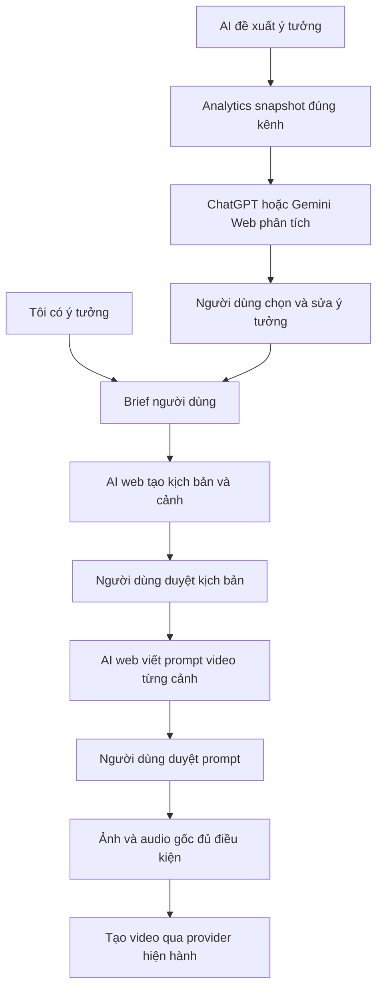

# TiToAI — AI web đề xuất ý tưởng và tạo prompt video

> **Delta 2026-10-27 — sản xuất từ ảnh:** [Plan ảnh mẫu/sản phẩm → ảnh đã duyệt → prompt chuyển động → video](PRODUCT_IMAGE_VIDEO_WORKFLOW_PLAN.md) thay bố cục Project/Scene dạng bảng làm luồng chính và bổ sung ba chế độ đầu vào. Luồng ảnh đi thẳng, không bắt tạo kịch bản trước; audio tùy chọn và tự động chạy theo quyết định mới. Đây là spec bàn giao, chưa nghiệm thu code.

Ngày 2026-10-27 (UTC+07). Trạng thái: **đặc tả để giao AI khác triển khai; chưa code, chưa nghiệm thu**.

## 1. Yêu cầu đã chốt

Hỗ trợ hai cách bắt đầu: người dùng cung cấp ý tưởng/nội dung/kịch bản, hoặc ChatGPT Web/Gemini Web phân tích analytics của kênh và đề xuất ý tưởng. Sau khi người dùng chọn, AI web phát triển kịch bản, chia cảnh và viết prompt video bằng tiếng Anh. Người dùng không phải điền các biến kỹ thuật như camera, ánh sáng hay chuyển động.

TiToAI chuẩn bị dữ liệu, ghép hướng dẫn, gửi yêu cầu qua adapter web và nhận/lưu kết quả. ChatGPT/Gemini trên website thực hiện phân tích và sáng tạo. Không thay bằng OpenAI API, Gemini API hoặc model local khi chưa có yêu cầu mới.

Nguồn liên quan: [SOURCE](SOURCE_PLAN.md) §7.4,9; [Settings](SETTINGS_PLAN.md); [queue 1.2](QUEUE_EXECUTION_SETTINGS_PLAN.md); [UI/Browser](UI_BROWSER_PLAN.md); [Theme](UI_THEME_PLAN.md); [Engineering](../agents/ENGINEERING_RULES.md). Prompt bàn giao và hướng dẫn AI web nằm tại [bộ prompt](AI_WEB_CONTENT_CREATION_PROMPTS.md).

## 2. Delta so với plan cũ

| Phần | Quyết định bổ sung/thay thế |
|---|---|
| T10 / T12a | Template là hướng dẫn AI có version. Điền biến kỹ thuật không còn là điều kiện để người dùng tạo nội dung. Bộ render hiện có vẫn dùng nội bộ và cho chế độ nâng cao. |
| Render xem trước | Chỉ xem yêu cầu đã ghép; không gọi AI, không được trình bày như kết quả AI. |
| T18 / T20 | Tác vụ ý tưởng/phân tích dùng adapter text của ChatGPT/Gemini Web. |
| T22 / T23 | Có hai điểm bắt đầu; chọn/duyệt ý tưởng trước khi tạo kịch bản. |
| T25 | Analytics snapshot trở thành đầu vào cho AI web đề xuất nội dung. Vẫn P1, không đổi gate MVP hiện tại. |
| SOURCE §7.4 | Giữ bài đăng TikTok kèm kết quả text, lưu theo project; không nhân caption theo từng cảnh. |

Đây là nguồn chuẩn cho delta này; các spec cũ giữ invariant còn hiệu lực. Không lấy DONE lịch sử của T10/T12 làm chứng nhận đã có luồng mới. Không cập nhật STATUS/TASKS từ tài liệu này; coordinator quản lý trạng thái thật.

## 3. Luồng người dùng

### 3.1. Tôi có ý tưởng — phần nền P0

2. Nhập ý tưởng, nội dung hoặc kịch bản có sẵn. Tùy chọn: mục tiêu, đối tượng, thời lượng, phong cách. Nếu bỏ trống, AI đề xuất và ghi rõ giả định.
3. Chọn **AI phát triển kịch bản**. TiToAI gửi brief + ngữ cảnh kênh + hướng dẫn Script + hợp đồng đầu ra tới provider text đã cấu hình.
4. Xem kịch bản, cảnh và bài đăng; sửa, yêu cầu tạo lại hoặc áp dụng. Nếu đã đưa kịch bản, ưu tiên giữ nội dung/chia cảnh, không tự đổi chủ đề.
5. Tạo/chọn ảnh nếu bước video cần ảnh. Chọn **AI tạo prompt video** cho các cảnh đã chọn.
6. Xem prompt tiếng Anh từng cảnh, chỉnh và lưu/áp dụng. Đầu ra là bản nháp cho đến khi người dùng áp dụng.
7. Chỉ enqueue tạo video khi đủ ảnh đã chọn + prompt đã lưu + audio MP3/WAV gốc theo pipeline hiện hành.

Analytics không phải điều kiện của luồng này. Không tự gọi AI đề xuất ý tưởng trước khi phát triển brief người dùng.

### 3.2. AI đề xuất từ dữ liệu kênh — P1

2. TiToAI lấy analytics snapshot của đúng kênh từ dữ liệu đã nhập hoặc adapter thu thập được phép/đã xác minh. MVP làm import CSV/JSON trước.
3. Hiện nguồn, thời điểm cập nhật, kỳ dữ liệu, số video, metric còn thiếu và nội dung sắp gửi AI web. Người dùng xem/chỉnh phạm vi, chọn **Phân tích và đề xuất**; hành động này gửi dữ liệu được hiển thị.
4. TiToAI gửi snapshot + hồ sơ nội dung kênh + lịch sử ý tưởng đã chọn trong phạm vi liên quan. AI web phân tích và trả mặc định 5 ý tưởng kèm lý do/bằng chứng/giả thuyết thử nghiệm.
5. Hiện các thẻ ý tưởng: tiêu đề, hook, tóm tắt, thời lượng gợi ý, lý do, bằng chứng dữ liệu và bài đăng TikTok dự kiến. Phân biệt phát hiện có dữ liệu với suy luận sáng tạo.
6. Người dùng chọn, sửa hoặc yêu cầu thêm ý tưởng. **Dùng ý tưởng này** lưu lựa chọn vào brief; tạo kịch bản là hành động tiếp theo có chủ đích.
7. Tiếp tục luồng chung ở §3.1 bước 3–7.

Không có dữ liệu: hướng dẫn nhập analytics hoặc chuyển sang Tôi có ý tưởng. Nếu người dùng chủ động chọn đề xuất chỉ từ hồ sơ kênh, ghi rõ **Không dựa trên analytics**. Dữ liệu cũ/ít vẫn có thể phân tích khi người dùng chọn tiếp tục, nhưng phải nêu giới hạn, không hứa dự báo viral/doanh thu.

## 4. UI và template

- Cài đặt → AI & Prompt tiếp tục là nơi cấu hình provider và hướng dẫn. Tab Prompt video ghi **Hướng dẫn AI tạo prompt video**, mô tả rõ AI tự chọn chi tiết còn thiếu.
- Nút **Lưu phiên bản hướng dẫn** chỉ lưu. **Xem yêu cầu gửi AI** chỉ render. **AI tạo prompt video** mới enqueue; UI phân biệt ba thao tác.
- Purpose hiện hành Script/Image/VideoPrompt giữ nguyên. Phân tích/đề xuất là operation thuộc Script; coordinator mở rộng operation/template metadata có version thay vì tự thêm purpose thứ tư.
- Ngữ cảnh kênh/brief/cảnh được backend tự ghép thành phần dữ liệu. Template cũ có biến chưa có giá trị phải báo rõ và hỗ trợ sửa/migrate có xem trước; không âm thầm bỏ placeholder.
- Prompt per-scene có camera/ánh sáng/chuyển động do AI quyết định. Tùy chọn chỉnh nâng cao được phép; không bắt điền trước.
- Giữ theme/token/layout hiện hành; kiểm Light/Dark, keyboard, focus, trạng thái rỗng/lỗi/loading/awaiting_user và viewport/DPI theo release checklist.

## 5. Provider và cơ chế gửi

- Đề xuất MVP: dùng `ai.providers.script` cho cả phân tích/ý tưởng và kịch bản, `ai.providers.videoPrompt` cho prompt; `image` giữ nguyên. UI giải thích phạm vi của lựa chọn Script. Không thêm routing key riêng trong đợt này.
- Queue/retry/resume dùng snapshot, binding và checkpoint hiện hành. Sau khi đã có thể submit, reconcile hoặc awaiting_user trước khi gửi lại.
- Tự động chạy ẩn; chỉ mở browser cho đăng nhập thủ công theo CTA. UI đổi, CAPTCHA ngoài login hoặc capability chưa verified: manual handoff trong app bằng copy/export input và import output, không fallback provider ngầm.
- Trước khi bật thật, T19/T20 phải xác minh website/session, khả năng nhận dữ liệu, output, chạy ẩn và reconcile trên account test. Không viết selector/endpoint dựa trên phỏng đoán. Kích thước request giới hạn bằng cấu hình app và capability đo được, không coi đó là giới hạn chính thức của website.
- MVP gửi analytics đã chuẩn hóa dạng text có cấu trúc. Nếu quá lớn, tổng hợp số học xác định và lấy mẫu theo quy tắc được hiển thị; lưu manifest các bản ghi đã dùng/bỏ. Không cắt âm thầm hoặc thêm hệ chunking nhiều lượt ngay từ đầu.

## 6. Dữ liệu và hợp đồng đề xuất

Tên dưới là logical contract, chưa phải DTO/bridge command đã tồn tại. Coordinator phải đối chiếu CodeGraph/source và contract hiện hành trước khi chốt tên/file/schema.

### 6.1. Input bất biến

Job snapshot chốt cả input, analytics snapshot/hash, template/version, rendered request, output schema, provider/config và roots tại enqueue. Run giữ workflow version. Mỗi job tiếp theo chốt input mới theo cấu hình hiện hành; UI cho biết provider hiệu lực trước khi gửi. Snapshot không thay khi nguồn/template/Settings đổi.

### 6.2. Kết quả AI

| Operation | Nội dung bắt buộc |
|---|---|
| SuggestIdeas | analysis: observations có evidence IDs, limitations; ideas có stable key, title, hook, summary, suggestedDuration, rationale, evidenceRefs, hypothesis, tiktokPost |
| GenerateScript | title, concept, assumptions, continuity notes, scenes theo schema Script hiện hành và tiktokPost |
| GenerateVideoPrompts | scene key, promptEn, continuity notes cần thiết; một phương án tiktokPost cấp project |

Mỗi scene Script giữ các trường bắt buộc của contract hiện hành, gồm order/name/description/target duration/imagePrompt. Thời lượng gợi ý là mục tiêu, không phải thời lượng media thực tế.

`tiktokPost` theo SOURCE §7.4 gồm caption và hashtags; mỗi ý tưởng có phương án riêng. Khi apply vào project chỉ một bản hiện hành; prompt nhiều scene không tạo bài đăng cho từng scene. Negative prompt chỉ thêm nếu capability của công cụ đích hỗ trợ; không bắt mặc định 4K/24fps/photorealistic cho mọi nội dung.

Lưu raw response + parsed candidate + validation errors và provenance. Kiểm kiểu/schema, giới hạn app, scene IDs, tổng thể scope và evidenceRefs tồn tại trong snapshot. Không tự coi lý do AI là số liệu đã được kiểm chứng. JSON sai/thiếu caption thì giữ raw/phần hợp lệ để sửa hoặc nhập lại; không báo output hợp lệ và không tự enqueue lượt sửa tốn quota.

### 6.3. Persist và apply

- Tận dụng job result/run output hiện có, chỉ thêm entity/bảng khi vòng đời thực sự cần. Analytics snapshot immutable và ý tưởng đã chọn phải truy nguyên được sau restart.
- Đề xuất thao tác prepare_context/enqueue_suggestions/select_idea/enqueue_script/enqueue_video_prompts/review/apply; coordinator chốt DTO/allow-list/version/mã lỗi/cancellation và idempotency trước triển khai UI/backend phụ thuộc.
- Mọi read/write/event kiểm ownership backend. Apply dùng expected project/scene revision và transaction ngắn; apply lặp trả kết quả cũ. Kết quả stale lưu lịch sử, không ghi đè bản người dùng sửa.
- Giữ giới hạn T22: apply script tạo scenes cho project chưa có scenes; project đã có scenes hướng dẫn dùng project mới trong MVP. Tạo lại prompt trên scene hiện có vẫn được, có review và revision guard.
- Bài đăng đã sửa cần được giữ hoặc thay qua lựa chọn rõ ràng; đổi kịch bản/prompt đánh dấu cần review theo SOURCE §7.4.

## 7. Ranh giới gửi dữ liệu

Chỉ đưa metric/nội dung cần phân tích của kênh đã chọn. Cookie, token, đường dẫn profile, bí mật và dữ liệu kênh khác không được gửi. Preview hiển thị đúng payload đã rút gọn; thay dữ liệu sau preview thì đánh dấu cần xem lại trước enqueue.

Không tự sửa hướng dẫn đã lưu, tự chạy bước video, tự đăng TikTok hoặc tạo audio/TTS. Mỗi bước AI chạy theo hành động người dùng; restart không tự gửi lại yêu cầu uncertain.

## 8. Thứ tự triển khai và ownership

Các mã AC dưới là gói đề xuất, chưa là task đã dispatch. Coordinator đối chiếu TASKS/STATUS và nhận ownership trước mỗi gói; dependency chưa đạt thì chỉ chuẩn bị thiết kế/fixture, không sửa production phụ thuộc.

| Gói | Phạm vi/owner đề xuất | Dependency và kết quả nghiệm thu |
|---|---|---|
| AC0 — chốt contract | Coordinator: docs/decisions, Contracts, composition root; persistence owner duy nhất cho schema | Đọc trạng thái/model/baseline, kiểm T16 R1–R4, T18–T20/T22 thật; chốt operation/output/snapshot và file ownership, không dựa vào baseline cũ. |
| AC1 — hướng dẫn AI | Prompt owner: Application/Prompts và Web/features/prompts; handler qua coordinator | AC0, T10; template tự nhiên không biến bắt buộc, giữ lịch sử/override/draft, preview không gửi AI. |
| AC2 — từ brief đến prompt | Workflow owner: Application/Workflows; UI owner: project/pipeline; adapter owner T20 | AC0/AC1, T17/T18/T19/T20 và dependency T22 tương ứng; có script review/apply, prompt review/apply, tiktokPost; fake chứng minh logic, account thật chứng minh web. Không đợi analytics. |
| AC3 — analytics context | Analytics owner: Application/Analytics, import/query UI; persistence owner schema | Dependency T25 (T07,T09,T19); import preview, null/source/period, chống trùng, scope và snapshot. P1. |
| AC4 — analytics → ý tưởng | Workflow/adapter/UI theo brief file riêng | AC2/AC3 và contract AC0 mở rộng đã chốt; AI web trả ý tưởng có evidence, chọn ý tưởng nối luồng AC2, không gửi script tự động. P1. |
| AC5 — tích hợp/nghiệm thu | Coordinator/reviewer, release owner | Gói tương ứng hoàn tất; regression, manual handoff/restart/concurrency, evidence website thật và DPI. Thiếu tài khoản/môi trường ghi NOT_RUN. |

Không scaffold lại module đã có. Không yêu cầu chạy song song; mọi file contract/migration/router dùng một owner. Model policy Antigravity phải xác minh theo ORCHESTRATION; policy này khác provider nghiệp vụ ChatGPT/Gemini Web của sản phẩm.

## 9. Ma trận nghiệm thu

| ID | Tình huống | Kết quả phải đạt |
|---|---|---|
| C01 | Nhập một ý tưởng, không analytics, không camera/ánh sáng | Gửi đúng AI web, có kịch bản/cảnh/prompt/bài đăng qua các bước duyệt. |
| C02 | Đưa kịch bản sẵn | Giữ nội dung đã giao; AI bổ sung kỹ thuật và nêu giả định. |
| C03 | Lưu hướng dẫn, preview, rồi tạo prompt | Chỉ thao tác cuối enqueue; hướng dẫn không có placeholder vẫn dùng được. |
| C04 | Analytics có nguồn; 5 ý tưởng | Evidence trỏ đúng dữ liệu, mỗi ý tưởng có bài đăng; chọn một mới tạo script. |
| C05 | Null, 0, dữ liệu cũ/ít, kỳ lệch | Không biến null thành 0 hoặc kết luận tăng trưởng sai; hiển thị giới hạn. |
| C06 | Import lặp, payload quá lớn | Không nhân số liệu; preview/manifest phản ánh dữ liệu thực gửi. |
| C07 | Chuyển kênh, dùng ID project/scene/snapshot kênh khác | Backend từ chối; response cũ không xuất hiện ở kênh mới. |
| C08 | Đổi Settings/template/analytics khi job đang chạy | Job cũ giữ snapshot, job mới dùng cấu hình đúng thời điểm chốt. |
| C09 | Apply lặp, sửa tay khi đang chạy, project đã có scenes | Không scene trùng, không mất draft; stale vào lịch sử, không thay script cũ trái contract. |
| C10 | Submit rồi crash, mất session, cancel/timeout | Reconcile/awaiting_user đúng binding, không resend mù, không ló browser ngoài login. |
| C11 | Output sai JSON/thiếu trường/evidence giả/prompt injection | Không apply tự động; lưu để sửa; dữ liệu không thể điều khiển scope/lệnh app. |
| C12 | Manual import, job schema cũ, restart | Cùng validator cho output mới; job cũ vẫn mở được, không tự gọi AI lại. |
| C13 | Nhiều scene và caption đã sửa | Một bài đăng hiện hành cấp project; lưu/copy/TXT đúng phiên bản đã chọn. |
| C14 | ChatGPT và Gemini thật | Ghi account test/provider/date/build/capability; fake test không được tính là PASS website. |

Kiểm parser/context/validator bằng unit test, ownership/idempotency/apply/import bằng SQLite thật, nút và dirty guard bằng component interaction thật. Kiểm thủ công hidden/login, session, quota và output trên website; release kiểm DPI/theme/keyboard. Không dùng số phần trăm tiến độ giả. Chỉ báo hoàn tất khi có evidence theo từng hàng áp dụng, không dựa riêng vào build.

## 10. Bàn giao

Mỗi gói báo file đổi, hành vi đạt, schema/migration nếu có, test đã chạy, test chưa chạy, blocker, revision/hash và bước tiếp theo đủ dependency. Giữ findings chưa đóng; cập nhật liên kết/spec bị thay trong phạm vi gói, không xóa evidence lịch sử. Không thêm API trả phí, tự đăng, TTS hoặc engine workflow tổng quát vào scope này.
