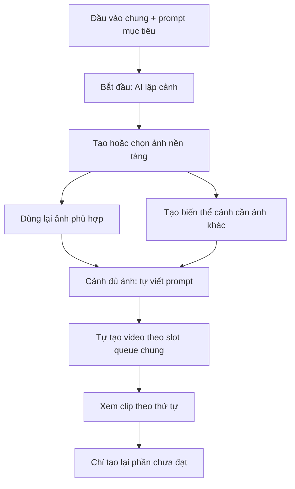

# TiToAI — sản xuất video từ ảnh mẫu và sản phẩm

Ngày 2026-10-27 (UTC+07). **Plan bàn giao, chưa triển khai hoặc nghiệm thu code.**

> **Delta clip/phân cảnh 2026-10-27:** [Plan thời lượng clip và phân cảnh trong prompt](CLIP_DURATION_STORYBOARD_PLAN.md) thay cách nhập số cảnh/thời lượng và lập nội dung bên dưới khi có khác biệt: Scene là một clip, shot nằm trong prompt; số clip do người dùng chọn, thời lượng theo capability provider. Ghép clip nằm ngoài phạm vi. [Prompt bàn giao triển khai](CLIP_DURATION_STORYBOARD_PROMPT.md).

**Đã chốt với người dùng:** audio không bắt buộc; một sản phẩm tạo nhiều cảnh tùy prompt; mặc định chạy tự động từ dữ liệu ban đầu; mẫu và sản phẩm được lưu để dùng lại. Các quyết định dưới thay yêu cầu duyệt thủ công từng bước và audio bắt buộc trong baseline cũ.

## 1. Mục tiêu và phạm vi thay thế

Yêu cầu trực tiếp: kênh quần áo có thể đưa ảnh mẫu và ảnh sản phẩm để AI tạo ảnh mẫu mặc sản phẩm, hoặc đưa ảnh đã mặc sẵn, hoặc chỉ dùng sản phẩm không cần mẫu. Sau khi có ảnh phù hợp, AI viết prompt chuyển động rồi provider video tạo clip.

Màn Project hiện tại trong ảnh người dùng thiên về bảng nhập cảnh, lời dẫn và kiểm đếm file. Thiếu vai trò ảnh mẫu/ảnh sản phẩm, bước tạo và duyệt ảnh kết quả, và phân biệt lời dẫn với prompt chuyển động. Đổi trọng tâm sang **chuẩn bị hình ảnh và tạo video**, giữ scene làm đơn vị một clip; một project có thể có một hoặc nhiều scene. MVP không tự ghép các clip thành video dài.

Tài liệu này là nguồn chuẩn cho delta ảnh đầu vào và UX Project/Scene; ưu tiên hơn bố cục bảng cũ của [UI/Browser](UI_BROWSER_PLAN.md), T12a/T23 trong phạm vi này. [AI web content](AI_WEB_CONTENT_CREATION_PLAN.md) tiếp tục quản lý ý tưởng/kịch bản/analytics/bài đăng. Luồng ảnh mới không bắt đi qua tạo ý tưởng hoặc kịch bản trước. Giữ [queue 1.2](QUEUE_EXECUTION_SETTINGS_PLAN.md), [Settings](SETTINGS_PLAN.md), [theme](UI_THEME_PLAN.md), [engineering](../agents/ENGINEERING_RULES.md) và ownership hiện hành.

## 2. Ba cách bắt đầu từ dữ liệu chung dự án

| Chế độ | Đầu vào | Xử lý ảnh | Điều kiện sang prompt video |
|---|---|---|---|
| Mẫu + sản phẩm | Một ảnh mẫu và một ảnh sản phẩm được gán đúng vai trò | AI tạo ảnh mẫu mặc/dùng sản phẩm theo cảnh | Có ảnh kết quả hợp lệ được pipeline chọn |
| Ảnh đã sẵn sàng | Ảnh mẫu đã mặc/cầm/dùng đúng sản phẩm | Bỏ qua tạo ảnh nếu prompt không yêu cầu biến đổi | Có ảnh đầu vào hợp lệ |
| Chỉ sản phẩm | Ảnh sản phẩm, không bắt ảnh mẫu | Dùng trực tiếp hoặc AI đổi nền/bố cục theo prompt | Có ảnh hợp lệ cho cảnh |

Chế độ có mặc định từ brief project và có thể khác theo scene. Thư viện có nhóm **Mẫu** và **Sản phẩm**, tên/thumbnail để chọn lại trong cùng Workspace; một mục có thể được nhiều project/scene tham chiếu. MVP một ảnh chính mỗi vai trò cho mỗi cảnh, có tham chiếu góc/chi tiết bổ sung tùy chọn theo §3.2 và capability; **một sản phẩm được dùng cho nhiều cảnh**, góc nhìn/hành động/bối cảnh do prompt quyết định. Giữ nhất quán mẫu và sản phẩm giữa các cảnh. Không bắt cả kênh dùng một chế độ. Đổi chế độ giữ tài nguyên cũ trong lịch sử.

“Tạo ảnh mẫu mặc sản phẩm” là tác vụ AI chỉnh/tổng hợp ảnh theo tham chiếu, không phải ghép hai ảnh cạnh nhau. AI cần giữ đặc điểm mẫu, màu/kiểu dáng/chi tiết sản phẩm theo yêu cầu; đây là tiêu chí đánh giá chất lượng kết quả, không cam kết AI luôn giữ chính xác logo, chữ hoặc cấu trúc trang phục.

## 3. Luồng thao tác đích

1. Mở project → chọn cách bắt đầu → upload/chọn mẫu và sản phẩm hoặc ảnh sẵn có từ thư viện **một lần ở cấp dự án**. Các cảnh kế thừa đầu vào chung; chỉ lưu override khi cần khác biệt.
2. Nhập prompt/brief mục tiêu bằng ngôn ngữ tự nhiên: nội dung muốn thể hiện, điều cần giữ. Chọn số clip và thời lượng mỗi clip theo [delta clip/phân cảnh](CLIP_DURATION_STORYBOARD_PLAN.md#2-ux-đích); AI tự lập các nhịp nội dung trong từng clip. Không bắt tạo scene hoặc nhập prompt kỹ thuật từng clip.
3. Chọn **Không gửi audio** (mặc định) hoặc file MP3/WAV có sẵn. Audio tùy chọn theo scene, không tự sao chép một track vào mọi cảnh; muốn dùng lại thì gán rõ trong dữ liệu ban đầu.
4. Bấm **Bắt đầu tạo video** một lần: cho phép run tự lập danh sách cảnh từ prompt, tạo ảnh cần thiết, viết prompt chuyển động từ ảnh kết quả và tạo video cho từng cảnh. Không có popup duyệt ảnh/prompt thường lệ ở giữa.
5. Pipeline kiểm schema/scope/file/capability trước khi tự áp kết quả vào scene không bị sửa; chuyển bước khi dữ liệu hợp lệ. Không gọi kiểm tra kỹ thuật là bảo đảm đúng màu/logo/nhận diện bằng mắt.
6. Người dùng theo dõi tiến độ thật, có thể tạm dừng để chỉnh, hủy hoặc xem ảnh/prompt/output. Hoàn tất thì xem/phát/tải clip và chủ động yêu cầu tạo lại phần chưa đạt; giữ các phiên bản cũ. Chi tiết điều phối và tái sử dụng theo §3.1–3.4.

### 3.1. Chuẩn bị một lần và lập cảnh có mục đích

Form chính chỉ yêu cầu đầu vào theo chế độ và prompt mục tiêu. Phong cách, tỷ lệ khung hình và hướng dẫn giữ nhất quán lấy mặc định từ Workspace, có thể đổi cho dự án. Hiện giá trị hiệu lực và lưu cùng run; không thêm thiết lập tài khoản/provider theo kênh. Nếu cấu hình này chưa tồn tại, coordinator chốt mở rộng contract ở PV0, không giả định đã có.

AI lập danh sách cảnh trước khi tạo tài nguyên: mỗi cảnh có mục đích, hành động, thời lượng mục tiêu, yêu cầu góc nhìn và tham chiếu đầu vào. Ví dụ: tổng thể trang phục → cận chất vải → dáng áo khi chuyển động. Validator kiểm schema, giới hạn run và scene keys; việc các cảnh có hấp dẫn hoặc trung thực với sản phẩm vẫn cần đánh giá kết quả thực tế. Không bắt nhập lại mẫu/sản phẩm cho từng cảnh.

### 3.2. Ảnh nền tảng và tái sử dụng

Với Mẫu + sản phẩm, mặc định tạo một ảnh nền tảng mẫu mặc sản phẩm làm tham chiếu chung. Ảnh đã hoàn thiện hoặc ảnh sản phẩm trực tiếp có thể làm nền tảng mà không phát sinh job ảnh. Sau đó từng cảnh dùng một trong ba đường: dùng lại ảnh phù hợp, tạo biến thể góc nhìn/bố cục, hoặc dùng ảnh người dùng đã cung cấp cho cảnh.

Kế hoạch cảnh ghi rõ đường được chọn và ảnh nguồn; không tạo lại cùng ảnh cho mọi cảnh. Biến thể cần giữ cả tham chiếu mẫu/sản phẩm gốc và ảnh nền tảng nếu capability cho phép. Nếu provider không nhận đủ tham chiếu cần thiết, báo không tương thích, không âm thầm bỏ ảnh nguồn. Thiếu ảnh mặt sau hoặc chi tiết chất liệu thì không khẳng định AI dựng đúng chi tiết không quan sát được; có thể cung cấp tham chiếu bổ sung tùy chọn. Chốt danh sách ảnh tham chiếu có vai trò theo capability tại PV0, không mở rộng sang nhiều sản phẩm trong cùng run.

Chỉ tái sử dụng kết quả khi còn file hợp lệ, đúng scope và cùng yêu cầu hiệu lực: hash ảnh, vai trò, brief ảnh, template/version, provider/config và tùy chọn liên quan. Lưu provenance của lần dùng lại; thao tác **Tạo lại** có chủ đích bỏ qua kết quả cũ cho đúng bước được chọn. Không cần xây dịch vụ cache riêng hoặc tự dùng kết quả kênh khác.

### 3.3. Cảnh đủ điều kiện chạy ngay

Sau khi chốt danh sách cảnh và tham chiếu chung, cảnh nào có ảnh hợp lệ thì tự tạo prompt rồi video, không chờ toàn bộ ảnh của dự án. Cảnh phụ thuộc ảnh nền tảng phải chờ ảnh đó; các nhánh độc lập được tiếp tục trong giới hạn provider/account/tab và ngân sách toàn app. Đây là dependency của run, không thêm scheduler hoặc queue riêng theo dự án; queue chung vẫn FIFO giữa các job đủ điều kiện.

Chỉ enqueue bước con sau khi output tiền nhiệm được lưu và apply hợp lệ. Commit bước hoàn tất và đánh thức bước kế tiếp phải phục hồi được sau restart, chống enqueue trùng bằng run/scene/step/input revision và idempotency. Một cảnh lỗi không hủy cảnh độc lập; lỗi ở ảnh nền tảng chặn những cảnh phụ thuộc và hiển thị lý do. Job đã submit hoặc uncertain vẫn theo recovery/reconcile hiện hành.

### 3.4. Chỉ làm lại phần bị ảnh hưởng

| Thay đổi | Phạm vi cần làm lại |
|---|---|
| Yêu cầu chuyển động một cảnh | Prompt chuyển động và video cảnh đó; giữ ảnh |
| Sửa trực tiếp prompt chuyển động đã lưu | Chỉ video cảnh đó |
| Thay ảnh một cảnh | Prompt và video cảnh đó; không sinh lại ảnh vừa chọn |
| Thay mẫu/sản phẩm hoặc ảnh nền tảng chung | Ảnh dẫn xuất, prompt và video của những cảnh phụ thuộc; giữ cảnh có override độc lập |
| Thay thời lượng cảnh | Prompt/video cảnh đó; ảnh chỉ đổi khi yêu cầu hình ảnh cũng đổi |
| Thêm/thay/gỡ audio một cảnh | Chỉ video cảnh đó nếu provider hỗ trợ lựa chọn mới |
| Đổi thứ tự cảnh | Chỉ metadata thứ tự, không gọi AI lại |
| Clip chưa đạt, input giữ nguyên | Tạo lại clip được chọn, giữ ảnh/prompt và phiên bản cũ |

Lưu quan hệ phụ thuộc theo revision/hash để xác định phạm vi, không đánh dấu lại cả dự án một cách mặc định. Thay đổi khi run đang chạy không sửa snapshot cũ: tạm dừng dispatch nhánh liên quan, xử lý job active/uncertain an toàn, tạo revision mới và hiển thị phạm vi trước khi người dùng chủ động tiếp tục/tạo lại. Không tự gửi yêu cầu mới chỉ vì người dùng đang gõ. Tạo lại chủ động khác retry kỹ thuật; cả hai đều có giới hạn và lịch sử riêng.

Run bị chặn do thiếu input, capability, lỗi, login hoặc xung đột mới yêu cầu can thiệp. Manual import vẫn có validator/provenance. Một lần bắt đầu cho phép các bước và các scene trong run đó, không cho phép tạo lại vô hạn: chốt số cảnh tối đa, tổng thời lượng mục tiêu và retry budget từ cấu hình hiển thị trước khi chạy. AI trả vượt giới hạn thì dừng báo lý do, không âm thầm cắt hoặc mở rộng. Không tự đăng TikTok/ghép clip. Không gửi audio không có nghĩa provider bảo đảm video im lặng; capability phải mô tả rõ âm thanh do provider tự sinh nếu có, không thêm xử lý audio cục bộ.

## 4. Bố cục màn hình

Giữ shell và header project, nút Quay lại/Sửa dự án. Project mới mở form dữ liệu ban đầu với CTA chính Bắt đầu tạo video; khi chạy chuyển sang theo dõi run và scene:

- **Thanh cảnh bên trái**: thumbnail, tên, thứ tự, bước đang cần làm và trạng thái job. Thêm/đổi thứ tự/đổi tên; Xóa nằm trong menu có xác nhận. Project một cảnh mở ngay editor, không bắt chọn một hàng bảng trước.
- **Vùng làm việc bên phải**: bốn bước có nhãn **Đầu vào → Ảnh dùng cho video → Prompt chuyển động → Video**. Cho quay lại bước trước; bước thiếu điều kiện hiện lý do và CTA đưa tới đúng input. Nội dung chưa lưu có dirty guard.
- **Đầu vào**: bộ chọn ba chế độ; ô Ảnh mẫu/Ảnh sản phẩm/Ảnh có sẵn xuất hiện đúng chế độ. Upload và Thư viện có chữ/tooltip, preview lớn, thay/gỡ chỉ bỏ liên kết.
- **Ảnh dùng cho video**: ảnh chính nổi bật, đầu vào bên cạnh để đối chiếu, candidate/history gọn và thao tác xem/thay/tạo lại tùy chọn. Asset ID chỉ ở chi tiết kỹ thuật.
- **Prompt chuyển động**: brief tự nhiên, prompt tự sinh và bản đang dùng phân biệt; chỉnh/tạo lại là tùy chọn; chỉnh nâng cao thu gọn. Hiện ảnh mà prompt đang dựa vào.
- **Video**: player, kiểm tra input, audio tùy chọn có nghe thử, CTA tạo lại phần được chọn, job/queue và lịch sử kết quả. Provider lấy từ Cài đặt, không thêm lựa chọn tài khoản theo kênh.

Thay tab mặc định “Danh sách Cảnh” bằng **Sản xuất video**. “Tổng quan” giữ số cảnh/clip sẵn sàng và tổng thời lượng mục tiêu; không coi tổng này là độ dài video đã dựng. “Tài nguyên” hiển thị media có thumbnail/loại/vai trò/cảnh/nguồn; ID ở chi tiết. Bảng cảnh nếu giữ chỉ là chế độ xem phụ, không lặp editor.

Màn hình có ba trạng thái chính: **Chuẩn bị** (form chung, giá trị mặc định hiệu lực, giới hạn và một CTA Bắt đầu), **Đang chạy** (tiến độ thật của từng cảnh, lý do chờ, tạm dừng/hủy), **Kết quả** (clip theo thứ tự với Xem/Sửa yêu cầu/Tạo lại cảnh này/Tải kết quả). Ảnh trung gian, prompt, job và lịch sử mở trong chi tiết khi cần. Không bắt người dùng đi qua editor bốn bước; editor là nơi xem/chỉnh tùy chọn. Hiển thị rõ “Các clip theo cảnh”, không dùng nhãn ngụ ý đã ghép thành một video hoàn chỉnh.

Ở viewport hẹp, danh sách cảnh thành bộ chọn và editor xếp dọc; tránh ép bốn cột bước thành bảng rộng. Dùng tokens Light/Dark hiện có, keyboard/focus rõ, trạng thái kèm chữ; progress chỉ theo dữ liệu thực.

## 5. Dữ liệu và tính hợp lệ

Đây là logical contract đề xuất, chưa khẳng định field/command đã có. Trước triển khai, coordinator kiểm source bằng CodeGraph nếu có index, đối chiếu contract và chốt DTO/schema/migration.

- Run lưu brief, giới hạn số cảnh/thời lượng/retry và danh sách cảnh được apply idempotent; tự áp bước lập cảnh hợp lệ trong mode ảnh. Với project có cảnh, chỉ chạy trên tập cảnh được chọn, không tự thay/xóa cảnh cũ. Thư viện lưu nhóm Mẫu/Sản phẩm cùng metadata, nhiều tham chiếu dùng chung file; sửa metadata không thay snapshot cũ. Scene lưu chế độ đầu vào, liên kết asset theo vai trò `modelReference`, `productReference`, `readyImage`, và ảnh được chọn để tạo video. Tận dụng media/scene inputs hiện có khi phù hợp, không tạo hệ thư viện thứ hai.
- Tách yêu cầu tạo ảnh, lời dẫn/kịch bản nếu có, và prompt chuyển động. Prompt có provenance: ảnh/hash/revision, brief, template version và provider đã dùng.
- Kết quả AI lưu candidate và provenance trước khi apply. Run tự áp dụng khi validator đạt và revision còn khớp; nếu lỗi hoặc có sửa tay thì dừng nhánh bị ảnh hưởng, giữ kết quả để giải quyết. Lưu nguồn, job/result reference, input snapshot và thời điểm; ảnh import giữ provenance import.
- Đổi ảnh đã duyệt hoặc brief/thời lượng dùng tạo prompt: giữ prompt/video cũ, đánh dấu **Cần xem lại**. Chỉ cho tạo video tiếp sau khi tạo/áp dụng prompt mới hoặc người dùng xác nhận dùng lại prompt với input mới. Đổi prompt/ảnh/audio/thời lượng làm video cũ không còn đại diện cấu hình hiện tại, không xóa output.
- Job chốt input bất biến lúc enqueue: các asset/hash, prompt, duration/options, template/schema, provider/config/root. Retry/resume giữ snapshot và binding; job cũ không đọc input scene mới.
- Apply dùng expected revision và idempotency hiện hành. Output đến sau khi sửa scene/cancel vào lịch sử hoặc Unlinked theo contract, không tự thay ảnh/prompt/video đang chọn.
- Backend kiểm ownership Workspace/project/scene/asset ở mọi thao tác, kể cả hai ảnh đầu vào. Gỡ/thay/xóa scene không xóa file vật lý được dùng lại.
- Scene readiness và job lifecycle là hai khái niệm riêng. Nhãn UI có thể là Thiếu đầu vào/Đang chuẩn bị ảnh/Đang chuẩn bị prompt/Sẵn sàng tạo video/Có video/Cần xem lại; job vẫn dùng queued/reserved/running/awaiting_user/succeeded/failed/canceled. Không migrate enum tùy tiện theo nhãn UI.

## 6. Provider và điểm chưa được tự suy diễn

- Image provider từ Settings phải được xác minh nhận **hai ảnh tham chiếu với vai trò rõ** và trả ảnh; text provider tạo prompt phải được xác minh đọc ảnh. Capability “tạo ảnh” hoặc “text” chung chưa chứng minh được hai khả năng này.
- Nếu không hỗ trợ: hiện lý do; cung cấp copy hướng dẫn, xuất input có nhãn và import ảnh/prompt kết quả. Không giả ghép ảnh local, không tự chuyển sang API/provider khác, không mở browser automation để thao tác thủ công ngoài luồng login được phép.
- Provider video kiểm capability input, thời lượng, tỷ lệ và audio trước enqueue. 30 giây mục tiêu không đồng nghĩa provider tạo được clip 30 giây; không tự chia hoặc ghép clip để đáp ứng.
- **Audio tùy chọn đã chốt.** Snapshot ghi rõ không gửi audio hoặc asset/hash audio được chọn. Không có audio không chặn readiness. Provider bắt buộc audio không tương thích mode này: báo capability trước chạy, không tự tạo audio hoặc đổi provider. Cần triển khai đồng bộ DTO/validator/workflow/adapter và test; code cũ chưa được coi đã hỗ trợ.
- Không cần kiểm chứng API hoặc pin version mới trong đợt viết plan; capability website thật vẫn NOT_RUN. Browser chạy ẩn, login thủ công, account pool global và queue độc lập theo spec hiện hành.

## 7. Gói triển khai đề xuất

Các gói PV dưới chưa dispatch, không đổi STATUS/TASKS hoặc nghiệm thu lại milestone lịch sử. Đọc baseline/dependency/ownership trước sửa. Quy tắc model Antigravity áp dụng khi làm trong Antigravity, không phải lựa chọn provider sản phẩm.

| Gói | Phạm vi và owner | Điều kiện hoàn tất |
|---|---|---|
| PV0 — chốt contract | Coordinator sở hữu docs/decisions, Contracts, bridge allow-list; một persistence owner | Kiểm input/media/job hiện có, chốt roles/revisions/stale/capability/manual import và mapping file cụ thể trước chia việc. Kiểm TASKS/STATUS; không vượt gate T16/T17/T18 đang mở. |
| PV1 — chuẩn bị ảnh thủ công | UI owner: Web/features/projects và thư viện hiện có; backend asset/scene qua owner tương ứng | Ba chế độ, gán đúng vai trò, dùng ảnh có sẵn/import ảnh hoàn thiện, form chung và override, mặc định Workspace, selection bền sau restart, ownership và không xóa file. |
| PV2 — tự tạo ảnh AI | Adapter/workflow owner phối hợp image provider và UI review | Sau contract/capability và dependencies T18–T20/T22 tương ứng: gửi hai ảnh đúng vai trò, ảnh nền tảng dùng chung, biến thể theo cảnh, tái sử dụng theo input fingerprint, tự apply có revision guard, manual fallback. |
| PV3 — prompt từ ảnh | Content/prompt owner dùng luồng AI web hiện hành, UI scene | Ảnh hợp lệ tự chọn vào request thật, tự áp prompt hợp lệ, invalidation và snapshot; không gọi nhầm tác vụ script. |
| PV4 — video và tích hợp | Workflow T22, UI T23, video adapter T21; coordinator file chung | Gate phụ thuộc hoàn tất; enqueue từ input đã lưu, readiness audio tùy chọn, điều phối cảnh ngay khi đủ điều kiện qua queue chung, phục hồi giữa commit/enqueue, chạy lại theo bảng phụ thuộc, pause/resume/recovery/cancel, màn kết quả và regression. |
| PV5 — nghiệm thu/bàn giao | Reviewer/release owner | Kiểm ma trận dưới, cập nhật spec/links bị thay và evidence; thiếu môi trường ghi NOT_RUN. |

Không scaffold lại module đã có. File code cụ thể được chốt tại PV0 sau khảo sát source; đây là plan hành vi, không phải xác nhận hiện trạng implementation. T12/T23 DONE lịch sử không chứng minh delta này đã có.

## 8. Tiêu chí nghiệm thu

1. Mẫu + sản phẩm: hai ảnh gửi đúng vai trò; kết quả hợp lệ tự chuyển sang prompt và video; không thể tạo ảnh khi thiếu một vai trò.
2. Ảnh đã sẵn sàng: đi thẳng tới prompt, không phát sinh job tạo ảnh. Chỉ sản phẩm: không bắt mẫu, có cả dùng trực tiếp và chỉnh ảnh tùy chọn.
3. Tạo cảnh không cần prompt; prompt chuyển động không bị trộn với lời dẫn. Không bắt khai báo camera/ánh sáng.
4. Tạo lại ảnh/prompt/video giữ bản cũ; chọn kết quả bền qua restart; event cũ không ghi đè draft hoặc scene mới.
5. Đổi input đánh dấu stale đúng; job đã enqueue vẫn dùng snapshot cũ. Apply lặp/conflict không tạo trùng hoặc mất bản sửa.
6. Upload/thư viện/thay/gỡ làm đúng scope; backend từ chối asset Workspace khác và báo file thiếu/hỏng rõ ràng.
7. Không audio vẫn tạo video khi provider hỗ trợ; có audio gửi đúng file/hash. Provider bắt buộc audio phải báo không tương thích, không tự thêm file. Duration/capability không đáp ứng phải báo rõ.
8. Provider không nhận đa ảnh/không đọc ảnh có manual handoff dùng cùng validator; không giả kết quả hoặc fallback ngầm.
9. Pool đầy hiển thị Chờ slot; submit rồi crash/cancel/retry xử lý uncertainty theo contract, không submit trùng mù.
10. Project cũ vẫn mở được, giữ legacy prompt provenance và media; không tự suy vai trò ảnh hay tự gửi AI sau migration.
11. Caption/hashtags vẫn một bản cấp project theo plan AI web; dùng luồng ảnh không tự sinh bài đăng hoặc đăng TikTok.
12. Kiểm Light/Dark, viewport hẹp, DPI 100/125/150/200%, keyboard/dirty guard/player. Test logic bằng fake không thay nghiệm thu hai ảnh/đọc ảnh/video trên website thật.
13. Một sản phẩm sinh nhiều cảnh theo prompt, giữ đúng mẫu/sản phẩm; giới hạn run ngăn tạo cảnh hoặc retry vô hạn. Một lần Bắt đầu chạy tới clip, không yêu cầu duyệt trung gian.
14. Mẫu/sản phẩm chọn lại được sau restart và trong project khác cùng Workspace; sửa metadata thư viện không làm đổi snapshot cũ, gỡ một tham chiếu không làm mất file ở các cảnh khác.
15. Pause ngăn dispatch bước mới; job đã submit được theo dõi/reconcile an toàn. Resume tiếp bước chưa hoàn tất, không gửi lại bước đã thành công hoặc uncertain; không tự mở rộng run sau khi user sửa prompt.
16. Đầu vào chung và mặc định Workspace được kế thừa đúng; override cảnh không làm thay đổi cảnh khác. Đổi mặc định sau enqueue không sửa snapshot cũ.
17. Một ảnh nền tảng được dùng chung đúng scope; cảnh cần góc khác tạo biến thể, cảnh đã có ảnh phù hợp không phát sinh job ảnh dư. Đổi hash/template/config liên quan khiến kết quả cũ không được dùng lại nhầm; Tạo lại chủ động thực sự chạy bước được chọn.
18. Với hai cảnh A/B, A đủ ảnh được tạo prompt/video trong khi B còn tạo ảnh, trong giới hạn queue chung. Lỗi B không hủy A; lỗi ảnh chung chặn đúng cảnh phụ thuộc. Crash ở khoảng commit output/enqueue bước sau không làm mất bước hoặc tạo job trùng.
19. Kiểm từng hàng của bảng §3.4: chỉ đúng phần phụ thuộc cần làm lại; đổi thứ tự không enqueue; video đến muộn của revision cũ giữ lịch sử, không thay bản hiện hành.
20. Kết quả hiển thị clip đúng thứ tự và thao tác sửa/tạo lại riêng; không tự ghép, đăng hoặc phát sinh job khi chỉ mở chi tiết ảnh/prompt.

Bàn giao ghi file đổi, revision, test thực chạy, NOT_RUN và blocker. Đợt lập plan này chỉ kiểm tài liệu/liên kết; chưa chạy app hoặc kiểm provider.
