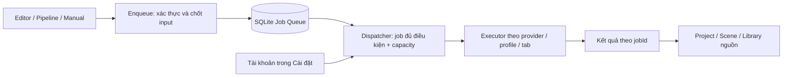

# TiToAI — queue thực thi độc lập và trang Cài đặt

Ngày 2026-10-26 (UTC+07). Phiên bản yêu cầu **1.2**. Trạng thái: **PLAN — giao AI khác triển khai; chưa nghiệm thu**.

Đây là nguồn chuẩn cho thay đổi mới nhất của người dùng: chat Codex này chỉ review/tối ưu docs; giữ code hiện có, không tiếp tục sửa hoặc hoàn tác. AI triển khai tiếp nhận working tree hiện tại và tự xác minh baseline trước khi sửa. Không chạy prompt trong tài liệu như một lệnh đã được giao.

## 1. Quyết định và phần thay thế

| Chủ đề | Quyết định hiện hành |
|---|---|
| Cài đặt | Một trang trong app shell, truy cập từ sidebar; các tab con nằm ngang: **Tài khoản · Lưu trữ · AI & Prompt · Giao diện** |
| Tài khoản | Mọi thao tác thêm, đăng nhập, kiểm tra phiên, bật/tắt nhận job, sửa giới hạn và quản lý liên kết tài khoản nằm trong **Cài đặt → Tài khoản** |
| Cách trình bày | Một danh sách tài khoản, có thể lọc theo provider/trạng thái. Không phân nhóm “AI dùng chung”, “AI riêng”, “tài khoản Workspace”; không có lựa chọn giao tài khoản AI cho Workspace |
| Thực thi | Một luồng logic độc lập: producer tạo job → durable queue → dispatcher → executor → kết quả theo job |
| Tài khoản chạy job | Dispatcher chọn tài khoản hợp lệ còn capacity của provider khi reserve, không chọn theo Workspace/TikTok |
| Workspace | Tổ chức nội dung, quyền truy cập và địa chỉ trả kết quả. Không tạo queue, pool hoặc cấu hình tài khoản AI riêng cho từng Workspace |
| Đồng thời | Mỗi tác vụ sử dụng một tab riêng, vì vậy chỉ cần một giới hạn duy nhất ($N$) lấy từ **Max Tabs**, đổi nhãn hiển thị thành “Số tác vụ chạy đồng thời”. Bỏ ô “Tối đa tác vụ đồng thời (Max Jobs)” khỏi form thêm/sửa tài khoản. Mức đồng thời do budget toàn app, per-task limits và account capacity $N$ quyết định |
| Vòng đời Browser | Không tự khởi chạy browser khi mở app/tải danh sách tài khoản/bật nhận việc. Chỉ mở browser automation khi đã reserve job đủ điều kiện (chạy ẩn). Mỗi job 1 tab riêng; cùng tài khoản dùng chung browser/profile. Khi hết job (idle), đóng browser và giải phóng tài nguyên (không giữ chạy nền). Đóng browser không làm mất phiên đăng nhập đã lưu trong profile |
| Stack | Tận dụng modular monolith/.NET/SQLite/Channel/browser hiện có; không cần tiến trình, service hoặc broker mới |

Thay yêu cầu popup trong SETTINGS_PLAN §1, UI_BROWSER_PLAN §2, ENGINEERING_RULES và các plan UI liên quan. Thay cách trình bày account “global/shared/riêng” và round-robin theo Workspace trong execution-contract-v1.1 §1.2/§3.2 và T15 plan. Các invariant về snapshot, xác minh identity, isolation, lease/fencing, chống resend, storage và backup vẫn giữ.

“Không chia tài khoản với Workspace” áp dụng việc cấp tài nguyên thực thi AI. TikTok nếu có vẫn cần định danh kênh cho nghiệp vụ/analytics; quản lý tại Cài đặt, không dùng liên kết kênh đó để chọn tài khoản AI. Không xóa WorkspaceId/ProjectId/SceneId khỏi job hoặc xóa lịch sử vì đổi điều hướng UI.

## 2. Luồng job và ranh giới dữ liệu

### 2.1. Enqueue

1. Kiểm quyền/scope và input, chốt providerKey, workflow/config/template version, rendered prompt, asset/hash/revision và storageRoot. Persist job trước khi wake Channel.
2. Idempotency ngăn double-click/tái gửi bridge tạo hai job cùng yêu cầu. Không chốt tài khoản/profile theo màn hình Workspace đang mở.
3. Workspace/project/scene trong snapshot là provenance và nơi trả kết quả; không phải khóa chọn account. Chuyển màn hình/Workspace sau enqueue không làm đổi job.
4. Thiếu provider hoặc input bắt buộc: trả lỗi trường tương ứng. Chưa có tài khoản hợp lệ hoặc hết slot: giữ Queued với reason cụ thể; attempts chưa tăng.

### 2.2. Dispatch

1. Một queue SQLite chung. Chọn **job đủ điều kiện cũ nhất theo createdAtUtc rồi jobId**; các job chờ provider/login/quota/backoff/input không chặn job khác đủ điều kiện. Không dùng vòng round-robin Workspace hoặc hàng đợi lâu dài theo account.
2. Workspace pause hiện có vẫn ngăn job nguồn đó được dispatch; không hủy job đã submit. Pause là điều kiện eligibility của job, không tạo tài khoản/queue riêng cho Workspace.
3. Với job chưa bind, chọn account đúng provider: enabled, identity đã xác minh, session/capability phù hợp, không login/quiescing/closing/quarantine và còn slot. Chọn ít job đang giữ tài nguyên nhất, rồi lastAssignedAt/id để thứ tự ổn định.
4. Trong một transaction SQLite ngắn: kiểm lại budget toàn app, capacity $N$ từ `max_tabs` (đồng bộ `max_concurrent_jobs = N`), `perTaskLimits`, chiếm **slot cụ thể đang rảnh**, tạo binding nếu chưa có, chuyển Queued→Reserved và tăng lease token/attempt một lần. Dữ liệu cũ dùng nguyên $N = max\_tabs$, không lấy $\min(max\_concurrent\_jobs, max\_tabs)$. Giảm $N$ không hủy job đang chạy, chỉ dừng nhận thêm đến khi còn capacity. Không gọi browser/network trong transaction.
5. Binding là dấu vết **job → account/profile/slot đã reserve**, phục vụ retry/reconcile; không phải mapping Workspace → account. Job đã bind giữ đúng account khi retry, nhưng mọi giới hạn hiện hành vẫn phải được kiểm lại.
6. Slot runtime có một owner duy nhất bằng ràng buộc/CAS ở DB. Binding lịch sử không phải slot đang chiếm. Không suy slot ID từ số job đang chạy; không chỉ khóa bằng RAM.
7. Heartbeat/progress/submit/result commit kiểm owner, token, state và lease expiry. Worker mất lease không được tự hồi sinh hoặc ghi kết quả muộn.
8. **Vòng đời Browser Automation:** Tuyệt đối không tự khởi chạy browser khi mở app, tải danh sách tài khoản hoặc chỉ vì tài khoản đang bật nhận việc. Chỉ mở browser automation khi đã reserve được job đủ điều kiện (chạy ẩn `Headless = true`). Mỗi job dùng một tab riêng; các job cùng tài khoản dùng chung browser context/profile.
9. Khi một job hoàn tất, đóng tab của job đó. Khi không còn job cần giữ browser (idle: `activeJobCount == 0` và không còn job active/uncertain), đóng browser context và giải phóng tài nguyên ngay lập tức; không giữ browser chạy nền chờ việc (bỏ mọi cơ chế keep-warm hoặc idle delay timeout). Lưu profile/cookie để lần chạy sau dùng lại phiên đăng nhập (đóng browser không đăng xuất). Không đóng browser khi còn job đang chạy hoặc job chưa rõ kết quả cần đối soát (`AwaitingUser` với `SideEffectSubmitted == 1`). Xử lý an toàn trường hợp job mới đến trong lúc browser đang closing (`_profileLaunchCloseLocks` semaphore), không tạo 2 browser cùng sở hữu 1 profile. Cho phép người dùng chủ động mở browser đăng nhập/kiểm tra phiên thủ công; xong thì đóng và giải phóng tài nguyên. UI phân biệt rõ trạng thái tiến trình ("Đã dừng" vs "Đang chạy ẩn") và phiên đăng nhập ("Đã kết nối").

### 2.3. Kết thúc và recovery

- Thành công: xác thực và persist kết quả theo jobId + scope gốc; hoàn tất/checkpoint runtime; đóng context nếu thực sự idle; xác nhận close rồi nhả tài nguyên tương ứng và wake queue ngay. Tab khác còn bận thì giữ context.
- Closing vẫn chiếm browser budget. Close lỗi chặn/quarantine profile đó; không giả Stopped hoặc mở owner thứ hai.
- Job có thể đã submit nhưng chưa rõ kết quả giữ AwaitingUser/reconcile_required và tài nguyên cần bảo vệ. Không coi slot đó rảnh chỉ vì job không còn Running, lease hết hoặc user bấm Cancel.
- Retry/resume không đổi binding của job đã gửi. Chỉ cho resend sau bằng chứng provider chưa nhận; đổi Settings không đổi input snapshot cũ.
- Restart đọc lại SQLite, đối soát slot/lease/context/checkpoint. Channel chỉ đánh thức, không là nguồn sự thật.
- Không có conversation/input/output dùng chung giữa hai job. Account/profile có thể xử lý job từ mọi nguồn nhưng từng job dùng phiên hội thoại/task context riêng.

## 3. Trang Cài đặt

### 3.1. Navigation và nháp

- Sidebar Cài đặt mở vùng nội dung trang, có active state/breadcrumb đúng và nút quay lại công việc. Không có backdrop/focus trap/modal semantics ở trang này.
- Đổi tab có ArrowLeft/ArrowRight/Home/End, roving tabIndex, tablist horizontal và tabpanel liên kết ID duy nhất. Focus nhìn thấy ở Light/Dark; tab cuộn nội bộ nếu hẹp.
- Không mất draft Scene/Prompt khi mở hoặc rời Cài đặt. Không nhất thiết giữ component mounted: owner có thể dùng draft store/guard hiện có; phải kiểm hành vi thực tế.
- Nháp roots/provider/budget thuộc một phiên chỉnh Settings thống nhất, giữ khi đổi tab. Lưu atomically với expectedRevision; conflict/lỗi giữ draft. Hủy khôi phục saved state. Rời trang khi dirty cần chọn ở lại hoặc bỏ thay đổi.
- Theme áp và lưu ngay độc lập; Hủy nháp Settings không hoàn tác theme. Không dựng nguồn lưu theme thứ hai.

### 3.2. Tài khoản

- Một danh sách tài khoản với tên/nhãn, provider, identity/session, enabled, capacity/đang bận và lỗi. Trên danh sách tài khoản, hiển thị “Đồng thời: tối đa N tác vụ” (với $N$ lấy từ Max Tabs), loại bỏ hoàn toàn nhãn cũ “Hạn mức: X tác vụ / Y tab”.
- Thêm và sửa tài khoản AI: Giữ trường Max Tabs làm nguồn cấu hình duy nhất $N$, đổi nhãn hiển thị thành “Số tác vụ chạy đồng thời”. Bỏ ô “Tối đa tác vụ đồng thời (Max Jobs)” khỏi form thêm và sửa tài khoản. Thêm mô tả: “Mỗi tác vụ sử dụng một tab riêng. Các tác vụ vượt giới hạn sẽ chờ trong hàng đợi.”
- Khi tạo/sửa tài khoản, backend đồng bộ `max_concurrent_jobs = N` để tương thích và bảo đảm $N$ giới hạn đồng thời cả số job chạy và số tab automation. Dữ liệu cũ giữ nguyên `MaxTabs` làm $N$, không lấy $\min(MaxJobs, MaxTabs)$.
- Thêm tài khoản AI: chọn provider, nhãn → profile riêng → login thủ công → probe identity → cho bật nhận job. Không hỏi Workspace; nhãn không phải bằng chứng identity.
- Không đăng nhập giả hoặc enable chỉ từ cookie/metadata cũ. Người dùng chủ động mở đăng nhập đồng thời nhiều profile độc lập; quiesce đúng profile, automation chạy ẩn, tuân thủ ngân sách tài nguyên max_open_browsers.
- Bật/tắt nhận job mới/giảm cap không kill tác vụ đã chạy. Account đang có binding/checkpoint/lịch sử dùng archive/disable theo contract, không hard-delete.
- Mọi CTA connect/link/login và quản lý tài khoản ở Workspace cards/overview/scene/sidebar Trình duyệt AI được chuyển vào tab này. Trang công việc có thể dẫn **Đến Cài đặt → Tài khoản** khi thiếu phiên, không chứa form connect riêng.
- TikTok nếu nghiệp vụ cần liên kết kênh: form liên kết nằm trong tab này, tách rõ provider/task capability; không cho chọn SharedAI làm profile TikTok và không link MuseAI với Workspace.
- UI/backend phải đi cùng: commands account/profile thật, allow-list, DTO, handler đăng ký tại host, persistence và error states. Không dựng nút có handler placeholder hoặc gọi lệnh chưa tồn tại.

### 3.3. Các tab còn lại

- Lưu trữ: ba root độc lập, chọn thư mục native; root history và snapshot theo SETTINGS_PLAN §2–3.
- AI & Prompt: provider cho Script/Image/VideoPrompt; VideoRender qua MuseAI; budget toàn app. T12 prompt manager chỉ nối khi các findings review đã có test tương tác chứng minh, không gọi toàn T12 DONE khi media/audio còn thiếu.
- Giao diện: System/Light/Dark, warning read/save/retry và đồng bộ host như UI_THEME_PLAN.

## 4. Thứ tự bàn giao và ownership

Không dispatch agent từ chat tài liệu này. Coordinator của AI triển khai xác nhận owner đang ghi, snapshot working tree/hash và model policy trước nhận việc. Không reset/clean phần người khác.

| Task | Depends | Owner / phạm vi | Điều kiện hoàn tất |
|---|---|---|---|
| Q0 — chốt contract và baseline | G1 và các task nền đã có | Coordinator: docs/decisions, STATUS/TASKS, DTO/allow-list inventory; chưa sửa source trước khi thống nhất owner | Review findings, ghi delta v1.2; command catalog JSON, state/slot schema và migration fixtures được review; ghi file thiếu/đang sửa |
| Q1 — hoàn thiện executor/queue/account backend | Q0 | Một backend/persistence owner: Application/Jobs, account service, Browser runtime, Infrastructure migrations; Desktop wiring qua coordinator | Xử lý H1–H4 trong review; atomic capacity/slots/retry/uncertain/close thật; account CRUD/probe/enable hoạt động; upgrade fixture bảo toàn dữ liệu |
| Q2 — UI Cài đặt và dọn connect Workspace | Q0,Q1 | Một UI owner: App.tsx/style.css, components/Settings*, features/settings/browsers/workspaces; typed client chung qua coordinator | Trang 4 tab, account flow thật; không popup/affinity UI; dirty guard/keyboard/2 theme; giữ mọi sửa hợp lệ đang có |
| Q3 — khép findings Prompt | Q0,T09,T10 | UI prompts owner: features/prompts; App/Scene wiring qua coordinator sau Q2 | H5–H6 được test trên component mount/tương tác thật; response muộn không ghi đè; scene apply đúng provenance |
| Q4 — tích hợp và nghiệm thu | Q1,Q2,Q3 | Coordinator/reviewer: báo cáo và evidence, sửa lỗi giao lại đúng owner | Ma trận §5 đạt; build/test cùng revision; NOT_RUN công khai; cập nhật STATUS/TASKS sau kiểm chứng |

Q1 và Q3 chỉ chạy song song khi coordinator đã tách exact write paths và xác minh model từng phiên; Q2/Q3 không cùng ghi App/Scene. Một người/AI có thể làm tuần tự; không bắt buộc tạo nhiều agent. T16–T18 và pipeline phụ thuộc runtime mới chỉ mở khi phần dependency tương ứng thực sự đạt, không lấy DONE lịch sử làm đủ.

## 5. Ma trận nghiệm thu

| ID | Scenario | Kết quả bắt buộc |
|---|---|---|
| A01 | Mở Cài đặt từ Scene có draft; đổi 4 tab; quay lại | Trang trong shell, không backdrop; giữ draft/context; keyboard/active tab đúng |
| A02 | Account của nhiều provider; chuyển 10 Workspace | Cùng danh sách account, không shared/private hoặc chọn account theo Workspace; connect chỉ trong Settings |
| A03 | 10 job nguồn khác nhau, 1 account, cap/task=1 rồi cap/task=3 | Đồng thời đúng cap; còn lại Queued, attempts không tăng khi chờ; output đúng nguồn |
| A04 | 10 VideoRender, 4 accounts cap=1, budget đủ | 4 chạy, 6 chờ; slot nào xong nhận job kế ngay; không chờ cả đợt |
| A05 | Budget job=1/browser=1, hoặc maxTabs nhỏ hơn maxConcurrentJobs | Reserve tôn trọng giới hạn nhỏ nhất; giảm cap không kill running; retry cũng kiểm cap |
| A06 | Slot-1 xong trước slot-2; hai dispatcher tranh slot rảnh | Không cấp trùng slot-2; một winner/job/slot; attempts tăng đúng một lần |
| A07 | Một job uncertain/Closing/login hoặc account disabled | Không tái dùng tài nguyên bị giữ; job/provider khác còn capacity tiếp tục; không đổi account để resend |
| A08 | Job đầu queue bị chặn provider, job sau sẵn sàng | Job sau chạy; FIFO giữa các job đủ điều kiện; không tạo queue theo Workspace |
| A09 | Crash trước/sau submit/result/close; late result/cancel/dispose | Không resend mù, không mất evidence, không hai owner; kết quả đúng job và fencing |
| A10 | Save roots + provider + budget, lỗi giữa chừng hoặc revision stale | Commit cả bộ hoặc rollback; lỗi giữ draft; tab switch không mất nháp; theme độc lập |
| A11 | Legacy MuseAI Connected, duplicate identity, Script từng gắn Scene, job uncertain | Upgrade giữ history/provenance; FK/check hợp lệ; tài khoản chưa xác minh không enabled; không clone session |
| A12 | Prompt sửa nháp rồi đổi Workspace/purpose/template, tạo mới/hủy tạo, save/preview/rollback | Thao tác DOM thật; ở lại giữ draft; preview cũ/biến đổi không apply; late response không đổi context |
| A13 | Fresh app + create account + login/probe/enable + job hoàn tất | Host commands thật, profile test riêng; không chỉ seed ProviderAccount trực tiếp trong test |

Chạy build solution và test projects riêng (solution hiện không bao gồm hai smoke projects); frontend typecheck/build; SQLite fixtures/concurrency; test UI tương tác thật và WPF/WebView2 trên dữ liệu test tách biệt. Fake provider chỉ chứng minh thuật toán. Account thật, website automation, DPI và máy Windows sạch thiếu evidence phải ghi NOT_RUN, không ký/chạy binary để né policy.

## 6. Điểm bắt đầu cho AI triển khai

Đọc AGENTS → STATUS → TASKS → tài liệu này → [review bàn giao](../reviews/2026-10-26-handoff-recheck.md). Tiếp nhận **Q0** trước. Dùng CodeGraph khi locate/read code, Context7 khi tra API thư viện. Nếu làm trong Antigravity, model Gemini 3.8 Flash / High theo ORCHESTRATION. Giữ một owner mỗi file; prompt tham khảo không tự cấp quyền ghi.

Bàn giao gồm: delta/file thực tế, bảng H1–H6 và A01–A13, lệnh/kết quả cùng revision/hash, migration fixtures, evidence UI và NOT_RUN. Chỉ đóng task sau khi reviewer kiểm acceptance; build xanh không chứng minh UI/account/recovery đã xong.
