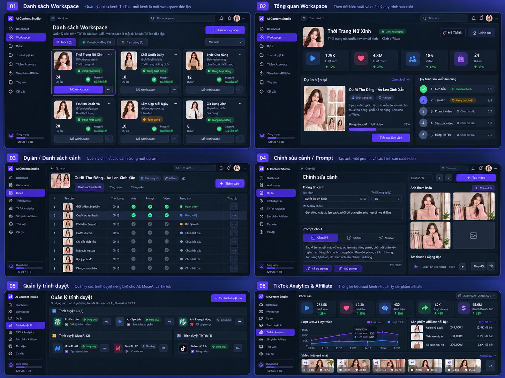

# TiToAI — giao diện tham khảo và browser chạy ẩn

> **Đã chốt 2026-10-27:** [Luồng sản xuất từ ảnh](PRODUCT_IMAGE_VIDEO_WORKFLOW_PLAN.md) tự chạy sau một lần Bắt đầu: lập nhiều cảnh theo prompt → ảnh → prompt chuyển động → video, không bắt duyệt trung gian. Audio tùy chọn; mẫu và sản phẩm dùng lại trong thư viện Workspace. Trong mode này, tự áp output hợp lệ bằng revision guard; yêu cầu audio bắt buộc/duyệt từng bước bên dưới là baseline cũ đã được thay trong phạm vi này. Contract/version/validator/adapter còn phải triển khai đồng bộ; chưa là evidence code hỗ trợ. Lỗi, capability không tương thích, login, xung đột hoặc uncertainty vẫn dừng đúng policy.

> **Delta 2026-10-27 — sản xuất từ ảnh:** [Plan ảnh mẫu/sản phẩm → ảnh đã duyệt → prompt chuyển động → video](PRODUCT_IMAGE_VIDEO_WORKFLOW_PLAN.md) thay bố cục Project/Scene dạng bảng làm luồng chính và bổ sung ba chế độ đầu vào. Luồng ảnh đi thẳng, không bắt tạo kịch bản trước; audio tùy chọn và tự động chạy theo quyết định mới. Đây là spec bàn giao, chưa nghiệm thu code.

**Phiên bản:** 1.2 — ngày 2026-10-26 (UTC+07).  
**Ưu tiên:** UI sản xuất và browser chạy ẩn là P0; analytics/affiliate giữ P1.  
**Trạng thái:** spec hiện hành; quyền triển khai có điều kiện và checkpoint theo [STATUS](../agents/STATUS.md). Xem [plan triển khai từng tính năng](implementation/README.md).

Đọc cùng [plan nguồn](SOURCE_PLAN.md) và [plan sáng/tối](UI_THEME_PLAN.md). Tài liệu này bổ sung/thay thế các quyết định về bố cục UI, khả năng hiển thị browser, manual handoff và nghiệm thu liên quan tại SOURCE_PLAN §1, §3, §7–9, §11–12 và DoD. Các quyết định nghiệp vụ và stack khác giữ theo plan hiện hành.

> **Delta hiện hành:** [queue/Settings 1.2](QUEUE_EXECUTION_SETTINGS_PLAN.md) thay popup, trang account riêng và cách phân nhóm account theo Workspace. Evidence baseline không nghiệm thu thay đổi mới.

## 1. Nguồn tham khảo và thứ tự ưu tiên

- Ảnh gốc được lưu tại `references/ui-reference.png` để các phiên sau không phụ thuộc file clipboard tạm.
- Yêu cầu: giao diện càng gần ảnh càng tốt về bố cục, màu sắc, phân cấp và cách tổ chức công việc; được điều chỉnh để UX tốt và đáp ứng chức năng thực tế. Đây là ảnh định hướng, không phải yêu cầu khớp từng pixel.
- Nhãn AI Content Studio trong ảnh được thay bằng **TiToAI**. Avatar, tên kênh, số liệu, tỷ lệ tăng trưởng, quota và trạng thái trong ảnh chỉ minh họa; ứng dụng dùng dữ liệu thật hoặc trạng thái trống rõ ràng.
- Yêu cầu trực tiếp mới nhất > plan bổ sung này trong phạm vi UI/browser > plan nguồn. Theme vẫn theo UI_THEME_PLAN: Light/Dark/System, mặc định System. Ảnh tối không thay mặc định thành Dark.
- Không suy ra các chức năng như tự đăng TikTok, tạo giọng đọc hay catalog affiliate chỉ từ nút/nhãn trong ảnh. Mọi chức năng cần nằm trong phạm vi plan và capability đã xác minh.
- Yêu cầu P0 bổ sung: review ý tưởng/kịch bản và kết quả prompt có vùng “Nội dung đăng TikTok” để sửa, lưu, áp dụng, sao chép hoặc xuất caption/hashtag theo [SOURCE §7.4](SOURCE_PLAN.md#74-tạo-ý-tưởngprompt-kèm-nội-dung-đăng-tiktok--p0). Bài đăng thuộc project; đây là nội dung để người dùng tự đăng.

## 2. App shell và điều hướng P0

- Cửa sổ desktop gồm sidebar trái cố định, thanh ngữ cảnh trên và vùng nội dung chính. Giữ nền navy tối, surface phân lớp nhẹ, đường viền mảnh, bo góc vừa, accent tím và thumbnail nổi bật như ảnh.
- Sidebar: **Tổng quan**, **Workspaces**, **Dự án**, **Thư viện**, **Cài đặt**. Cài đặt mở trang bốn tab ngang: Tài khoản, Lưu trữ, AI & Prompt, Giao diện; quản lý browser/login nằm trong tab Tài khoản. **TikTok Analytics** và **Affiliate** xuất hiện khi tính năng P1 khả dụng; không đặt nút dẫn tới trang trống không giải thích.
- Tổng quan toàn app chỉ tổng hợp dữ liệu hiện có: Workspace, job đang chạy/chờ người dùng và dự án gần đây. Tổng quan Workspace chỉ hiển thị một kênh. Phân biệt rõ hai ngữ cảnh.
- Thanh trên có breadcrumb, Workspace hiện tại và tìm kiếm đúng phạm vi trang. Trạng thái job cần người dùng xuất hiện trong trung tâm tác vụ; không tạo biểu tượng thông báo/avatar tài khoản app không có chức năng.
- Sidebar cuối trang hiển thị dung lượng local thực tế nếu đọc được. Không dùng quota cloud giả như `120 GB / 1 TB` trong ảnh; lỗi đọc hiển thị “Chưa xác định”.
- Mỗi trang có một CTA chính rõ ràng. Các nút phụ và menu dấu ba chấm chứa thao tác ít dùng; xóa dữ liệu cần xác nhận đúng đối tượng và tác động.
- Luồng chính: Workspaces → Tổng quan Workspace → Dự án → Danh sách cảnh → Chỉnh sửa cảnh → Hàng đợi/kết quả. Back giữ bộ lọc và vị trí danh sách; chuyển Workspace có xử lý form chưa lưu và loại bỏ response cũ.
- Queue là panel/trang dùng chung có thể mở từ tiến trình; job và sự kiện luôn gắn Workspace/project/scene. Chọn thông báo dẫn tới đúng đối tượng, không tự đổi ngữ cảnh khi event nền đến.

## 3. Đặc tả sáu màn hình từ ảnh

### 3.1. Danh sách Workspace — P0

- Header “Danh sách Workspace”, mô tả ngắn một Workspace tương ứng một kênh TikTok; CTA “Tạo Workspace”.
- Tìm theo tên/kênh, lọc Tất cả/Đang hoạt động/Tạm dừng, sắp xếp cập nhật gần đây hoặc tên. Tạm dừng Workspace là ngừng dispatch job mới của kênh; không tự hủy job đã gửi provider. T02 chốt hành vi này với scheduler.
- Card gồm ảnh đại diện, tên, handle nếu có, chủ đề, trạng thái kênh, số dự án và liên kết TikTok. AI thực thi qua queue độc lập; account không gắn với Workspace. “Đã liên kết TikTok” khác “Phiên còn hiệu lực”.
- CTA “Mở Workspace”, menu chỉnh sửa/tạm dừng/xóa. Lưới khoảng ba cột ở vùng nội dung rộng; co xuống hai/một cột khi hẹp, giữ nút chính đọc được.
- Empty state dẫn tới tạo Workspace; lỗi tải có thử lại; lần đầu chưa liên kết vẫn tạo dự án được và có hướng dẫn cho bước cần account.

### 3.2. Tổng quan Workspace — P0; chỉ số TikTok P1

- Header có ảnh, tên kênh, mô tả và trạng thái; thao tác chỉnh sửa và lối đến Cài đặt khi cần quản lý tài khoản. Không đồng nhất “Mở TikTok” với mở browser tự động: mặc định xem thông tin account trong app, luồng đăng nhập theo §6.
- KPI P0: số dự án, số cảnh, job đang chạy, job cần người dùng. Khi P1 có nguồn thật, bổ sung lượt xem/like/video/affiliate theo nguồn và khoảng thời gian; dữ liệu thiếu hiển thị “Chưa có dữ liệu”.
- Nội dung dưới chia dự án hiện tại/gần đây bên trái và pipeline bên phải; “Tiếp tục làm việc” mở đúng cảnh/bước đang dở.
- Pipeline hiển thị Kịch bản → Ảnh → Prompt video → Audio đầu vào → Video → Thư viện. Audio là tệp người dùng nhập; không tạo TTS/Audio Worker. “Đăng TikTok” trong ảnh không thuộc P0.
- Progress tính bằng số scene/job đã hoàn thành trên tổng đủ điều kiện. Khi provider không cho tỷ lệ, hiển thị bước đang chạy thay vì phần trăm ước lượng bằng timer.

### 3.3. Dự án / Danh sách cảnh — P0

- Header thumbnail, tên dự án, Workspace và CTA “Thêm cảnh”; tab Cảnh / Tổng quan / Tài nguyên.
- Bảng gồm thứ tự, thumbnail/tên cảnh, thời lượng mục tiêu, ảnh, prompt, audio, video, trạng thái và thao tác. Cột audio được bổ sung so với ảnh để thấy điều kiện đầu vào còn thiếu.
- Trạng thái từng đầu ra có icon + nhãn/tooltip: chưa có, đang chờ, đang chạy, cần người dùng, hoàn thành, lỗi. “Có ảnh/prompt” không có nghĩa video đã hoàn thành.
- Chọn dòng mở editor; thao tác hàng loạt có chọn rõ scene và kiểm tra đủ input trước enqueue. Đổi thứ tự có phương án bàn phím, không chỉ kéo thả.
- Bảng dài dùng phân trang hoặc virtualization khi cần; header/cột tên và thao tác chính vẫn dễ tìm. Cuộn ngang nội bộ bảng khi thiếu chỗ, tránh cuộn ngang toàn cửa sổ.

### 3.4. Chỉnh sửa cảnh / Prompt — P0

- Header breadcrumb, tên cảnh, vị trí cảnh hiện tại, trước/sau và CTA “Tạo video”. Nếu thiếu input, CTA có giải thích và dẫn tới ô cần bổ sung.
- Bố cục hai cột như ảnh: trái là thông tin cảnh và prompt editor; phải là ảnh tham chiếu, audio và preview/kết quả. Khi hẹp xếp dọc, giữ thứ tự nhập → kiểm tra → chạy.
- Tên, mô tả, thời lượng mục tiêu; phân biệt mục tiêu với thời lượng media thực tế. Prompt có mục đích rõ: tạo ảnh hoặc chuyển động/video, template/version/biến, preview bản render và chỉnh sửa.
- Provider theo capability thật cho từng loại job; ảnh/kịch bản/video prompt dùng lựa chọn từ trang Cài đặt theo `SETTINGS_PLAN.md`. Editor hiển thị provider hiệu lực và lối mở nhóm AI & Prompt để đổi cho job mới, không giữ một lựa chọn ngầm khác. Không coi MuseAI là provider sinh prompt chỉ vì tab trong ảnh; lựa chọn không hỗ trợ có lý do rõ.
- “Tối ưu prompt”/“Thử prompt” nếu khả dụng sẽ enqueue job chạy ẩn, hiển thị tiến trình/kết quả trong app. Kết quả tối ưu được xem và áp dụng, không tự ghi đè bản người dùng đang sửa.
- Ảnh hỗ trợ thêm/chọn từ library, xem lớn, bỏ chọn/thay ảnh. Phân biệt ảnh tham chiếu, ảnh đã tạo và ảnh được chọn làm input video.
- Audio chỉ import MP3/WAV nguyên bản; có tên tệp, thông tin đọc được, nghe thử, thay/bỏ liên kết. Không sinh giọng đọc, trộn hoặc cắt audio. Không giả định thời lượng audio bằng thời lượng mục tiêu.
- Lưu nháp có trạng thái rõ; cảnh báo khi rời form chưa lưu. Job dùng snapshot đã lưu lúc enqueue; sửa scene sau đó không thay input của job đang chạy.
- Kết quả ảnh/prompt/video, retry/cancel và lỗi hiển thị ngay theo scene. Retry phải tuân thủ reconcile, không gửi trùng yêu cầu đã có thể được provider nhận.

### 3.5. Tài khoản và browser trong Cài đặt — P0

- Một danh sách tài khoản trong **Cài đặt → Tài khoản**; tìm/lọc provider hoặc trạng thái, không nhóm AI dùng chung/riêng hay theo Workspace. Mỗi card có provider, identity/session, enabled, capacity và trạng thái runtime thật.
- Mọi thêm account/login/probe/enable/disable/capacity và liên kết kênh đi qua trang này. Account AI không hỏi Workspace. Job detail có thể dẫn đến đúng account cần login tại Settings.
- Dispatcher lấy tài khoản đúng provider từ queue chung theo [plan 1.2](QUEUE_EXECUTION_SETTINGS_PLAN.md); Workspace chỉ là dữ liệu nguồn/đích. Card không gán account AI cho kênh.
- Một login visible toàn app, quiesce đúng profile; chỉ hiện browser sau CTA login. Không có nút mở browser chung hoặc kill browser còn tác vụ.
- Trạng thái account và job là hai đối tượng khác nhau; Hidden không chứng minh Stopped, Closing chưa phải đã đóng. Uncertain giữ reference/checkpoint; không tự nhả và resend.
- TikTok nếu cần liên kết kênh thì quản lý trong cùng tab; việc định danh kênh không tạo queue hoặc mapping tài khoản AI. DTO/commands/lifecycle phải hoạt động thật, không chỉ seed DB trong smoke tests.

### 3.6. TikTok Analytics & Affiliate — P1

- Bố cục KPI trên, chart bên trái, sản phẩm/metrics affiliate bên phải, video hiệu quả ở dưới; giữ tinh thần màn hình 06.
- Chọn Workspace/account và khoảng thời gian rõ; hiển thị nguồn, lần cập nhật, độ đầy đủ. Import/export hợp lệ và trạng thái chưa liên kết/chưa có dữ liệu được thiết kế trước.
- Chỉ hiện metric có nguồn hỗ trợ; chênh lệch tăng trưởng chỉ tính khi có hai kỳ so sánh hợp lệ. Chart có legend, tooltip và bảng dữ liệu thay thế; không chỉ phân biệt bằng màu.
- Phần sản phẩm affiliate chỉ hiện theo dữ liệu được cấp quyền, không mở rộng thành quản lý catalog/mua hàng. Không dùng doanh thu minh họa trong ảnh làm dữ liệu mặc định.

## 4. Hệ thiết kế và khả năng sử dụng

Đây là palette khởi điểm rút từ ảnh, cần kiểm tra tương phản trên UI thật; không phải màu đo chính xác từ ảnh. Mọi màu được dùng qua token ngữ nghĩa của UI_THEME_PLAN, không hardcode từng component.

| Token / mục đích | Dark tham khảo | Light tương ứng |
|---|---|---|
| Nền app | `#0B1220` | `#F4F6FB` |
| Surface/card | `#111D2E` | `#FFFFFF` |
| Surface nổi/hover | `#18263B` | `#EAF0F8` |
| Viền phân vùng | `#33465F` | `#D5DEEB` |
| Chữ chính | `#F4F7FC` | `#172238` |
| Chữ phụ | `#A9B8CD` | `#52627A` |
| Accent/CTA | `#6D3AF2` | `#6230DC` |
| Focus | `#B7A0FF` | `#6230DC` |

- Sidebar khoảng 208–232 px, thu gọn có tooltip/nhãn truy cập; topbar 56–64 px. Spacing theo bước 4/8 px, padding card 16–20 px, khoảng cách khối 16–24 px, bo góc 8–12 px. Tỷ lệ cần điều chỉnh theo viewport thật, không ép sáu panel nhỏ trong ảnh thành kích thước app.
- Font ưu tiên Segoe UI với fallback sans-serif hỗ trợ tiếng Việt, dùng tài nguyên local. Nội dung/form 14–16 px, tiêu đề trang 22–28 px; metadata tối thiểu 12 px. Không sao chép chữ siêu nhỏ của ảnh ghép.
- Nút chính cao tối thiểu 40 px; vùng bấm icon ít nhất 32 px ở chế độ chuột và 44 px khi cần hỗ trợ chạm. Icon nhất quán, icon-only có tên truy cập và tooltip; status có chữ đi kèm.
- Tương phản chữ thường mục tiêu ít nhất 4.5:1; focus, control và dấu trạng thái quan trọng ít nhất 3:1 với nền liền kề. Border trang trí không dùng thay cho dấu nhận diện control.
- Kiểm tra bàn phím xuyên suốt, focus rõ/không bị che; modal quản lý focus và trả về nút mở. Không dùng hover làm cách duy nhất truy cập chức năng.
- Kiểm tra cửa sổ 1280×800 và 1440×900 ở 100%, cùng DPI 125%/150% và kích thước vùng nội dung hữu dụng thực tế. Vùng hẹp thu sidebar, xếp cột; không mất CTA, không cắt form/dialog. Chốt min-window sau kiểm chứng, không hardcode gây mất nội dung ở DPI cao.
- Gradient/glow tím dùng tiết chế ở CTA/selected state; media giữ màu gốc. Animation ngắn khoảng 120–200 ms cho phản hồi, tôn trọng reduced motion, không làm chậm thao tác.
- Mọi màn P0 có loading, empty, lỗi có thử lại, disabled có lý do, lưu thành công/thất bại, mất mạng và `awaiting_user`. UI vẫn chỉnh sửa được khi worker chờ provider.

## 5. Quy tắc browser chạy ẩn — P0

- Mọi tác vụ tự động lấy/tối ưu prompt, viết kịch bản, tạo/tải ảnh, gửi/nhận video và đọc dữ liệu được phép đều chạy **ẩn**. Không tự mở tab/cửa sổ ra desktop, giành focus hoặc bật browser để báo hoàn thành/lỗi.
- Chỉ hiện browser được TiToAI quản lý khi người dùng cần **đăng nhập/đăng nhập lại thủ công**, gồm MFA hoặc xác minh gắn với phiên đăng nhập đó. Người dùng có thể chủ động chọn “Đăng nhập” để bắt đầu luồng; không cần chờ job lỗi.
- “Ẩn” là hành vi người dùng quan sát được, không đồng nghĩa chỉ thu nhỏ cửa sổ. Phương án kỹ thuật (headless hoặc cơ chế chạy ẩn được hỗ trợ) phải chứng minh không ló cửa sổ/giành focus trên Windows. Không mặc định đổi cờ launch là có thể hiện/ẩn phiên đang chạy.
- Không có tùy chọn production “Luôn hiện browser khi chạy job”. Khi adapter không đáp ứng chạy ẩn, tắt automation cho capability đó và báo giới hạn; không âm thầm chuyển sang visible.
- Session được lưu trong profile TiToAI đúng loại/account theo quyền dịch vụ. Login không đọc profile browser cá nhân; cookie/token không đưa vào UI/log/Git. Không tự điền/lưu mật khẩu trong form của app.
- Hạn chế tự bật nhiều cửa sổ login: thông báo trong app và chỉ mở khi user chủ động chọn “Đăng nhập”. Cho phép người dùng mở đồng thời nhiều profile độc lập; mỗi profile chỉ có 1 owner, không mở trùng khi bấm nhiều lần và tuân thủ ngân sách tài nguyên max_open_browsers.
- Browser AI mở ẩn khi job lấy slot; xong nhận/lưu kết quả thì đóng nếu toàn profile idle, giữ userDataDir/session. Nhả slot/wake queue sau close/release owner; tab khác còn bận thì chỉ nhả tab, không đóng context. Full pool hiển thị Chờ slot. Uncertain/checkpoint chưa an toàn không bị idle-close. Chi tiết [v1.1 §1.3/§3](../decisions/execution-contract-v1.1.md).

## 6. Luồng login, tiếp tục và manual handoff

| Tình huống | Job/scheduler | UI và browser |
|---|---|---|
| Phiên hợp lệ, đủ input | Chạy theo queue/lock/quota | Browser ẩn; progress/output trong app |
| Chưa có/mất phiên đăng nhập | Job `awaiting_user`, reason `login_required`; không retry submit | Thông báo đúng account/Workspace, CTA “Đăng nhập” |
| User chọn Đăng nhập | Tạm ngừng dispatch trên profile đó, nhường ownership an toàn | Hiện browser đúng profile để nhập tay; app ghi trạng thái đang đăng nhập |
| Xác minh session thành công | Kiểm tra lại input, lock và side effect trước resume | Kết thúc cửa sổ login, xác nhận browser đã trở lại ẩn rồi mới tiếp tục automation |
| User đóng login/chưa đăng nhập xong | Giữ `awaiting_user`; có tiếp tục hoặc hủy | Không tự bật lại, không báo login thành công |
| Sai account so với liên kết | Giữ job chờ; không đổi liên kết ngầm | Báo sai tài khoản và hướng dẫn đăng nhập đúng |
| CAPTCHA ngoài login, UI đổi, chặn automation hoặc capability không hỗ trợ | `awaiting_user` với reason thích hợp; không tự retry vượt bảo vệ | Hướng dẫn, copy prompt, export input, import/link kết quả trong app; không tự bật browser |
| Browser/profile lỗi hoặc không chạy ẩn được | Chặn dispatch bị ảnh hưởng, báo lỗi/manual mode | Không fallback sang cửa sổ visible; các profile độc lập vẫn hoạt động |

- Browser visibility/session state tách khỏi job lifecycle hiện có. T02 chốt DTO/event/reason codes và state machine cho profile/login; không thêm trạng thái job tùy tiện hoặc suy luận login từ việc cửa sổ đã đóng.
- Nếu cần đóng/mở lại browser để chuyển chế độ, chỉ làm sau khi profile owner đã dừng/nhường an toàn. Tuyệt đối một owner cho userDataDir, không mở hidden và login browser đồng thời trên cùng profile.
- Mỗi profile AI theo provider có nhiều tab: login chỉ ảnh hưởng các tab của profile đó; đăng nhập Gemini không tạm ngừng profile ChatGPT và ngược lại. Tạm ngừng dispatch ở mọi tab thuộc profile cần login, checkpoint/reconcile job đang chạy trước chuyển chế độ; không đóng ngang tab vừa submit. Không giữ transaction DB trong khi chờ người dùng.
- T02/T13/T19 phải chốt cách phát hiện cần login và bằng chứng xác minh phiên/identity từng provider. Chưa xác minh được thì giữ trạng thái chưa xác minh, không tự resume.
- Sau login, job chưa submit có thể quay lại queue; job đã có thể submit phải reconcile hoặc tiếp tục chờ xác nhận, không tự gửi lại. Mất mạng trong xác minh không đồng nghĩa session hợp lệ/hết hạn.
- Manual fallback của plan nguồn được giữ bằng hướng dẫn và trao đổi file/prompt/kết quả trong app. Người dùng có thể tự thao tác dịch vụ bên ngoài; TiToAI không tự mở browser cho bước không phải login. Nếu một provider bắt buộc app mở browser để thao tác ngoài login, capability đó chưa đáp ứng yêu cầu này và phải ghi giới hạn, chỉ đổi khi người dùng có chỉ dẫn mới.

## 7. Tích hợp vào task và quyết định kỹ thuật

- **T01:** nghiên cứu tài liệu chính thức về chạy ẩn và chuyển sang login trong stack browser đã chọn; ghi giới hạn/phiên bản, chưa tuyên bố provider thật đã đạt.
- **T02:** chốt navigation, token, scope/search, Workspace pause semantics, profile/login state/DTO/event, quyền command, login serialization, ownership handoff, resume/reconcile và capability chạy ẩn.
- **T06/T06a:** shell gần ảnh, token hai theme và ba lựa chọn preference; reference được dùng cho UI task tiếp theo, không chờ đến cuối dự án mới restyle.
- **T11/T12/T17/T23:** hiện thực từng màn P0 tại §3, queue/progress và trạng thái UX tại §4; không lấy hình thức làm thay thế cho hành vi backend.
- **T13/T14/T16:** browser ẩn, login/profile ownership và recovery; test lifecycle bằng fake có kiểm soát và profile test riêng khi phù hợp.
- **T19–T21:** provider matrix có cột chạy ẩn, login thủ công, giữ session sau chuyển chế độ, download và reconcile; mỗi capability ghi VERIFIED / NOT_VERIFIED / UNSUPPORTED và bằng chứng. Chưa xác minh chạy ẩn thì chưa bật automation thật.
- **T24/T30:** demo và nghiệm thu UI/browser theo §8; **T25** giữ analytics P1. Manual mode có thể đáp ứng MVP chức năng nhưng không được báo đã đạt automation chạy ẩn khi chưa thử thật.

## 8. Nghiệm thu bổ sung và DoD

1. So ảnh app ở cùng viewport với từng panel tham khảo: shell/sidebar, màu/accent, card Workspace, dashboard hai vùng, bảng cảnh, editor hai cột, Browser Manager theo nhóm. Cho phép khác biệt đã nêu về audio, dữ liệu thật, login CTA, theme và chức năng P1; ghi rõ khác biệt có chủ đích trong review.
2. Hoàn thành luồng tạo Workspace → dự án/cảnh → chỉnh prompt → chọn ảnh/audio → enqueue → nhận kết quả; không cần nhìn browser khi session còn hiệu lực. Thiếu input có chỉ dẫn cụ thể; job kết thúc cập nhật đúng scene.
3. Test phiên hợp lệ cho prompt/ảnh/video: khởi chạy, xử lý, tải kết quả và lỗi không ló cửa sổ provider, không giành focus. Ghi build/Windows/DPI/provider và quan sát màn hình thật; fake không thay bằng chứng này.
4. Test mất session giữa job: chờ đúng reason, chọn login hiện đúng profile để nhập tay, xác minh account, về ẩn trước resume; không rò dữ liệu giữa Workspace.
5. Test user đóng login, login thất bại, sai account, hai profile cùng cần login: không lặp popup, không false success, không hai owner/profile; hai profile độc lập mở cửa sổ đồng thời trơn tru; ngân sách tài nguyên được thực thi đúng.
6. Test shared AI nhiều tab và job đã submit lúc cần login: không mất checkpoint, không nhân đôi request/asset, không chuyển chế độ khi profile chưa nhường an toàn. Restart/crash trong handoff được phục hồi/reconcile đúng.
   Phạm vi shared ở đây là từng provider riêng: Gemini login không dừng ChatGPT; MuseAI A login không dừng B. Profile legacy không dispatch, vẫn giữ lịch sử theo v1.1 §2.
7. CAPTCHA ngoài login/UI đổi/không hỗ trợ chạy ẩn: chờ/hướng dẫn manual trong app, không tự mở browser hoặc vượt bảo vệ, kết quả import kiểm tra đúng Workspace/scene.
8. Kiểm tra Light/Dark/System cùng bộ UI P0, bàn phím/focus/contrast, viewport và DPI tại §4; loading/empty/error/chưa liên kết và dữ liệu analytics thiếu không hiển thị số giả. Theme DoD theo UI_THEME_PLAN vẫn bắt buộc.
9. Giữ metadata/job và form đang nhập khi chuyển trang/theme; progress thật, cancel/retry đúng backend. Kiểm tra đổi Workspace không nhận response/event của kênh cũ.

Tài liệu cập nhật không đồng nghĩa T00–T30 DONE. Đã có source nền tảng và một số bằng chứng build/smoke trong STATUS; chúng không thay kiểm thử UI tích hợp, browser/provider thật nêu trên. Các scenario chưa có evidence vẫn là **NOT_RUN**. Trước release phải có bằng chứng thật cho các capability được công bố, hoặc ghi rõ chỉ hỗ trợ manual và giới hạn còn lại.
