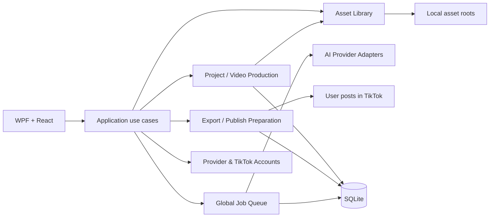

# TiToAI — kiến trúc video-first, không Workspace

Ngày 2026-10-27 (UTC+07). Trạng thái: **ĐỊNH HƯỚNG SẢN PHẨM ĐÃ CHỐT; plan triển khai chưa dispatch**.

Đây là nguồn chuẩn mới cho ranh giới sản phẩm và domain: TiToAI tập trung tạo một video TikTok trong mỗi Project, sau đó chuẩn bị và đăng video lên TikTok. Tài liệu này thay các quyết định có `Workspace` làm tenant/owner nội dung, account affinity, storage scope, queue scope, UI navigation hoặc analytics scope. Giữ lại quy tắc kỹ thuật và workflow tạo video hiện hành khi chúng không xung đột.

## 1. Mục tiêu và nguyên tắc

- Ứng dụng local-first cho một người dùng Windows, ưu tiên một luồng rõ: **Tạo Project → tạo một video → xem/duyệt → đăng TikTok**.
- `Project` là đơn vị công việc và aggregate root của đúng **một video đích**. Có thể tạo nhiều revision/candidate trong lịch sử, nhưng chỉ một output được chọn là bản hiện hành để đăng.
- `Scene` và các clip trung gian, nếu cần, là cấu trúc nội bộ của video. Chúng không phải các video độc lập cấp sản phẩm. Chỉ hiển thị “Sẵn sàng đăng” khi có một file video cuối cùng hợp lệ.
- Không duy trì Workspace, channel workspace, project grouping hoặc ownership theo Workspace trong UI, API/bridge, domain hay schema đích.
- AI provider accounts là pool cấp ứng dụng. Không ràng buộc Project với tài khoản AI hoặc TikTok identity.
- Giữ modular monolith, WPF/WebView2, React/TypeScript, SQLite, durable queue và browser profile isolation hiện hành. Không thêm service, broker, database server hoặc công cụ ghép video cục bộ.

## 2. Ngôn ngữ domain

| Khái niệm | Ý nghĩa và ranh giới |
|---|---|
| Project | Một công việc tạo và đăng một video TikTok; là aggregate root và đơn vị tìm kiếm/lọc/xóa. |
| Video | Tệp đầu ra được chọn cho Project, kèm metadata/provenance và revision. Một Project có tối đa một video hiện hành; lịch sử candidate được giữ. |
| Scene | Phân đoạn/storyboard tùy chọn dùng nội bộ khi provider yêu cầu nhiều cảnh/clip. Không có WorkspaceId và không phải Project độc lập. |
| Publish record | Thông tin URL/ID và thời điểm người dùng nhập sau khi tự đăng; không phải xác nhận API từ TikTok. |
| Provider account | Account/profile của AI executor, quản lý toàn app; chỉ được bind vào job khi reserve theo policy hiện hành. |
| Asset | File local được quản lý bởi TiToAI; có thể được tham chiếu từ nhiều Project mà không chuyển quyền sở hữu file. |
| Job | Một tác vụ bền vững trong queue chung, có snapshot đầu vào và trạng thái recovery độc lập với trạng thái Project/video. |

## 3. Aggregate và mô-đun



### Project / Video Production

- `Project` chứa brief, output preferences, scene plan tùy chọn, video revisions, selected output, caption/hashtags draft và trạng thái workflow.
- Một Project khởi tạo từ brief và media đầu vào. Một lần chạy tạo đúng một logical video; retry kỹ thuật giữ nguyên snapshot, còn regenerate có chủ đích tạo revision mới.
- Giữ `Scene` khi cần cho provider/pipeline; áp giới hạn cảnh và tổng thời lượng. Clip theo cảnh là intermediate outputs. Chúng không đủ điều kiện đăng cho đến khi provider hỗ trợ xuất một video hoàn chỉnh.
- Không thêm local stitching, TTS, audio mixer hoặc FFmpeg trong kiến trúc đích hiện tại. Nếu provider chỉ trả clip rời, project dừng ở `NeedsFinalVideo` với hướng dẫn cụ thể; không giả vờ các clip là một video.

### TikTok Publishing

- TiToAI hiện là tiện ích local-first cho một người dùng. TikTok Content Posting API không phù hợp với app chỉ phục vụ upload tài khoản do cùng cá nhân/đội quản lý; MVP dùng **export + người dùng tự đăng** theo [Content Sharing Guidelines](https://developers.tiktok.com/doc/content-sharing-guidelines/). Direct Post còn yêu cầu app/scope được duyệt, user OAuth consent và lấy creator info mới nhất ([Direct Post](https://developers.tiktok.com/doc/content-posting-api-reference-direct-post/), [Creator Info](https://developers.tiktok.com/doc/content-posting-api-reference-query-creator-info/)). Không gọi API publish hoặc tự động hóa UI TikTok.
- Trang **Chuẩn bị đăng** hiển thị preview video, caption/hashtags có thể sửa/copy, đường dẫn file và thao tác mở thư mục. Người dùng tự chuyển sang TikTok và tải tệp lên. TiToAI ghi `Exported`, không ghi `Published`; URL/ID và thời điểm sau khi đăng là thông tin người dùng nhập tùy chọn.
- Không suy diễn năng lực publish chỉ từ việc có browser profile TikTok. Không gửi nội dung lên dịch vụ bên ngoài nếu người dùng chưa chủ động yêu cầu hành động đó.
- Direct Post API chỉ được xem xét qua ADR riêng nếu sản phẩm đổi thành ứng dụng công khai cho nhiều nhà sáng tạo, sau khi có app/product/scope approval, OAuth consent, creator info và option UI đúng yêu cầu TikTok, status reconciliation và audit.

### Global Queue / Providers

- Giữ một queue durable cấp app. Job thuộc `ProjectId` (có thể null với tác vụ app-level) và tùy chọn `SceneId`; không có `WorkspaceId`, queue hay account pool theo Project.
- SQLite là nguồn sự thật. Giữ job snapshot, leases/fencing, account slot reservation, cancellation, retry/recovery và uncertain-side-effect guards hiện hành.
- Provider accounts và AI settings tiếp tục ở Settings toàn app. Job snapshot/retry/resume và account identity isolation không đổi.

### Asset Library / Storage

- Thư viện local cấp app; asset có thể được tham chiếu trong nhiều Project. Xóa liên kết khỏi Project không xóa file vật lý đang được tham chiếu.
- Đường dẫn mới theo `<root>/<project-id>/<assets|videos|documents>/...`; loại bỏ `<workspace-id>` khỏi cây thư mục. Tệp DB/profile tiếp tục ở `%LOCALAPPDATA%/TiToAI`.
- Giữ các root lưu trữ cấu hình nếu cần; không dùng folder root để biểu diễn Workspace. Backup manifest liệt kê Project, asset và output đang được tham chiếu.

## 4. Trạng thái sản phẩm

Project workflow và queue là hai state machine riêng:

```text
Project: Draft → Generating → NeedsReview → VideoReady → Exported
                           ↘ Blocked / Failed
```

- `Generating` chỉ phản ánh generation run đang hoạt động; job lifecycle vẫn dùng states hiện hành.
- `NeedsReview` yêu cầu video file hoàn chỉnh và previewable, metadata hợp lệ, revision còn khớp.
- `VideoReady` có thể tồn tại trước khi user đăng; caption có thể sửa mà không tạo video lại.
- `Exported` chỉ xác nhận TiToAI đã chuẩn bị file cho người dùng; không chứng minh TikTok đã nhận hoặc đăng.
- Publish record do người dùng nhập được gắn nhãn là dữ liệu do người dùng cung cấp.
- Lưu lịch sử revision và publish records để không mất dữ liệu khi tạo lại hoặc đăng lại.

### MVP tối giản

- Mặc định một brief + một bộ ảnh đầu vào + một video generation request + một video output. Không bắt người dùng tự lập nhiều cảnh để bắt đầu.
- Storyboard/scene generation là năng lực nâng cao, chỉ bật khi cần cho provider và vẫn phải hội tụ thành đúng một video output hoàn chỉnh.
- Analytics, prompt library phức tạp và media editing cục bộ không phải điều kiện để hoàn tất luồng video → publish.

## 5. Màn hình đích

- Sidebar: **Dự án**, **Hàng đợi**, **Thư viện**, **Tài khoản**, **Cài đặt**. Không có Workspace selector, Workspace list, workspace overview hoặc account-link flow trong Project.
- Home/Dự án hiển thị danh sách dự án video, tìm kiếm và lọc theo generation/publish state; CTA chính **Tạo video**.
- Tạo Project gồm brief, loại nội dung/tỷ lệ/thời lượng mục tiêu, media tham chiếu và caption context. Giá trị ít dùng nằm trong phần nâng cao; không bắt đầu bằng tạo Workspace/kênh.
- Project page tập trung vào một video: brief/input → tiến trình thật → preview video cuối → caption/hashtags → chọn TikTok identity → CTA đăng. Scene/editor chỉ là chi tiết nâng cao khi pipeline tạo dùng scene.
- Settings chứa provider accounts, AI/prompt, storage và theme. Tài khoản AI không được gán cho Project. TikTok login/profile không cần cho luồng export; phần quản lý profile phục vụ analytics cũ có thể giữ ở khu vực nâng cao cho tới khi analytics được loại bỏ.
- Queue lọc theo job/provider/status và điều hướng về Project/Scene; không có tab theo Workspace.

## 6. Dữ liệu đích (logical schema)

- `projects(id, title, brief, status, current_video_revision_id, created_at_utc, updated_at_utc, revision)`.
- `video_revisions(id, project_id, revision, state, asset_id, content_hash, duration, width, height, provenance_json, created_at_utc)`; unique `(project_id, revision)`.
- `scenes(id, project_id, sequence, input_revision, state, ...)` chỉ khi storyboard/clip provider cần; unique `(project_id, sequence)`.
- `assets(id, relative_path, content_hash, media_type, metadata_json, created_at_utc)`; references/tables thể hiện Project/Scene/Job usage, không gắn workspace.
- `jobs` giữ contract hiện hành; scope dùng `project_id` + optional `scene_id` và snapshot. Xóa `workspace_id` sau migration và kiểm tra mọi unique/FK/index liên quan.
- `publish_records(id, project_id, video_revision_id, caption_snapshot, external_post_url, external_post_id, user_entered_at_utc, created_at_utc)`.
- Analytics nếu giữ sẽ gắn với TikTok identity + external post/video + capture time/source/completeness; là P1, không mở rộng scope của Project. Không có WorkspaceId.

Schema trên là logical target, không xác nhận field/source hiện có. Coordinator implementation phải inventory DB, DTO, bridge, UI và file tree trước khi chốt migration.

## 7. Migration và tương thích dữ liệu

1. Tạo backup nhất quán DB + mọi storage roots đang được tham chiếu trước migration. Migrate theo schema version trong một bước có thể retry/idempotent.
2. Giữ nguyên mỗi Project hiện hữu, Scene, Asset, Job, prompt snapshot, revision, video output và history. Gỡ `WorkspaceId` khỏi active foreign keys/queries sau khi ánh xạ.
3. Các Project cũ trong cùng Workspace trở thành các Project độc lập cấp app, không gộp nội dung. Workspace name/id cũ chỉ được giữ như migration provenance tùy chọn, không còn là entity hoặc filter/runtime owner.
4. Nếu Workspace có setting/prompt override chung, chuyển sang Project override cho đúng các Project tham chiếu. Xung đột không thể ánh xạ rõ phải giữ snapshot và tạo migration report để người dùng chọn; không tự gộp hoặc ghi đè.
5. Tài khoản/profile TikTok cũ được giữ cho dữ liệu analytics/history hiện có; không chuyển chúng thành OAuth identity hoặc dùng để publish.
6. Job đang hoạt động/uncertain giữ nguyên snapshot, binding, occupancy và recovery state. Không tự chạy lại job cũ trong migration.
7. Media path có `<workspace-id>` được giữ nguyên trong lần migrate đầu để không di chuyển file đang dùng; registry mới đọc path cũ. Di chuyển vật lý là tác vụ riêng có verify hash + rollback, không bắt buộc để loại Workspace khỏi domain.
8. Kiểm nghiệm migration từ DB snapshot thực: project không mất, FK hợp lệ, asset hash/file tồn tại, prompt scope không bị trộn, job/publish state được giữ, backup restore hoạt động.

## 8. Lộ trình triển khai đề xuất

Đây là các gói để coordinator giao sau; chưa phải lệnh chạy và chưa cập nhật thành DONE:

| Gói | Phạm vi | Điều kiện phụ thuộc |
|---|---|---|
| VF0 — inventory + contract | CodeGraph/source inventory; dependency/file ownership; baseline; chốt schema, DTO, bridge, route, migration và publish capability boundary | Gói đầu tiên, một owner coordinator |
| VF1 — Project-first data migration | Xóa Workspace runtime ownership/CRUD; flatten data; migrations/backup/recovery; project-level contracts and queries | VF0 review xong; persistence owner duy nhất |
| VF2 — Project-first UI | Sidebar, home, Project create/list/detail, library/settings links; loại Workspace selector/forms; giữ queue/account flows | VF1 contract/schema chốt |
| VF3 — One-video production | Bảo đảm một selected complete output per Project; scenes optional internal; output validation/revision/invalidation; không ghép local | VF0; reuse current automatic generation plan where compatible |
| VF4 — chuẩn bị đăng | Export video/caption, open-folder/copy-caption, tùy chọn nhập URL/ID sau đăng; không tự đăng hoặc poll API trong MVP | VF1–VF3; Direct Post API cần ADR riêng nếu sản phẩm/đối tượng thay đổi |
| VF5 — retire old docs and qualify | Xóa hoặc đánh dấu superseded các spec Workspace; cập nhật links/status/tasks; migration/runtime verification và test evidence | VF1–VF4 theo phần liên quan |

Một owner cho từng gói; coordinator giữ STATUS/TASKS và file contract chung. Người dùng đã giao trực tiếp implementation cho Codex ngày 2026-10-27. Không triển khai song song trên schema/contract chưa được review. Giữ mọi chỉnh sửa có sẵn; không reset/stash/rollback working tree.

## 9. Tiêu chí chấp nhận kiến trúc

1. Người dùng tạo Project mà không tạo/chọn Workspace; Project chứa đúng một video đích và revision/history.
2. Không còn Workspace trong navigation, bridge/domain/schema active ownership, queue routing, storage mới hoặc analytics target. Từ “workspace” có thể xuất hiện trong migration documentation/lịch sử.
3. Project có thể tái sử dụng asset local; xóa link không xóa file đang dùng nơi khác.
4. Generation state/job state/publish state không nhập làm một; resume/retry giữ snapshot và không duplicate side effect.
5. Project đạt VideoReady chỉ khi có một video file hoàn chỉnh. Scene clips đơn lẻ không được báo là video đăng được.
6. TikTok publish luôn cho user xem video/caption/account/options và xác nhận; Published yêu cầu xác nhận ngoài hệ thống đáng tin cậy.
7. Khi publish capability chưa được xác minh, export có thể dùng được và không hiển thị success giả.
8. Migration giữ toàn bộ Project/Scene/Asset/Job/history, cô lập workspace settings cũ đúng Project, và không tự đăng hoặc tự chạy job.
9. App local-first vẫn chạy không cần server/database service; backup/restore cover DB và tất cả referenced assets.
10. Kiểm thử migration, dữ liệu cũ, uncertain jobs, Project xóa/asset share, queue toàn app và export video/caption; không có network publish side effect trong MVP.

## 10. Tài liệu liên quan

- Workflow generation tự động vẫn theo [AUTOMATIC_VIDEO_WORKFLOW_PLAN.md](AUTOMATIC_VIDEO_WORKFLOW_PLAN.md).
- Quy tắc Windows/local-first và stack vẫn theo [SOURCE_PLAN.md](SOURCE_PLAN.md) trừ những mục Workspace đã được tài liệu này thay.
- Queue/account capacity vẫn theo [QUEUE_EXECUTION_SETTINGS_PLAN.md](QUEUE_EXECUTION_SETTINGS_PLAN.md) nhưng không có Workspace scope.
- Publish capability phải được nghiên cứu/chốt trước triển khai tại VF0/VF4; không coi UI browser automation hiện có là bằng chứng TikTok cho phép đăng.
