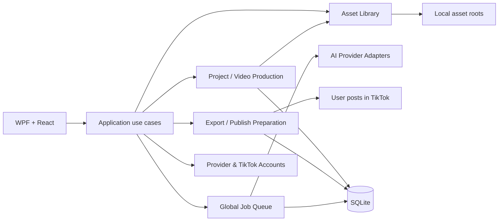

Ngày 2026-10-27 (UTC+07). Trạng thái: **ĐỊNH HƯỚNG ĐÃ CHỐT; triển khai video-first đang tiến hành**. Checkpoint và bằng chứng hiện hành nằm trong [STATUS](../agents/STATUS.md); task/owner/dependency nằm trong [TASKS](../agents/TASKS.md). Không dùng trạng thái cũ trong bảng lộ trình bên dưới thay cho checkpoint đó.


> **Delta đăng video 2026-10-27:** người dùng sau đó cho phép thử luồng upload TikTok bằng Playwright sau thao tác chủ động của người dùng. Chi tiết hiện hành và giới hạn live verification ở [TIKTOK_PUBLISHING_HANDOFF.md](TIKTOK_PUBLISHING_HANDOFF.md); phần export-only phía dưới là baseline ban đầu.

## 1. Mục tiêu và nguyên tắc

- Ứng dụng local-first cho một người dùng Windows, ưu tiên một luồng rõ: **Tạo Project → tạo một video → xem/duyệt → đăng TikTok**.
- `Project` là đơn vị công việc và aggregate root của đúng **một video đích**. Có thể tạo nhiều revision/candidate trong lịch sử, nhưng chỉ một output được chọn là bản hiện hành để đăng.
- `Scene` và các clip trung gian, nếu cần, là cấu trúc nội bộ của video. Chúng không phải các video độc lập cấp sản phẩm. Chỉ hiển thị “Sẵn sàng đăng” khi có một file video cuối cùng hợp lệ.
- AI provider accounts là pool cấp ứng dụng. Không ràng buộc Project với tài khoản AI hoặc TikTok identity.
- Giữ modular monolith, WPF/WebView2, React/TypeScript, SQLite, durable queue và browser profile isolation hiện hành. Không thêm service, broker, database server hoặc công cụ ghép video cục bộ.

## 2. Ngôn ngữ domain

| Khái niệm | Ý nghĩa và ranh giới |
|---|---|
| Project | Một công việc tạo và đăng một video TikTok; là aggregate root và đơn vị tìm kiếm/lọc/xóa. |
| Video | Tệp đầu ra được chọn cho Project, kèm metadata/provenance và revision. Một Project có tối đa một video hiện hành; lịch sử candidate được giữ. |
| Publish record | Kết quả đăng và đối soát, phân biệt xác nhận TikTok với dữ liệu người dùng cung cấp. |
| Provider account | Account/profile của AI executor, quản lý toàn app; chỉ được bind vào job khi reserve theo policy hiện hành. |
| Asset | File local được quản lý bởi TiToAI; có thể được tham chiếu từ nhiều Project mà không chuyển quyền sở hữu file. |
| Job | Một tác vụ bền vững trong queue chung, có snapshot đầu vào và trạng thái recovery độc lập với trạng thái Project/video. |

## 3. Aggregate và mô-đun



### Project / Video Production

- `Project` chứa brief, output preferences, scene plan tùy chọn, video revisions, selected output, caption/hashtags draft và trạng thái workflow.
- Một Project khởi tạo từ brief và media đầu vào. Một lần chạy tạo đúng một logical video; retry kỹ thuật giữ nguyên snapshot, còn regenerate có chủ đích tạo revision mới.
- Giữ `Scene` khi cần cho provider/pipeline; áp giới hạn cảnh và tổng thời lượng. Clip theo cảnh là intermediate outputs. Chúng không đủ điều kiện đăng cho đến khi provider hỗ trợ xuất một video hoàn chỉnh.
- Không thêm local stitching, TTS, audio mixer hoặc FFmpeg trong kiến trúc đích hiện tại. Nếu provider chỉ trả clip rời, project dừng ở `NeedsFinalVideo` với hướng dẫn cụ thể; không giả vờ các clip là một video.

### TikTok Publishing

- Người dùng chủ động chọn video, tài khoản và yêu cầu upload qua browser; generation hoàn tất không tự đăng. Export vẫn là lựa chọn.
- `Published` cần xác nhận từ TikTok hoặc đối soát có nhãn nguồn; trạng thái chưa chắc chắn không tự retry. Live TikTok chưa được nghiệm thu. Xem [publishing](TIKTOK_PUBLISHING_HANDOFF.md).
- Không dùng TikTok Direct Post API trong phạm vi hiện tại; thay đổi phạm vi sản phẩm cần quyết định riêng.
### Global Queue / Providers

- SQLite là nguồn sự thật. Giữ job snapshot, leases/fencing, account slot reservation, cancellation, retry/recovery và uncertain-side-effect guards hiện hành.
- Provider accounts và AI settings tiếp tục ở Settings toàn app. Job snapshot/retry/resume và account identity isolation không đổi.

### Asset Library / Storage

- Thư viện local cấp app; asset có thể được tham chiếu trong nhiều Project. Xóa liên kết khỏi Project không xóa file vật lý đang được tham chiếu.

## 4. Trạng thái sản phẩm

Project workflow và queue là hai state machine riêng:

```text
Project: Draft → Generating → NeedsReview → VideoReady → Exported
                           ↘ Blocked / Failed
```

- `Generating` chỉ phản ánh generation run đang hoạt động; job lifecycle vẫn dùng states hiện hành.
- `NeedsReview` yêu cầu video file hoàn chỉnh và previewable, metadata hợp lệ, revision còn khớp.
- `VideoReady` có thể tồn tại trước khi user đăng; caption có thể sửa mà không tạo video lại.
- `Exported` chỉ xác nhận TiToAI đã chuẩn bị file cho người dùng; không chứng minh TikTok đã nhận hoặc đăng.
- Publish record do người dùng nhập được gắn nhãn là dữ liệu do người dùng cung cấp.
- Lưu lịch sử revision và publish records để không mất dữ liệu khi tạo lại hoặc đăng lại.

### MVP tối giản

- Mặc định một brief + một bộ ảnh đầu vào + một video generation request + một video output. Không bắt người dùng tự lập nhiều cảnh để bắt đầu.
- Storyboard/scene generation là năng lực nâng cao, chỉ bật khi cần cho provider và vẫn phải hội tụ thành đúng một video output hoàn chỉnh.
- Analytics, prompt library phức tạp và media editing cục bộ không phải điều kiện để hoàn tất luồng video → publish.

## 5. Màn hình đích

- Home/Dự án hiển thị danh sách dự án video, tìm kiếm và lọc theo generation/publish state; CTA chính **Tạo video**.
- Project page tập trung vào một video: brief/input → tiến trình thật → preview video cuối → caption/hashtags → chọn TikTok identity → CTA đăng. Scene/editor chỉ là chi tiết nâng cao khi pipeline tạo dùng scene.
- Settings chứa provider accounts, AI/prompt, storage và theme. Tài khoản AI không được gán cho Project. TikTok login/profile không cần cho luồng export; phần quản lý profile phục vụ analytics cũ có thể giữ ở khu vực nâng cao cho tới khi analytics được loại bỏ.

## 6. Dữ liệu đích (logical schema)

- `projects(id, title, brief, status, current_video_revision_id, created_at_utc, updated_at_utc, revision)`.
- `video_revisions(id, project_id, revision, state, asset_id, content_hash, duration, width, height, provenance_json, created_at_utc)`; unique `(project_id, revision)`.
- `scenes(id, project_id, sequence, input_revision, state, ...)` chỉ khi storyboard/clip provider cần; unique `(project_id, sequence)`.
- `publish_records(id, project_id, video_revision_id, caption_snapshot, external_post_url, external_post_id, user_entered_at_utc, created_at_utc)`.

Schema trên là logical target, không xác nhận field/source hiện có. Coordinator implementation phải inventory DB, DTO, bridge, UI và file tree trước khi chốt migration.

## 7. Khởi tạo schema cuối và tương thích file

**Cập nhật thực thi 2026-10-28:** Bootstrap dùng schema `user_version=3`. Database version 2 được nâng cấp giữ dữ liệu để hỗ trợ nhiều mẫu prompt; database mới tạo theo schema cuối, database cũ hơn được backup rồi reset. DB có version cao hơn hiện hành sẽ dừng, không tự đoán hạ cấp.

Quyết định này thay các bước migration dữ liệu ở phần dưới. Các nguyên tắc tương thích file vẫn có hiệu lực: giữ nguyên file/path đã có; upload mới đặt dưới `<projectId>/...`; profile TikTok dùng app scope. Backup schema cũ được giữ trước reset để khôi phục thủ công khi cần.

1. DB chưa version và có bảng được backup bằng SQLite Backup API trước khi reset; schema version không hỗ trợ thì dừng, không tự đoán nâng cấp.
2. Không import lại dữ liệu test từ backup vào schema mới. File trên đĩa được bảo toàn; các path cũ được giữ nguyên metadata nơi ứng dụng còn tham chiếu được.
3. Kiểm thử schema từ cùng EF model, bootstrap DB mới, reset DB legacy và xác nhận file backup tồn tại.

## 8. Lộ trình triển khai đề xuất

Lộ trình dưới là kế hoạch ban đầu; tiến độ đã chạy được ghi tại [STATUS](../agents/STATUS.md) và [TASKS](../agents/TASKS.md). VF1/VF3 đã có implementation cục bộ, còn qualification runtime chưa hoàn tất.

| Gói | Phạm vi | Điều kiện phụ thuộc |
|---|---|---|
| VF0 — inventory + contract | CodeGraph/source inventory; dependency/file ownership; baseline; chốt schema, DTO, bridge, route, migration và publish capability boundary | Gói đầu tiên, một owner coordinator |
| VF3 — One-video production | Bảo đảm một selected complete output per Project; scenes optional internal; output validation/revision/invalidation; không ghép local | VF0; reuse current automatic generation plan where compatible |
| VF4 — đăng video | Export và upload qua browser theo yêu cầu chủ động; xác nhận và đối soát trạng thái | VF1–VF3; Direct Post API cần ADR riêng nếu sản phẩm/đối tượng thay đổi |

Một owner cho từng gói; coordinator giữ STATUS/TASKS và file contract chung. Người dùng đã giao trực tiếp implementation cho Codex ngày 2026-10-27. Không triển khai song song trên schema/contract chưa được review. Giữ mọi chỉnh sửa có sẵn; không reset/stash/rollback working tree.

## 9. Tiêu chí chấp nhận kiến trúc

3. Project có thể tái sử dụng asset local; xóa link không xóa file đang dùng nơi khác.
4. Generation state/job state/publish state không nhập làm một; resume/retry giữ snapshot và không duplicate side effect.
5. Project đạt VideoReady chỉ khi có một video file hoàn chỉnh. Scene clips đơn lẻ không được báo là video đăng được.
6. TikTok publish luôn cho user xem video/caption/account/options và xác nhận; Published yêu cầu xác nhận ngoài hệ thống đáng tin cậy.
7. Khi publish capability chưa được xác minh, export có thể dùng được và không hiển thị success giả.
8. DB legacy chưa version được backup trước reset sang schema cuối; không chuyển dữ liệu thử. Giữ file hiện có và không tự đăng hoặc tự chạy job.
9. App local-first vẫn chạy không cần server/database service; backup/restore cover DB và tất cả referenced assets.
10. Kiểm thử backup/reset trên fixture, uncertain jobs, Project xóa/asset share, queue toàn app, export và publishing do người dùng chủ động yêu cầu.

## 10. Tài liệu liên quan

- Workflow generation tự động vẫn theo [AUTOMATIC_VIDEO_WORKFLOW_PLAN.md](AUTOMATIC_VIDEO_WORKFLOW_PLAN.md).
- Publish capability phải được nghiên cứu/chốt trước triển khai tại VF0/VF4; không coi UI browser automation hiện có là bằng chứng TikTok cho phép đăng.
